# Entity Relationship Diagram (ERD) Specification: LAHAP Platform

> **Document Version:** 1.0.0 (Production / Audit-Compliant)  
> **Notation:** Crow's Foot Relational Database Notation (3NF Normalized)  
> **Target Database Engine:** PostgreSQL 16+ / MySQL 8.0+ / Supabase / Prisma ORM  
> **Companion Documents:** [`docs/design/PRD.md`](PRD.md), [`docs/design/UML.md`](UML.md), [`docs/design/USE_CASES.md`](USE_CASES.md), [`docs/design/SITEMAP.md`](SITEMAP.md)

---

## 1. Architectural Philosophy & Database Foundations

This document constitutes the authoritative Entity Relationship Diagram (ERD) and physical data architecture specification for the **LAHAP** catering subscription and fulfillment platform. It provides autonomous AI agents, backend software engineers, database administrators, and QA auditors with the exact relational schema required for database migrations, ORM modeling, transaction boundaries, and query optimizations.

### 1.1. Core Architectural Pillars

1. **Third Normal Form (3NF) Rigor with Zero Redundancy:**
   - Every non-key attribute is non-transitively dependent exclusively on the primary key.
   - All many-to-many relationships (Customer Allergies, Menu Ingredients, Ingredient Allergens, Scheduled Dishes) are decomposed into dedicated associative/junction entities (`user_allergy`, `menu_ingredient`, `ingredient_allergy`, `schedule_menu`).
   - Derived or transient states (such as live order classification labels `"Akan Datang"`, `"Aktif"`, `"Selesai"`, or calculated Haversine delivery charges) are strictly computed in application domain services and never persisted as denormalized redundant columns (PRD BR-21).

2. **Synthetic UUID Primary Keys (`VARCHAR(36)`):**
   - All tables utilize a 36-character UUID string (UUID v4) as their immutable primary key.
   - This eliminates sequential integer enumeration vulnerabilities, enables offline and client-side ID generation, and prevents database write-lock contention across concurrent microservices and worker jobs.

3. **High-Precision Financial and Spatial Types:**
   - Monetary values (`base_price`, `total_price`, `amount`, `discount_value`, `min_purchase`, `delivery_price_per_km`) are stored as fixed-point `DECIMAL(12,2)` to prevent binary floating-point rounding errors.
   - Geolocation coordinates (`latitude DECIMAL(10,8)`, `longitude DECIMAL(11,8)`) store exact WGS 84 spatial coordinates supporting high-precision Haversine spherical distance calculations down to millimeter fidelity without proprietary GIS extensions (PRD BR-15).

4. **Multi-Tenant Referential Integrity:**
   - Foreign keys enforce strict referential actions:
     - `ON DELETE CASCADE` for parent-child ownership compositions (e.g., `subscription` $\rightarrow$ `order`, `schedule` $\rightarrow$ `schedule_menu`, `menu` $\rightarrow$ `menu_ingredient`, `user` $\rightarrow$ `notification`, `user` $\rightarrow$ `membership`).
     - `ON DELETE RESTRICT` for financial and historical audit records (e.g., `user` $\rightarrow$ `subscription`, `package` $\rightarrow$ `subscription`, `user` $\rightarrow$ `payment`).
     - `ON DELETE SET NULL` for optional references (e.g., `promo_code` $\rightarrow$ `subscription`, `courier` $\rightarrow$ `order`).
     - `ON DELETE RESTRICT` for `tier` $\rightarrow$ `membership`: the app moves members to the previous tier before deleting a tier (PRD UC-38).
     - `ON DELETE RESTRICT` for audit actors (`user` $\rightarrow$ `order_status_history`, `user` $\rightarrow$ `delivery_obstacle`, `user` $\rightarrow$ `ingredient_stock_history`); accounts are deactivated via `is_active`, never deleted.

5. **Audit Timestamps & Media Keys:**
   - Tabel entitas yang dapat berubah menyimpan `created_at` dan `updated_at` (diperbarui otomatis). Tabel penghubung (`user_allergy`, `schedule_menu`, `menu_ingredient`, `ingredient_allergy`, `delivery_method_change_slot`) dan log append-only (`order_status_history`, `delivery_obstacle`, `ingredient_stock_history`, `job_run`) tidak memakai `updated_at`.
   - Kolom foto menyimpan **kunci objek** (`photo_key`), bukan URL: adapter object storage hanya menerbitkan URL bertanda tangan yang kedaluwarsa, sehingga API menandatangani `photoUrl` setiap kali dibaca.

6. **Single-Tenant MVP, Multi-Tenant Ready:**
   - Business profile and global settings (kitchen coordinates, default delivery rates, max distance, payment timeout, WhatsApp number) live in the singleton `business` table (exactly one row).
   - `business_id` columns on other tables (tenant scoping) are deferred past the MVP and planned as an additive migration: add the column, backfill it with the single business id, then make it `NOT NULL`.

---

## 2. Visual Entity Relationship Diagram (Crow's Foot Notation)

```mermaid
erDiagram
    user ||--o{ notification : "receives (r2)"
    user ||--o{ user_allergy : "has (r3)"
    allergy ||--o{ user_allergy : "recorded_in (r4)"
    tier ||--o{ membership : "granted_in (r1)"
    user ||--o| membership : "holds (r26)"
    user ||--o{ subscription : "subscribes (r5)"
    package ||--o{ subscription : "chosen_in (r6)"
    promo_code |o--o{ subscription : "applied_to (r7)"
    tier |o--o{ subscription : "discounted_by (r27)"
    subscription ||--|{ order : "consists_of (r8)"
    schedule ||--o{ order : "fulfills (r9)"
    user |o--o{ order : "delivered_by (r10)"
    subscription ||--o{ payment : "paid_via (r11)"
    user ||--o{ payment : "pays (r12)"
    package ||--o{ schedule : "schedules (r13)"
    schedule ||--|{ schedule_menu : "presents (r14)"
    menu ||--o{ schedule_menu : "scheduled_in (r15)"
    menu ||--|{ menu_ingredient : "requires (r16)"
    ingredient ||--o{ menu_ingredient : "used_in (r17)"
    ingredient ||--o{ ingredient_allergy : "contains (r18)"
    allergy ||--o{ ingredient_allergy : "mapped_in (r19)"
    package |o--o{ announcement : "targets (r20)"
    schedule |o--o{ announcement : "targets (r21)"
    order ||--o{ order_status_history : "tracked_by (r22)"
    user |o--o{ order_status_history : "changed_by (r23)"
    order ||--o{ delivery_obstacle : "reports (r24)"
    user ||--o{ delivery_obstacle : "written_by (r25)"
    user ||--o{ refresh_token : "signs_in_with (r28)"
    subscription ||--o{ delivery_method_change : "switches_method_via (r29)"
    user ||--o{ delivery_method_change : "requests_switch (r30)"
    payment |o--o| delivery_method_change : "pays_upgrade (r31)"
    delivery_method_change ||--|{ delivery_method_change_slot : "switches (r32)"
    order ||--o{ delivery_method_change_slot : "switched_in (r33)"
    ingredient ||--o{ ingredient_stock_history : "tracked_by (r34)"
    user ||--o{ ingredient_stock_history : "changed_by (r35)"
    menu ||--o{ menu_component : "composed_of (r36)"
    user |o--o{ menu_component : "cooked_by (r37)"

    user {
        VARCHAR_36 id PK
        VARCHAR_100 name
        VARCHAR_100 email UK "nullable"
        VARCHAR_20 phone UK
        VARCHAR_255 password
        VARCHAR_20 role
        TEXT address "nullable"
        DECIMAL latitude "nullable"
        DECIMAL longitude "nullable"
        TEXT allergy_note "nullable"
        BOOLEAN is_active
        TIMESTAMP created_at
        TIMESTAMP updated_at
    }

    tier {
        VARCHAR_36 id PK
        VARCHAR_50 name UK
        TEXT description "nullable"
        INT required_subscription_days UK
        INT duration_days
        DECIMAL discount_percent
        TEXT photo_key "nullable"
        TIMESTAMP created_at
        TIMESTAMP updated_at
    }

    allergy {
        VARCHAR_36 id PK
        VARCHAR_50 name UK
        TIMESTAMP created_at
        TIMESTAMP updated_at
    }

    user_allergy {
        VARCHAR_36 id PK
        VARCHAR_36 user_id FK
        VARCHAR_36 allergy_id FK
        TIMESTAMP created_at
    }

    notification {
        VARCHAR_36 id PK
        VARCHAR_36 user_id FK
        VARCHAR_150 title
        TEXT body
        BOOLEAN is_read
        TIMESTAMP created_at
        TIMESTAMP updated_at
    }

    promo_code {
        VARCHAR_36 id PK
        VARCHAR_50 code UK
        VARCHAR_10 discount_type
        DECIMAL discount_value
        DECIMAL min_purchase
        BOOLEAN allow_stack_with_tier
        TIMESTAMP valid_until
        INT quota
        BOOLEAN is_active
        TIMESTAMP created_at
        TIMESTAMP updated_at
    }

    package {
        VARCHAR_36 id PK
        VARCHAR_100 name
        TEXT description
        DECIMAL base_price
        TEXT_ARRAY periods
        DECIMAL delivery_free_radius "nullable"
        DECIMAL delivery_max_distance "nullable"
        DECIMAL delivery_price_per_km "nullable"
        TIME_ARRAY delivery_times
        TEXT photo_key
        TIMESTAMP start_at
        TIMESTAMP end_at "nullable"
        BOOLEAN is_active
        TIMESTAMP created_at
        TIMESTAMP updated_at
    }

    subscription {
        VARCHAR_36 id PK
        VARCHAR_36 user_id FK
        VARCHAR_36 package_id FK
        VARCHAR_36 promo_code_id FK "nullable"
        VARCHAR_30 status
        VARCHAR_10 purchase_type
        VARCHAR_10 period
        DATE start_date
        DATE end_date
        BOOLEAN is_delivery
        VARCHAR_100 recipient_name
        TEXT delivery_address "nullable"
        DECIMAL delivery_latitude "nullable"
        DECIMAL delivery_longitude "nullable"
        INT delivery_distance_km "nullable"
        TEXT notes "nullable"
        DECIMAL price_per_portion
        DECIMAL food_subtotal
        VARCHAR_36 tier_id FK "nullable"
        DECIMAL tier_discount
        DECIMAL promo_discount
        DECIMAL delivery_fee_per_slot
        DECIMAL delivery_fee_total
        DECIMAL total_price
        BOOLEAN needs_refund
        TIMESTAMP created_at
        TIMESTAMP updated_at
    }

    payment {
        VARCHAR_36 id PK
        VARCHAR_36 subscription_id FK
        VARCHAR_36 user_id FK
        VARCHAR_50 method
        VARCHAR_30 type
        DECIMAL amount
        VARCHAR_30 status
        VARCHAR_100 transaction_id UK "nullable"
        TIMESTAMP paid_at "nullable"
        TIMESTAMP created_at
        TIMESTAMP updated_at
    }

    order {
        VARCHAR_36 id PK
        VARCHAR_36 subscription_id FK
        VARCHAR_36 menu_schedule_id FK
        DATE service_date
        VARCHAR_36 courier_id FK "nullable"
        VARCHAR_30 status
        BOOLEAN uses_alternative_menu
        TEXT skip_reason "nullable"
        BOOLEAN is_delivery
        DECIMAL delivery_fee
        TIMESTAMP created_at
        TIMESTAMP updated_at
    }

    schedule {
        VARCHAR_36 id PK
        VARCHAR_36 package_id FK
        DATE date
        TIME delivery_time
        BOOLEAN is_published
        TIMESTAMP created_at
        TIMESTAMP updated_at
    }

    schedule_menu {
        VARCHAR_36 id PK
        VARCHAR_36 schedule_id FK
        VARCHAR_36 menu_id FK
        BOOLEAN is_primary
    }

    menu {
        VARCHAR_36 id PK
        VARCHAR_100 name
        TEXT description
        BOOLEAN is_alternative
        TEXT_ARRAY tags
        TEXT photo_key
        TIMESTAMP created_at
        TIMESTAMP updated_at
    }

    menu_ingredient {
        VARCHAR_36 id PK
        VARCHAR_36 menu_id FK
        VARCHAR_36 ingredient_id FK
        DECIMAL quantity_per_portion
    }

    ingredient {
        VARCHAR_36 id PK
        VARCHAR_100 name UK
        VARCHAR_20 unit
        DECIMAL stock
        DECIMAL minimum_threshold
        TEXT photo_key
        TIMESTAMP created_at
        TIMESTAMP updated_at
    }

    ingredient_allergy {
        VARCHAR_36 id PK
        VARCHAR_36 ingredient_id FK
        VARCHAR_36 allergy_id FK
    }

    announcement {
        VARCHAR_36 id PK
        VARCHAR_36 package_id FK "nullable"
        VARCHAR_36 menu_schedule_id FK "nullable"
        VARCHAR_150 title
        TEXT body
        VARCHAR_20 scope
        TIMESTAMP created_at
        TIMESTAMP updated_at
    }

    business {
        VARCHAR_36 id PK
        VARCHAR_100 name
        VARCHAR_20 whatsapp_number
        TEXT address
        DECIMAL latitude
        DECIMAL longitude
        DECIMAL delivery_free_radius
        DECIMAL delivery_max_distance
        DECIMAL delivery_price_per_km
        INT payment_timeout_minutes
        TIMESTAMP created_at
        TIMESTAMP updated_at
    }

    order_status_history {
        VARCHAR_36 id PK
        VARCHAR_36 order_id FK
        VARCHAR_36 changed_by_id FK "nullable"
        VARCHAR_30 from_status "nullable"
        VARCHAR_30 to_status
        TEXT admin_note "nullable"
        TIMESTAMP changed_at
    }

    delivery_obstacle {
        VARCHAR_36 id PK
        VARCHAR_36 order_id FK
        VARCHAR_36 author_id FK
        TEXT note
        TEXT photo_key "nullable"
        TIMESTAMP created_at
    }

    membership {
        VARCHAR_36 id PK
        VARCHAR_36 user_id FK, UK
        VARCHAR_36 tier_id FK
        TIMESTAMP started_at
        TIMESTAMP expires_at
        TIMESTAMP created_at
        TIMESTAMP updated_at
    }

    message_template {
        VARCHAR_36 id PK
        VARCHAR_100 name
        TEXT body
        TIMESTAMP created_at
        TIMESTAMP updated_at
    }

    refresh_token {
        VARCHAR_36 id PK
        VARCHAR_36 user_id FK
        TIMESTAMP expires_at
        TIMESTAMP revoked_at "nullable"
        TIMESTAMP created_at
        TIMESTAMP updated_at
    }

    delivery_method_change {
        VARCHAR_36 id PK
        VARCHAR_36 subscription_id FK
        VARCHAR_36 requested_by_id FK
        BOOLEAN to_delivery
        DATE effective_from
        VARCHAR_30 status
        INT slot_count
        DECIMAL delivery_fee_per_slot
        DECIMAL amount
        BOOLEAN needs_refund
        TIMESTAMP refunded_at "nullable"
        VARCHAR_36 payment_id FK, UK "nullable"
        TEXT delivery_address "nullable"
        DECIMAL delivery_latitude "nullable"
        DECIMAL delivery_longitude "nullable"
        INT delivery_distance_km "nullable"
        TIMESTAMP created_at
        TIMESTAMP updated_at
    }

    delivery_method_change_slot {
        VARCHAR_36 id PK
        VARCHAR_36 change_id FK
        VARCHAR_36 order_id FK
        DECIMAL fee
    }

    ingredient_stock_history {
        VARCHAR_36 id PK
        VARCHAR_36 ingredient_id FK
        VARCHAR_36 changed_by_id FK
        DECIMAL previous_stock
        DECIMAL new_stock
        TIMESTAMP changed_at
    }

    menu_component {
        VARCHAR_36 id PK
        VARCHAR_36 menu_id FK
        VARCHAR_100 name
        VARCHAR_36 cook_id FK "nullable"
    }
```



---

## 3. Entity Data Dictionary (27 Relational Tables)

### 3.1. `user` (`t1`)
Pusat identitas seluruh pengguna sistem (Pelanggan, Administrator, Koki Dapur, Kurir Pengantar).
- **Primary Key:** `id` (`VARCHAR(36)`)
- **Foreign Keys:** None (tier loyalitas aktif disimpan pada `membership`, `t21`)
- **Columns:**
  | Column | Data Type | Nullable | Constraints | Description & Domain Rules |
  | :--- | :--- | :---: | :--- | :--- |
  | `id` | `VARCHAR(36)` | No | PK | UUID v4 identitas unik pengguna. |
  | `name` | `VARCHAR(100)` | No | - | Nama tampilan pengguna. Opsional saat registrasi (UC-01); jika kosong, aplikasi mengisi dengan nomor HP. |
  | `email` | `VARCHAR(100)` | Yes | UNIQUE | Opsional (UC-01); dapat dipakai login (UC-13). Disimpan trim + huruf kecil; format divalidasi bila diisi. |
  | `phone` | `VARCHAR(20)` | No | UNIQUE | Wajib; identitas login utama (UC-01, UC-13). Dinormalisasi ke digit berawalan `62` (e.g., `0812…`/`+62812…` → `62812…`) agar unik dan siap tautan `wa.me` (UC-29). |
  | `password` | `VARCHAR(255)` | No | - | Hash sandi akun terenkripsi bcrypt / argon2id. |
  | `role` | `VARCHAR(20)` | No | - | Peran akses: `'CUSTOMER'`, `'ADMIN'`, `'KITCHEN'`, `'COURIER'`. |
  | `address` | `TEXT` | Yes | - | Alamat default profil; hanya untuk mengisi otomatis form pemesanan (UC-07). Alamat pengantaran tiap pesanan disimpan pada `subscription.delivery_address`. |
  | `latitude` | `DECIMAL(10,8)` | Yes | - | Lintang pin default profil (WGS 84, e.g., `-6.20880000`); hanya untuk autofill. |
  | `longitude` | `DECIMAL(11,8)` | Yes | - | Bujur pin default profil (WGS 84, e.g., `106.84560000`); hanya untuk autofill. |
  | `allergy_note` | `TEXT` | Yes | - | Catatan alergi lain di luar daftar alergen umum (PRD UC-41, BR-24). Tidak dapat dicocokkan otomatis dengan tag menu; jika terisi, seluruh slot pelanggan masuk kategori khusus dapur (UC-39) agar dibaca manusia. |
  | `is_active` | `BOOLEAN` | No | DEFAULT `true` | Status aktivasi akun; dinonaktifkan jika akun diblokir. |
  | `created_at` | `TIMESTAMP` | No | DEFAULT `CURRENT_TIMESTAMP` | Timestamp pembuatan akun pelanggan / staf. |
  | `updated_at` | `TIMESTAMP` | No | DEFAULT `CURRENT_TIMESTAMP` | Waktu perubahan terakhir; diperbarui otomatis setiap update (`@onUpdate(now())`). |
- **Indexes:**
  - `idx_user_email` UNIQUE (`email`)
  - `idx_user_phone` UNIQUE (`phone`)
  - `idx_user_role` (`role`)

---

### 3.2. `tier` (`t2`)
Konfigurasi tingkatan reward loyalitas pelanggan berdasarkan akumulasi hari pesanan sukses.
- **Primary Key:** `id` (`VARCHAR(36)`)
- **Foreign Keys:** None
- **Columns:**
  | Column | Data Type | Nullable | Constraints | Description & Domain Rules |
  | :--- | :--- | :---: | :--- | :--- |
  | `id` | `VARCHAR(36)` | No | PK | UUID v4 identitas tingkat loyalitas. |
  | `name` | `VARCHAR(50)` | No | UNIQUE | Nama tier, mis. `'Biasa'`, `'Silver'`, `'Gold'`. |
  | `description` | `TEXT` | Yes | - | Deskripsi tier untuk pelanggan dan admin (PRD UC-35). |
  | `required_subscription_days` | `INT` | No | UNIQUE, ≥ 0 | Syarat minimal akumulasi hari pesanan `Success` untuk naik ke tier ini (PRD BR-18); tier dasar boleh `0` (UC-36). Unik agar "tier sebelumnya" (UC-38) tidak ambigu. |
  | `duration_days` | `INT` | No | - | Masa aktif benefit tier (default: 30 hari). |
  | `discount_percent` | `DECIMAL(5,2)` | No | - | Persentase diskon makanan (e.g., `5.00` untuk 5%, `10.00` untuk 10%). |
  | `photo_key` | `TEXT` | Yes | - | Lencana/medali visual tingkatan tier. Kunci objek di object storage (bukan URL, mis. `menus/2026/11/<uuid>.webp`); API mengembalikan `photoUrl` bertanda tangan (sementara) saat dibaca. |
  | `created_at` | `TIMESTAMP` | No | DEFAULT `CURRENT_TIMESTAMP` | Waktu pembuatan baris. |
  | `updated_at` | `TIMESTAMP` | No | DEFAULT `CURRENT_TIMESTAMP` | Waktu perubahan terakhir; diperbarui otomatis setiap update (`@onUpdate(now())`). |
- **Indexes:**
  - `idx_tier_name` UNIQUE (`name`)
  - `idx_tier_days` UNIQUE (`required_subscription_days`)

---

### 3.3. `allergy` (`t3`)
Katalog master alergen medis (e.g., Kacang Tanah, Seafood, Udang, Telur, Gluten, Susu Sapi).
- **Primary Key:** `id` (`VARCHAR(36)`)
- **Foreign Keys:** None
- **Columns:**
  | Column | Data Type | Nullable | Constraints | Description & Domain Rules |
  | :--- | :--- | :---: | :--- | :--- |
  | `id` | `VARCHAR(36)` | No | PK | UUID v4 identitas alergen. |
  | `name` | `VARCHAR(50)` | No | UNIQUE | Nama spesifik alergen (PRD BR-24). |
  | `created_at` | `TIMESTAMP` | No | DEFAULT `CURRENT_TIMESTAMP` | Waktu pembuatan baris. |
  | `updated_at` | `TIMESTAMP` | No | DEFAULT `CURRENT_TIMESTAMP` | Waktu perubahan terakhir; diperbarui otomatis setiap update (`@onUpdate(now())`). |
- **Indexes:**
  - `idx_allergy_name` UNIQUE (`name`)

---

### 3.4. `user_allergy` (`t4`)
Tabel asosiatif (junction table) memetakan profil alergi yang dimiliki oleh pelanggan ($N:M$).
- **Primary Key:** `id` (`VARCHAR(36)`)
- **Foreign Keys:**
  - `user_id` $\rightarrow$ `user(id)` (ON DELETE CASCADE)
  - `allergy_id` $\rightarrow$ `allergy(id)` (ON DELETE CASCADE)
- **Columns:**
  | Column | Data Type | Nullable | Constraints | Description & Domain Rules |
  | :--- | :--- | :---: | :--- | :--- |
  | `id` | `VARCHAR(36)` | No | PK | UUID v4 relasi user-alergi. |
  | `user_id` | `VARCHAR(36)` | No | FK $\rightarrow$ `t1.id` | Pengguna pemilik catatan alergi. |
  | `allergy_id` | `VARCHAR(36)` | No | FK $\rightarrow$ `t3.id` | Alergen yang diderita pelanggan. |
  | `created_at` | `TIMESTAMP` | No | DEFAULT `CURRENT_TIMESTAMP` | Waktu pencatatan deklarasi alergi profil. |
- **Indexes:**
  - `idx_user_allergy_pair` UNIQUE (`user_id`, `allergy_id`)
  - `idx_user_allergy_allergy_id` (`allergy_id`)

---

### 3.5. `notification` (`t5`)
Pusat pencatatan pesan notifikasi in-app 3-level (Pelanggan, Paket, Aplikasi) disalurkan via Server-Sent Events (SSE).
- **Primary Key:** `id` (`VARCHAR(36)`)
- **Foreign Keys:** `user_id` $\rightarrow$ `user(id)` (ON DELETE CASCADE)
- **Columns:**
  | Column | Data Type | Nullable | Constraints | Description & Domain Rules |
  | :--- | :--- | :---: | :--- | :--- |
  | `id` | `VARCHAR(36)` | No | PK | UUID v4 identitas notifikasi. |
  | `user_id` | `VARCHAR(36)` | No | FK $\rightarrow$ `t1.id` | Pengguna penerima notifikasi (PRD BR-27). |
  | `title` | `VARCHAR(150)` | No | - | Judul notifikasi singkat. |
  | `body` | `TEXT` | No | - | Isi pesan lengkap, keterangan kendala kurir, atau menu alternatif. |
  | `is_read` | `BOOLEAN` | No | DEFAULT `false` | Status keterbacaan pesan oleh pengguna. |
  | `created_at` | `TIMESTAMP` | No | DEFAULT `CURRENT_TIMESTAMP` | Waktu publikasi notifikasi. |
  | `updated_at` | `TIMESTAMP` | No | DEFAULT `CURRENT_TIMESTAMP` | Waktu perubahan terakhir; diperbarui otomatis setiap update (`@onUpdate(now())`). |
- **Indexes:**
  - `idx_notification_user_unread` (`user_id`, `is_read`)
  - `idx_notification_created_at` (`created_at` DESC)

---

### 3.6. `promo_code` (`t6`)
Master kupon diskon promosi pemasaran dengan aturan kuota, masa berlaku, dan opsi penumpukan diskon tier.
- **Primary Key:** `id` (`VARCHAR(36)`)
- **Foreign Keys:** None
- **Columns:**
  | Column | Data Type | Nullable | Constraints | Description & Domain Rules |
  | :--- | :--- | :---: | :--- | :--- |
  | `id` | `VARCHAR(36)` | No | PK | UUID v4 voucher promosi. |
  | `code` | `VARCHAR(50)` | No | UNIQUE | Kode kupon klaim pelanggan (uppercase, e.g., `'HEMATSEHAT'`, `'WINBACK15'`). |
  | `discount_type` | `VARCHAR(10)` | No | - | Jenis potongan: `'Persen'` atau `'Nominal'` (PRD BR-18). |
  | `discount_value` | `DECIMAL(12,2)` | No | - | Besar potongan: persen (0–100) jika `'Persen'`, rupiah jika `'Nominal'`. |
  | `min_purchase` | `DECIMAL(12,2)` | No | DEFAULT `0.00` | Minimal subtotal makanan (sebelum diskon) agar kupon berlaku (PRD BR-18). |
  | `allow_stack_with_tier` | `BOOLEAN` | No | DEFAULT `true` | Sakelar penumpukan diskon: jika `true`, kupon dipotong setelah diskon tier; jika `false`, sistem memilih potongan tertinggi (PRD BR-18). |
  | `valid_until` | `TIMESTAMP` | No | - | Batas akhir kedaluwarsa kupon. |
  | `quota` | `INT` | No | - | Sisa kuota pemakaian kupon (dikurangi atomik saat checkout). |
  | `is_active` | `BOOLEAN` | No | DEFAULT `true` | Status keaktifan kupon. |
  | `created_at` | `TIMESTAMP` | No | DEFAULT `CURRENT_TIMESTAMP` | Waktu pembuatan baris. |
  | `updated_at` | `TIMESTAMP` | No | DEFAULT `CURRENT_TIMESTAMP` | Waktu perubahan terakhir; diperbarui otomatis setiap update (`@onUpdate(now())`). |
- **Indexes:**
  - `idx_promo_code_lookup` UNIQUE (`code`)
  - `idx_promo_active_valid` (`is_active`, `valid_until`)

---

### 3.7. `package` (`t7`)
Produk paket langganan komersial katering (e.g., Paket Hemat Mahasiswa, Paket Sehat Kantoran, Family Dinner).
- **Primary Key:** `id` (`VARCHAR(36)`)
- **Foreign Keys:** None
- **Columns:**
  | Column | Data Type | Nullable | Constraints | Description & Domain Rules |
  | :--- | :--- | :---: | :--- | :--- |
  | `id` | `VARCHAR(36)` | No | PK | UUID v4 paket langganan. |
  | `name` | `VARCHAR(100)` | No | - | Nama komersial paket langganan. |
  | `description` | `TEXT` | No | - | Deskripsi detail hidangan, porsi, dan target gizi. |
  | `base_price` | `DECIMAL(12,2)` | No | - | Harga flat dasar per porsi/slot (PRD BR-01, BR-02). |
  | `periods` | `TEXT[]` | No | Minimal 1 elemen | Periode pesanan yang ditawarkan paket: `'Harian'`, `'Mingguan'`, dan/atau `'Bulanan'` (PRD BR-03 "duration", UC-05). Lama langganan aktual disimpan pada `subscription.start_date`–`end_date`; masa jual paket pada `start_at`–`end_at`. |
  | `delivery_free_radius` | `DECIMAL(5,2)` | Yes | - | Override radius gratis ongkir (km); `NULL` = pakai `business.delivery_free_radius` (PRD BR-14). |
  | `delivery_max_distance` | `DECIMAL(5,2)` | Yes | - | Override jarak maksimum layanan antar (km); `NULL` = pakai `business.delivery_max_distance`. Di atas batas ini opsi Diantar disembunyikan (PRD BR-15). |
  | `delivery_price_per_km` | `DECIMAL(10,2)` | Yes | - | Override tarif per km di luar radius gratis; `NULL` = pakai `business.delivery_price_per_km` (PRD BR-14). |
  | `delivery_times` | `TIME[]` | No | Elemen tidak boleh `NULL` | Daftar waktu makan paket yang diinput manual oleh admin per paket (PRD BR-05, UC-20), presisi menit (e.g., `{07:00, 12:00, 18:30}`). Label Pagi/Siang/Malam diturunkan saat output (00:00–10:59 Pagi, 11:00–15:59 Siang, 16:00–23:59 Malam), tidak disimpan. |
  | `photo_key` | `TEXT` | No | - | Foto cover paket untuk display katalog dan landing page. Kunci objek di object storage (bukan URL, mis. `menus/2026/11/<uuid>.webp`); API mengembalikan `photoUrl` bertanda tangan (sementara) saat dibaca. |
  | `start_at` | `TIMESTAMP` | No | DEFAULT `CURRENT_TIMESTAMP` | Awal masa berlaku paket (PRD BR-03). |
  | `end_at` | `TIMESTAMP` | Yes | - | Akhir masa berlaku paket; `NULL` = tanpa batas. Setelah lewat, paket nonaktif dan menolak pesanan baru (PRD BR-03). |
  | `is_active` | `BOOLEAN` | No | DEFAULT `true` | Sakelar manual admin untuk menonaktifkan/mengaktifkan kembali paket tanpa menghapus riwayat (UC-22). Status tampil "aktif" = `is_active` dan dalam rentang `start_at`–`end_at` (diturunkan, tidak disimpan). |
  | `created_at` | `TIMESTAMP` | No | DEFAULT `CURRENT_TIMESTAMP` | Waktu pembuatan baris. |
  | `updated_at` | `TIMESTAMP` | No | DEFAULT `CURRENT_TIMESTAMP` | Waktu perubahan terakhir; diperbarui otomatis setiap update (`@onUpdate(now())`). |
- **Indexes:**
  - `idx_package_name` (`name`)
  - `idx_package_active` (`is_active`)

---

### 3.8. `subscription` (`t8`)
Entitas transaksi induk pemesanan paket langganan oleh pelanggan.
- **Primary Key:** `id` (`VARCHAR(36)`)
- **Foreign Keys:**
  - `user_id` $\rightarrow$ `user(id)` (ON DELETE RESTRICT)
  - `package_id` $\rightarrow$ `package(id)` (ON DELETE RESTRICT)
  - `promo_code_id` $\rightarrow$ `promo_code(id)` (ON DELETE SET NULL)
  - `tier_id` $\rightarrow$ `tier(id)` (ON DELETE SET NULL)
- **Columns:**
  | Column | Data Type | Nullable | Constraints | Description & Domain Rules |
  | :--- | :--- | :---: | :--- | :--- |
  | `id` | `VARCHAR(36)` | No | PK | UUID v4 transaksi langganan. |
  | `user_id` | `VARCHAR(36)` | No | FK $\rightarrow$ `t1.id` | Pelanggan pemesan langganan. |
  | `package_id` | `VARCHAR(36)` | No | FK $\rightarrow$ `t7.id` | Paket langganan yang dipilih. |
  | `promo_code_id` | `VARCHAR(36)` | Yes | FK $\rightarrow$ `t6.id` | Kupon promo yang diaplikasikan (jika ada). |
  | `status` | `VARCHAR(30)` | No | - | Status tersimpan database: `'Pending'`, `'Success'`, `'Expire'`, `'Dibatalkan'` (PRD BR-21). |
  | `purchase_type` | `VARCHAR(10)` | No | - | Jenis pembelian: `'Online'` (bayar non-tunai lewat gateway saja) atau `'Offline'` (gateway atau tunai) (PRD UC-03). Dipakai untuk rincian pemasukan per jenis pembelian (UC-31). |
  | `period` | `VARCHAR(10)` | No | - | Periode yang dipilih pelanggan: `'Harian'`, `'Mingguan'`, atau `'Bulanan'`; wajib salah satu dari `package.periods` (PRD UC-05, divalidasi aplikasi). |
  | `start_date` | `DATE` | No | - | Tanggal slot pertama pesanan; acuan cut-off 23:59:59 H-1 (PRD BR-09). |
  | `end_date` | `DATE` | No | - | Tanggal slot terakhir pesanan; acuan label Akan Datang/Aktif/Selesai (BR-21) dan deteksi churn (BR-28). |
  | `is_delivery` | `BOOLEAN` | No | DEFAULT `true` | Metode penerimaan saat ini pada pesanan (diisi saat checkout dan diperbarui bila ganti metode berhasil): `true` = Diantar Kurir; `false` = Ambil Sendiri (PRD BR-13, §7.5). Metode aktual tiap slot disimpan pada `order.is_delivery`. Waktu makan tiap slot mengikuti `schedule.delivery_time`; satu pesanan dapat mencakup beberapa waktu makan (PRD UC-06, UC-09). |
  | `recipient_name` | `VARCHAR(100)` | No | - | Nama pemesan untuk pesanan ini; wajib (UC-07). Diisi otomatis dari profil dan dapat diubah. |
  | `delivery_address` | `TEXT` | Yes | Wajib jika `is_delivery` | Alamat pengantaran pesanan ini (UC-07); snapshot saat checkout, tidak berubah saat profil diubah. |
  | `delivery_latitude` | `DECIMAL(10,8)` | Yes | Wajib jika `is_delivery` | Lintang pin peta pesanan (WGS 84; PRD §6.3 "koordinat disimpan di pesanan"). |
  | `delivery_longitude` | `DECIMAL(11,8)` | Yes | Wajib jika `is_delivery` | Bujur pin peta pesanan (WGS 84). |
  | `delivery_distance_km` | `INT` | Yes | Wajib jika `is_delivery` | Jarak Haversine dibulatkan ke atas yang dipakai menghitung ongkir (PRD BR-15); ditampilkan ke pelanggan dan admin (§6.3). |
  | `notes` | `TEXT` | Yes | - | Catatan selera non-alergi (e.g., "sambal dipisah", PRD BR-25). |
  | `price_per_portion` | `DECIMAL(12,2)` | No | - | Snapshot `package.base_price` saat checkout; perubahan harga paket hanya berlaku untuk pesanan baru (PRD BR-02, UC-21). |
  | `food_subtotal` | `DECIMAL(12,2)` | No | - | Jumlah slot × `price_per_portion` (sebelum diskon). |
  | `tier_id` | `VARCHAR(36)` | Yes | FK $\rightarrow$ `t2.id` | Tier yang memberi `tier_discount` (laporan per tier, UC-35). `NULL` jika tanpa tier atau tier sudah dihapus. |
  | `tier_discount` | `DECIMAL(12,2)` | No | DEFAULT `0.00` | Potongan tier dalam rupiah, dipotong lebih dulu dari subtotal makanan (PRD BR-18). |
  | `promo_discount` | `DECIMAL(12,2)` | No | DEFAULT `0.00` | Potongan kode promo dalam rupiah (PRD BR-18). |
  | `delivery_fee_per_slot` | `DECIMAL(10,2)` | No | DEFAULT `0.00` | Snapshot ongkir per slot saat checkout; `0` untuk Ambil Sendiri; tidak didiskon (PRD BR-16). |
  | `delivery_fee_total` | `DECIMAL(12,2)` | No | DEFAULT `0.00` | `delivery_fee_per_slot` × jumlah slot diantar; dicatat terpisah dari harga makanan (PRD BR-16, §8). Skip tidak mengubahnya (BR-11). |
  | `total_price` | `DECIMAL(12,2)` | No | - | Total final: `food_subtotal − tier_discount − promo_discount + delivery_fee_total` (PRD BR-17). |
  | `needs_refund` | `BOOLEAN` | No | DEFAULT `false` | `true` jika pesanan lunas dibatalkan (`'Dibatalkan'`); refund dieksekusi manual oleh admin di luar aplikasi (PRD §6A, §8.5). |
  | `created_at` | `TIMESTAMP` | No | DEFAULT `CURRENT_TIMESTAMP` | Waktu submit pemesanan. |
  | `updated_at` | `TIMESTAMP` | No | DEFAULT `CURRENT_TIMESTAMP` | Waktu perubahan terakhir; diperbarui otomatis setiap update (`@onUpdate(now())`). |
- **Indexes:**
  - `idx_subscription_user_id` (`user_id`)
  - `idx_subscription_status` (`status`)
  - `idx_subscription_dates` (`start_date`, `end_date`)
  - `idx_subscription_pkg` (`package_id`)
  - `idx_subscription_needs_refund` (`needs_refund`)
  - `idx_subscription_tier` (`tier_id`)

---

### 3.9. `payment` (`t9`)
Pencatatan mutasi finansial pembayaran dan pengembalian dana (*refund*) pesanan langganan.
- **Primary Key:** `id` (`VARCHAR(36)`)
- **Foreign Keys:**
  - `subscription_id` $\rightarrow$ `subscription(id)` (ON DELETE RESTRICT)
  - `user_id` $\rightarrow$ `user(id)` (ON DELETE RESTRICT)
- **Columns:**
  | Column | Data Type | Nullable | Constraints | Description & Domain Rules |
  | :--- | :--- | :---: | :--- | :--- |
  | `id` | `VARCHAR(36)` | No | PK | UUID v4 transaksi pembayaran. |
  | `subscription_id` | `VARCHAR(36)` | No | FK $\rightarrow$ `t8.id` | Langganan yang dibayar. |
  | `user_id` | `VARCHAR(36)` | No | FK $\rightarrow$ `t1.id` | Pelanggan pembayar. |
  | `method` | `VARCHAR(50)` | No | - | Metode pembayaran: `'CASH'` (tunai di kasir, diverifikasi admin), `'FREE'` (total 0, lunas saat checkout tanpa gateway), `'MIDTRANS'` (gateway, kanal belum dipilih), atau `'MIDTRANS_<PAYMENT_TYPE>'` dari webhook (e.g., `'MIDTRANS_QRIS'`, `'MIDTRANS_BANK_TRANSFER'`) (PRD BR-19). Respons API menyertakan `doneOnline = method <> 'CASH'` (turunan, tidak disimpan). |
  | `type` | `VARCHAR(30)` | No | - | Jenis transaksi: `'SUBSCRIPTION'` (pembayaran langganan saat checkout) atau `'DELIVERY_SERVICE_UPGRADE'` (tambahan ongkir saat ganti metode Ambil Sendiri → Diantar pada `delivery_method_change`, PRD §7.5). |
  | `amount` | `DECIMAL(12,2)` | No | - | Nominal rupiah yang ditransaksikan. |
  | `status` | `VARCHAR(30)` | No | - | Status pembayaran: `'Pending'`, `'Success'`, `'Expire'` (PRD BR-20), atau `'Refund'` (refund manual telah dikonfirmasi admin). |
  | `transaction_id` | `VARCHAR(100)` | Yes | UNIQUE | ID transaksi eksternal Midtrans sandbox atau kode resi kasir. |
  | `paid_at` | `TIMESTAMP` | Yes | - | Waktu penyelesaian verifikasi pembayaran. |
  | `created_at` | `TIMESTAMP` | No | DEFAULT `CURRENT_TIMESTAMP` | Waktu pembuatan invoice tagihan. |
  | `updated_at` | `TIMESTAMP` | No | DEFAULT `CURRENT_TIMESTAMP` | Waktu perubahan terakhir; diperbarui otomatis setiap update (`@onUpdate(now())`). |
- **Indexes:**
  - `idx_payment_sub_id` (`subscription_id`)
  - `idx_payment_user_id` (`user_id`)
  - `idx_payment_tx_id` UNIQUE (`transaction_id`)
  - `idx_payment_status` (`status`)

---

### 3.10. `order` (`t10`)
Unit operasional terkecil dari katering: **1 Slot = 1 Porsi = 1 Pengiriman** (PRD BR-06, BR-23).
- **Primary Key:** `id` (`VARCHAR(36)`)
- **Foreign Keys:**
  - `subscription_id` $\rightarrow$ `subscription(id)` (ON DELETE CASCADE)
  - `menu_schedule_id` $\rightarrow$ `schedule(id)` (ON DELETE RESTRICT)
  - `courier_id` $\rightarrow$ `user(id)` (ON DELETE SET NULL)
- **Columns:**
  | Column | Data Type | Nullable | Constraints | Description & Domain Rules |
  | :--- | :--- | :---: | :--- | :--- |
  | `id` | `VARCHAR(36)` | No | PK | UUID v4 slot pesanan harian. |
  | `subscription_id` | `VARCHAR(36)` | No | FK $\rightarrow$ `t8.id` | Paket langganan induk pemilik slot. |
  | `menu_schedule_id` | `VARCHAR(36)` | No | FK $\rightarrow$ `t11.id` | Jadwal kalender menu harian yang dipenuhi (PRD BR-04). |
  | `service_date` | `DATE` | No | - | Salinan `schedule.date` saat checkout, agar filter dan urutan tanggal cukup membaca tabel `order` sendiri. Tidak bisa basi karena tanggal jadwal tidak boleh diubah setelah ada pesanan. |
  | `courier_id` | `VARCHAR(36)` | Yes | FK $\rightarrow$ `t1.id` | Kurir yang ditugaskan admin **per slot** (UC-27; tanpa tabel shift), khusus `order.is_delivery = true`. Memindahkan satu pengantaran = mengubah kolom ini; dikosongkan otomatis bila slot diubah menjadi Ambil Sendiri. |
  | `status` | `VARCHAR(30)` | No | - | Mesin status slot: `'Terjadwal'`, `'Disiapkan'`, `'Diantar'`, `'Siap Diambil'`, `'Selesai'`, `'Dilewati'` (PRD BR-23). |
  | `uses_alternative_menu` | `BOOLEAN` | No | DEFAULT `false` | `true` jika dapur mengalokasikan Menu Alternatif (`schedule_menu.is_primary = false`) karena bentrok alergi (PRD BR-24). |
  | `skip_reason` | `TEXT` | Yes | Hanya jika `status = 'Dilewati'` | Alasan skip bebas dan opsional (PRD UC-44), mis. "pulang kampung"; "Skip Hari Ini" mengisi alasan yang sama pada tiap slot. |
  | `is_delivery` | `BOOLEAN` | No | - | Metode penerimaan slot ini (`true` = Diantar Kurir, `false` = Ambil Sendiri); disalin dari `subscription.is_delivery` saat checkout dan dapat diubah per rentang tanggal lewat `delivery_method_change` (PRD §7.5). |
  | `delivery_fee` | `DECIMAL(10,2)` | No | DEFAULT `0.00` | Ongkir yang dibayar untuk slot ini; diisi `subscription.delivery_fee_per_slot` saat checkout diantar, diubah menjadi `0` saat turun ke Ambil Sendiri, atau diisi tarif baru saat naik ke Diantar. |
  | `created_at` | `TIMESTAMP` | No | DEFAULT `CURRENT_TIMESTAMP` | Waktu pembuatan baris. |
  | `updated_at` | `TIMESTAMP` | No | DEFAULT `CURRENT_TIMESTAMP` | Waktu perubahan terakhir; diperbarui otomatis setiap update (`@onUpdate(now())`). |
- **Indexes:**
  - `uq_order_slot` UNIQUE (`subscription_id`, `menu_schedule_id`): satu slot per pesanan per jadwal (PRD BR-06)
  - `idx_order_sched_id` (`menu_schedule_id`)
  - `idx_order_service_date` (`service_date`)
  - `idx_order_courier_id` (`courier_id`)
  - `idx_order_status` (`status`)

---

### 3.11. `schedule` (`t11`)
Kalender jadwal operasional katering yang mengikat tanggal kalender tertentu pada paket langganan.
- **Primary Key:** `id` (`VARCHAR(36)`)
- **Foreign Keys:** `package_id` $\rightarrow$ `package(id)` (ON DELETE CASCADE)
- **Columns:**
  | Column | Data Type | Nullable | Constraints | Description & Domain Rules |
  | :--- | :--- | :---: | :--- | :--- |
  | `id` | `VARCHAR(36)` | No | PK | UUID v4 jadwal kalender paket. |
  | `package_id` | `VARCHAR(36)` | No | FK $\rightarrow$ `t7.id` | Paket langganan yang dijadwalkan. |
  | `date` | `DATE` | No | - | Tanggal kalender operasional layanan (Senin–Minggu). |
  | `delivery_time` | `TIME` | No | - | Waktu makan slot; wajib salah satu dari `package.delivery_times` (divalidasi aplikasi). Slot = paket + tanggal + waktu makan (PRD BR-07). |
  | `is_published` | `BOOLEAN` | No | DEFAULT `false` | Bendera publikasi; menu hanya dapat dipesan jika `is_published = true`. |
  | `created_at` | `TIMESTAMP` | No | DEFAULT `CURRENT_TIMESTAMP` | Waktu pembuatan baris. |
  | `updated_at` | `TIMESTAMP` | No | DEFAULT `CURRENT_TIMESTAMP` | Waktu perubahan terakhir; diperbarui otomatis setiap update (`@onUpdate(now())`). |
- **Indexes:**
  - `idx_schedule_slot` UNIQUE (`package_id`, `date`, `delivery_time`)
  - `idx_schedule_date` (`date`)
  - `idx_schedule_published` (`is_published`)

---

### 3.12. `schedule_menu` (`t12`)
Tabel asosiatif yang menghubungkan jadwal kalender harian dengan 1 Menu Utama dan opsional 1 Menu Alternatif.
- **Primary Key:** `id` (`VARCHAR(36)`)
- **Foreign Keys:**
  - `schedule_id` $\rightarrow$ `schedule(id)` (ON DELETE CASCADE)
  - `menu_id` $\rightarrow$ `menu(id)` (ON DELETE RESTRICT)
- **Columns:**
  | Column | Data Type | Nullable | Constraints | Description & Domain Rules |
  | :--- | :--- | :---: | :--- | :--- |
  | `id` | `VARCHAR(36)` | No | PK | UUID v4 relasi jadwal-menu. |
  | `schedule_id` | `VARCHAR(36)` | No | FK $\rightarrow$ `t11.id` | Jadwal kalender harian terkait. |
  | `menu_id` | `VARCHAR(36)` | No | FK $\rightarrow$ `t13.id` | Resep hidangan masakan yang disajikan. |
  | `is_primary` | `BOOLEAN` | No | DEFAULT `true` | `true` = Menu Utama (default wajib); `false` = Menu Alternatif (opsional untuk bentrok alergi, PRD BR-07). |
- **Indexes:**
  - `idx_sched_menu_pair` UNIQUE (`schedule_id`, `menu_id`)
  - `uq_schedule_menu_slot` UNIQUE (`schedule_id`, `is_primary`): maksimal 1 Menu Utama dan 1 Menu Alternatif per jadwal (PRD BR-07)

---

### 3.13. `menu` (`t13`)
Master resep masakan kuliner katering yang disajikan kepada pelanggan.
- **Primary Key:** `id` (`VARCHAR(36)`)
- **Foreign Keys:** None
- **Columns:**
  | Column | Data Type | Nullable | Constraints | Description & Domain Rules |
  | :--- | :--- | :---: | :--- | :--- |
  | `id` | `VARCHAR(36)` | No | PK | UUID v4 master menu masakan. |
  | `name` | `VARCHAR(100)` | No | - | Nama masakan (e.g., `'Ayam Panggang Madu'`, `'Ikan Bakar Cianjur'`). |
  | `description` | `TEXT` | No | - | Deskripsi profil rasa, lauk pendamping, dan saran penyajian. |
  | `is_alternative` | `BOOLEAN` | No | DEFAULT `false` | Penanda hidangan yang didesain khusus sebagai varian alternatif hipoalergenik. |
  | `tags` | `TEXT[]` | No | Elemen tidak boleh `NULL` | Daftar tag kategori selera / nutrisi (e.g., `{'Pedas', 'Rendah Kalori', 'Tinggi Protein'}`). |
  | `photo_key` | `TEXT` | No | - | Foto sajian masakan untuk katalog dan eksplorasi pelanggan. Kunci objek di object storage (bukan URL, mis. `menus/2026/11/<uuid>.webp`); API mengembalikan `photoUrl` bertanda tangan (sementara) saat dibaca. |
  | `created_at` | `TIMESTAMP` | No | DEFAULT `CURRENT_TIMESTAMP` | Waktu pembuatan baris. |
  | `updated_at` | `TIMESTAMP` | No | DEFAULT `CURRENT_TIMESTAMP` | Waktu perubahan terakhir; diperbarui otomatis setiap update (`@onUpdate(now())`). |
- **Indexes:**
  - `idx_menu_name` (`name`)
  - `idx_menu_is_alternative` (`is_alternative`)

---

### 3.14. `menu_ingredient` (`t14`)
Bill of Materials (BOM) resep masakan yang memetakan takaran bahan baku per 1 porsi menu ($N:M$).
- **Primary Key:** `id` (`VARCHAR(36)`)
- **Foreign Keys:**
  - `menu_id` $\rightarrow$ `menu(id)` (ON DELETE CASCADE)
  - `ingredient_id` $\rightarrow$ `ingredient(id)` (ON DELETE RESTRICT)
- **Columns:**
  | Column | Data Type | Nullable | Constraints | Description & Domain Rules |
  | :--- | :--- | :---: | :--- | :--- |
  | `id` | `VARCHAR(36)` | No | PK | UUID v4 takaran bahan menu. |
  | `menu_id` | `VARCHAR(36)` | No | FK $\rightarrow$ `t13.id` | Resep menu masakan pemilik komposisi. |
  | `ingredient_id` | `VARCHAR(36)` | No | FK $\rightarrow$ `t15.id` | Komoditas bahan baku dapur yang digunakan. |
  | `quantity_per_portion` | `DECIMAL(10,2)` | No | - | Takaran gramatur per 1 porsi untuk perhitungan ToCook dapur (PRD BR-22). |
- **Indexes:**
  - `idx_menu_ing_pair` UNIQUE (`menu_id`, `ingredient_id`)
  - `idx_menu_ing_ingredient` (`ingredient_id`)

---

### 3.15. `ingredient` (`t15`)
Master stok komoditas bahan mentah dapur katering (e.g., Beras, Daging Ayam, Minyak Goreng, Bawang Merah).
- **Primary Key:** `id` (`VARCHAR(36)`)
- **Foreign Keys:** None
- **Columns:**
  | Column | Data Type | Nullable | Constraints | Description & Domain Rules |
  | :--- | :--- | :---: | :--- | :--- |
  | `id` | `VARCHAR(36)` | No | PK | UUID v4 master bahan baku. |
  | `name` | `VARCHAR(100)` | No | UNIQUE | Nama bahan baku fisik di dapur. |
  | `unit` | `VARCHAR(20)` | No | - | Satuan takaran standar: `'kg'`, `'gram'`, `'ml'`, `'liter'`, `'butir'`. |
  | `stock` | `DECIMAL(10,2)` | No | DEFAULT `0.00` | Sisa kuantitas stok fisik aktual di dapur. |
  | `minimum_threshold` | `DECIMAL(10,2)` | No | DEFAULT `10.00` | Ambang batas minimal stok sebelum peringatan belanja otomatis (*Stock Alert*). |
  | `photo_key` | `TEXT` | No | - | Foto referensi kemasan/wadah bahan baku untuk kalibrasi visual AI & staf dapur. Kunci objek di object storage (bukan URL, mis. `menus/2026/11/<uuid>.webp`); API mengembalikan `photoUrl` bertanda tangan (sementara) saat dibaca. |
  | `created_at` | `TIMESTAMP` | No | DEFAULT `CURRENT_TIMESTAMP` | Waktu pembuatan baris. |
  | `updated_at` | `TIMESTAMP` | No | DEFAULT `CURRENT_TIMESTAMP` | Waktu perubahan terakhir; diperbarui otomatis setiap update (`@onUpdate(now())`). |
- **Indexes:**
  - `idx_ingredient_name` UNIQUE (`name`)
  - `idx_ingredient_stock_warning` (`stock`, `minimum_threshold`)

---

### 3.16. `ingredient_allergy` (`t16`)
Tabel asosiatif yang memetakan kandungan alergen yang terdapat pada suatu bahan baku ($N:M$).
- **Primary Key:** `id` (`VARCHAR(36)`)
- **Foreign Keys:**
  - `ingredient_id` $\rightarrow$ `ingredient(id)` (ON DELETE CASCADE)
  - `allergy_id` $\rightarrow$ `allergy(id)` (ON DELETE CASCADE)
- **Columns:**
  | Column | Data Type | Nullable | Constraints | Description & Domain Rules |
  | :--- | :--- | :---: | :--- | :--- |
  | `id` | `VARCHAR(36)` | No | PK | UUID v4 relasi bahan-alergen. |
  | `ingredient_id` | `VARCHAR(36)` | No | FK $\rightarrow$ `t15.id` | Bahan baku yang mengandung alergen (PRD BR-24). |
  | `allergy_id` | `VARCHAR(36)` | No | FK $\rightarrow$ `t3.id` | Alergen yang terkandung di dalam bahan baku. |
- **Indexes:**
  - `idx_ing_allergy_pair` UNIQUE (`ingredient_id`, `allergy_id`)
  - `idx_ing_allergy_allergy_id` (`allergy_id`)

---

### 3.17. `announcement` (`t17`)
Pencatatan pesan broadcast publik operasional usaha katering (e.g., jadwal libur Idul Fitri, perubahan menu paket).
- **Primary Key:** `id` (`VARCHAR(36)`)
- **Foreign Keys:**
  - `package_id` $\rightarrow$ `package(id)` (ON DELETE SET NULL)
  - `menu_schedule_id` $\rightarrow$ `schedule(id)` (ON DELETE SET NULL)
- **Columns:**
  | Column | Data Type | Nullable | Constraints | Description & Domain Rules |
  | :--- | :--- | :---: | :--- | :--- |
  | `id` | `VARCHAR(36)` | No | PK | UUID v4 pengumuman publik. |
  | `package_id` | `VARCHAR(36)` | Yes | FK $\rightarrow$ `t7.id` | Paket target khusus (jika broadcast Level Paket, PRD BR-27). Null jika pengumuman global. |
  | `menu_schedule_id` | `VARCHAR(36)` | Yes | FK $\rightarrow$ `t11.id` | Hari jadwal spesifik yang terdampak perubahan menu (PRD BR-26). |
  | `title` | `VARCHAR(150)` | No | - | Judul pengumuman resmi katering. |
  | `body` | `TEXT` | No | - | Isi pesan pengumuman publik. |
  | `scope` | `VARCHAR(20)` | No | - | Jangkauan pengumuman: `'GLOBAL'` (semua pengguna), `'PACKAGE'` (pemesan paket terkait, `package_id` terisi), atau `'SCHEDULE'` (pemesan slot pada jadwal tertentu, `menu_schedule_id` terisi; mis. perubahan menu PRD BR-26). |
  | `created_at` | `TIMESTAMP` | No | DEFAULT `CURRENT_TIMESTAMP` | Waktu publikasi pengumuman. |
  | `updated_at` | `TIMESTAMP` | No | DEFAULT `CURRENT_TIMESTAMP` | Waktu perubahan terakhir; diperbarui otomatis setiap update (`@onUpdate(now())`). |
- **Indexes:**
  - `idx_announcement_scope` (`scope`)
  - `idx_announcement_pkg` (`package_id`)
  - `idx_announcement_created_at` (`created_at` DESC)

---

### 3.18. `business` (`t18`)
Profil usaha katering beserta pengaturan global operasional. MVP menyimpan **tepat satu baris**; pelingkupan multi-tenant (`business_id` pada tabel lain) ditunda pasca-MVP.
- **Primary Key:** `id` (`VARCHAR(36)`)
- **Foreign Keys:** None
- **Columns:**
  | Column | Data Type | Nullable | Constraints | Description & Domain Rules |
  | :--- | :--- | :---: | :--- | :--- |
  | `id` | `VARCHAR(36)` | No | PK | UUID v4 usaha katering. |
  | `name` | `VARCHAR(100)` | No | - | Nama usaha katering. |
  | `whatsapp_number` | `VARCHAR(20)` | No | - | Nomor kontak usaha (format `62…`). Disiapkan untuk pengembangan lanjutan; belum dipakai fitur MVP (tautan `wa.me` follow-up churn memakai nomor pelanggan). |
  | `address` | `TEXT` | No | - | Alamat dapur / outlet (lokasi Ambil Sendiri). |
  | `latitude` | `DECIMAL(10,8)` | No | - | Lintang koordinat dapur, titik asal Haversine (PRD BR-15). |
  | `longitude` | `DECIMAL(11,8)` | No | - | Bujur koordinat dapur, titik asal Haversine (PRD BR-15). |
  | `delivery_free_radius` | `DECIMAL(5,2)` | No | DEFAULT `1.00` | Radius gratis ongkir default (km) (PRD BR-14). |
  | `delivery_max_distance` | `DECIMAL(5,2)` | No | DEFAULT `10.00` | Jarak maksimum layanan antar default (km) (PRD BR-14). |
  | `delivery_price_per_km` | `DECIMAL(10,2)` | No | DEFAULT `5000.00` | Tarif ongkir default per km di luar radius gratis (PRD BR-14). |
  | `payment_timeout_minutes` | `INT` | No | DEFAULT `15` | Batas waktu pembayaran `Pending` sebelum otomatis `Expire` (PRD BR-20). |
  | `created_at` | `TIMESTAMP` | No | DEFAULT `CURRENT_TIMESTAMP` | Waktu pembuatan profil usaha. |
  | `updated_at` | `TIMESTAMP` | No | DEFAULT `CURRENT_TIMESTAMP` | Waktu perubahan terakhir; diperbarui otomatis setiap update (`@onUpdate(now())`). |
- **Indexes:** None (tabel satu baris).

---

### 3.19. `order_status_history` (`t19`)
Jejak audit setiap perubahan status slot pesanan (PRD §9.4, BR-23). Wajib disisipkan dalam transaksi yang sama dengan perubahan `order.status`.
- **Primary Key:** `id` (`VARCHAR(36)`)
- **Foreign Keys:**
  - `order_id` $\rightarrow$ `order(id)` (ON DELETE CASCADE)
  - `changed_by_id` $\rightarrow$ `user(id)` (ON DELETE RESTRICT)
- **Columns:**
  | Column | Data Type | Nullable | Constraints | Description & Domain Rules |
  | :--- | :--- | :---: | :--- | :--- |
  | `id` | `VARCHAR(36)` | No | PK | UUID v4 entri histori. |
  | `order_id` | `VARCHAR(36)` | No | FK $\rightarrow$ `t10.id` | Slot pesanan yang statusnya berubah. |
  | `changed_by_id` | `VARCHAR(36)` | Yes | FK $\rightarrow$ `t1.id` | Aktor pengubah (dapur, kurir, admin, pelanggan); `NULL` = sistem/worker (mis. otomatis `'Disiapkan'`). |
  | `from_status` | `VARCHAR(30)` | Yes | - | Status sebelum perubahan; `NULL` untuk status awal `'Terjadwal'`. |
  | `to_status` | `VARCHAR(30)` | No | - | Status sesudah perubahan (nilai PRD BR-23). |
  | `admin_note` | `TEXT` | Yes | - | Alasan koreksi status oleh admin (UC-27); wajib diisi jika pengubah adalah admin yang mengoreksi, `NULL` untuk perubahan alur normal. |
  | `changed_at` | `TIMESTAMP` | No | DEFAULT `CURRENT_TIMESTAMP` | Waktu perubahan status. |
- **Indexes:**
  - `idx_order_status_history_order` (`order_id`, `changed_at`)
  - `idx_order_status_history_actor` (`changed_by_id`)

---

### 3.20. `delivery_obstacle` (`t20`)
Catatan Kendala pengantaran ber-timestamp (ban bocor, hujan). **Bukan status slot** (PRD BR-23); memicu notifikasi real-time Level Pelanggan (PRD BR-27).
- **Primary Key:** `id` (`VARCHAR(36)`)
- **Foreign Keys:**
  - `order_id` $\rightarrow$ `order(id)` (ON DELETE CASCADE)
  - `author_id` $\rightarrow$ `user(id)` (ON DELETE RESTRICT)
- **Columns:**
  | Column | Data Type | Nullable | Constraints | Description & Domain Rules |
  | :--- | :--- | :---: | :--- | :--- |
  | `id` | `VARCHAR(36)` | No | PK | UUID v4 catatan kendala. |
  | `order_id` | `VARCHAR(36)` | No | FK $\rightarrow$ `t10.id` | Slot pesanan yang mengalami kendala. |
  | `author_id` | `VARCHAR(36)` | No | FK $\rightarrow$ `t1.id` | Penulis catatan (kurir atau admin). |
  | `note` | `TEXT` | No | - | Isi catatan kendala. |
  | `photo_key` | `TEXT` | Yes | - | Foto bukti kendala (opsional). Kunci objek di object storage (bukan URL, mis. `menus/2026/11/<uuid>.webp`); API mengembalikan `photoUrl` bertanda tangan (sementara) saat dibaca. |
  | `created_at` | `TIMESTAMP` | No | DEFAULT `CURRENT_TIMESTAMP` | Waktu pencatatan kendala. |
- **Indexes:**
  - `idx_delivery_obstacle_order` (`order_id`, `created_at`)
  - `idx_delivery_obstacle_author` (`author_id`)

---

### 3.21. `membership` (`t21`)
Keanggotaan loyalitas aktif pelanggan: **maksimal satu baris per pengguna** (relasi 1:0..1). Baris menyimpan tier terakhir yang diberikan beserta masa berlakunya; evaluasi ulang tier (setiap pembayaran) memperbarui baris yang sama (PRD BR-18). Jika masa berlaku habis, pelanggan **turun satu tingkat** dengan masa berlaku baru yang dimulai saat masa lama berakhir; turunnya dihitung aplikasi saat dibaca, bukan disimpan (keputusan PM 2026-11-06).
- **Primary Key:** `id` (`VARCHAR(36)`)
- **Foreign Keys:**
  - `user_id` $\rightarrow$ `user(id)` (ON DELETE CASCADE)
  - `tier_id` $\rightarrow$ `tier(id)` (ON DELETE RESTRICT)
- **Columns:**
  | Column | Data Type | Nullable | Constraints | Description & Domain Rules |
  | :--- | :--- | :---: | :--- | :--- |
  | `id` | `VARCHAR(36)` | No | PK | UUID v4 keanggotaan. |
  | `user_id` | `VARCHAR(36)` | No | FK $\rightarrow$ `t1.id`, UNIQUE | Pelanggan pemilik keanggotaan (satu keanggotaan per pengguna). |
  | `tier_id` | `VARCHAR(36)` | No | FK $\rightarrow$ `t2.id` | Tier loyalitas yang diperoleh. |
  | `started_at` | `TIMESTAMP` | No | DEFAULT `CURRENT_TIMESTAMP` | Waktu tier mulai berlaku. |
  | `expires_at` | `TIMESTAMP` | No | - | Waktu tier berakhir (`started_at` + `tier.duration_days`). Setelah lewat, tier efektif turun satu tingkat per masa berlaku yang habis; diskon diambil dari tier efektif selama masih aktif. |
  | `created_at` | `TIMESTAMP` | No | DEFAULT `CURRENT_TIMESTAMP` | Waktu pembuatan baris. |
  | `updated_at` | `TIMESTAMP` | No | DEFAULT `CURRENT_TIMESTAMP` | Waktu perubahan terakhir; diperbarui otomatis setiap update (`@onUpdate(now())`). |
- **Indexes:**
  - `idx_membership_user` UNIQUE (`user_id`)
  - `idx_membership_tier` (`tier_id`)
  - `idx_membership_expires_at` (`expires_at`)

---

### 3.22. `message_template` (`t22`)
Template pesan WhatsApp follow-up pelanggan churn yang dibuat admin (PRD UC-29, UC-48). Placeholder **tidak disimpan di basis data**; daftarnya tetap di kode (`backend/src/shared/utils/message-template`): `{nama}`, `{paket_terakhir}`, `{tanggal_berakhir}`, `{lama_tidak_memesan}`, `{kode_promo}`.
- **Primary Key:** `id` (`VARCHAR(36)`)
- **Foreign Keys:** None
- **Columns:**
  | Column | Data Type | Nullable | Constraints | Description & Domain Rules |
  | :--- | :--- | :---: | :--- | :--- |
  | `id` | `VARCHAR(36)` | No | PK | UUID v4 template. |
  | `name` | `VARCHAR(100)` | No | - | Label template pada pemilih admin (e.g., "Win-back umum"). |
  | `body` | `TEXT` | No | - | Isi pesan dengan placeholder `{key}`; diisi aplikasi per pelanggan lalu di-encode ke tautan `wa.me/62…?text=` (UC-29). |
  | `created_at` | `TIMESTAMP` | No | DEFAULT `CURRENT_TIMESTAMP` | Waktu pembuatan. |
  | `updated_at` | `TIMESTAMP` | No | DEFAULT `CURRENT_TIMESTAMP` | Waktu perubahan terakhir. |
- **Indexes:** None.

---

### 3.23. `refresh_token` (`t23`)
Refresh token JWT yang pernah diterbitkan, satu baris per token (`jti`). Access token tetap *stateless* dan tidak disimpan. Setiap `POST /auth/refresh` mencabut token lama dan menerbitkan token baru (*rotation*); token yang sudah dicabut tetapi dipakai lagi dianggap dicuri, sehingga seluruh token aktif pengguna tersebut dicabut (*reuse detection*). `POST /auth/logout` mencabut token yang dikirim.
- **Primary Key:** `id` (`VARCHAR(36)`)
- **Foreign Keys:**
  - `user_id` $\rightarrow$ `user(id)` (ON DELETE CASCADE)
- **Columns:**
  | Column | Data Type | Nullable | Constraints | Description & Domain Rules |
  | :--- | :--- | :---: | :--- | :--- |
  | `id` | `VARCHAR(36)` | No | PK | Klaim `jti` (UUID v4) dari refresh token; diisi aplikasi, bukan dibangkitkan basis data. |
  | `user_id` | `VARCHAR(36)` | No | FK $\rightarrow$ `t1.id` | Pengguna pemilik sesi. |
  | `expires_at` | `TIMESTAMP` | No | - | Waktu kedaluwarsa token (UTC, = waktu terbit + `JWT_REFRESH_EXPIRES_IN`); kedaluwarsa tetap divalidasi dari klaim `exp` JWT, kolom ini untuk pembersihan baris lama. |
  | `revoked_at` | `TIMESTAMP` | Yes | - | Waktu token dicabut (rotasi, logout, atau *reuse detection*). `NULL` = masih aktif. |
  | `created_at` | `TIMESTAMP` | No | DEFAULT `CURRENT_TIMESTAMP` | Waktu token diterbitkan. |
  | `updated_at` | `TIMESTAMP` | No | DEFAULT `CURRENT_TIMESTAMP` | Waktu perubahan terakhir; diperbarui otomatis setiap update (`@onUpdate(now())`). |
- **Indexes:**
  - `idx_refresh_token_user` (`user_id`)

---

### 3.24. `delivery_method_change` (`t24`)
Pencatatan perubahan metode penerimaan pada pesanan lunas (`subscription.status = 'Success'`) mulai tanggal layanan tertentu (`effective_from`), baik dari Diantar ke Ambil Sendiri (memicu refund ongkir slot yang beralih) maupun dari Ambil Sendiri ke Diantar (memicu tagihan `payment.type = 'DELIVERY_SERVICE_UPGRADE'` dengan tarif hari ini) (PRD §7.5). Snapshot harga awal pada `subscription` tidak pernah diubah.
- **Primary Key:** `id` (`VARCHAR(36)`)
- **Foreign Keys:**
  - `subscription_id` $\rightarrow$ `subscription(id)` (ON DELETE RESTRICT)
  - `requested_by_id` $\rightarrow$ `user(id)` (ON DELETE RESTRICT)
  - `payment_id` $\rightarrow$ `payment(id)` (ON DELETE RESTRICT)
- **Columns:**
  | Column | Data Type | Nullable | Constraints | Description & Domain Rules |
  | :--- | :--- | :---: | :--- | :--- |
  | `id` | `VARCHAR(36)` | No | PK | UUID v4 perubahan metode penerimaan. |
  | `subscription_id` | `VARCHAR(36)` | No | FK $\rightarrow$ `t8.id` | Pesanan langganan yang diubah metodenya. |
  | `requested_by_id` | `VARCHAR(36)` | No | FK $\rightarrow$ `t1.id` | Aktor pengaju perubahan (pelanggan pemilik pesanan atau admin). |
  | `to_delivery` | `BOOLEAN` | No | - | Arah perubahan: `true` = Ambil Sendiri → Diantar (*upgrade*); `false` = Diantar → Ambil Sendiri (*downgrade*). |
  | `effective_from` | `DATE` | No | - | Tanggal layanan awal perubahan (setelah hari ini, ≤ `subscription.end_date`). Seluruh slot `'Terjadwal'` pada atau setelah tanggal ini ikut beralih. |
  | `status` | `VARCHAR(30)` | No | - | Status perubahan: `'Pending'` (menunggu pembayaran upgrade), `'Success'` (diterapkan), atau `'Expire'` (pembayaran upgrade kedaluwarsa atau lunas terlambat melewati cut-off). |
  | `slot_count` | `INT` | No | - | Jumlah slot yang termasuk dalam perubahan ini. |
  | `delivery_fee_per_slot` | `DECIMAL(10,2)` | No | DEFAULT `0.00` | Tarif ongkir per slot untuk upgrade (dihitung dengan tarif hari ini); `0.00` untuk downgrade. |
  | `amount` | `DECIMAL(12,2)` | No | - | Total nominal perubahan: tagihan tambahan ongkir (upgrade) atau nominal refund ongkir yang harus dikembalikan (downgrade). |
  | `needs_refund` | `BOOLEAN` | No | DEFAULT `false` | `true` bila ada dana yang wajib di-refund manual oleh admin (downgrade dengan `amount > 0`, atau upgrade yang dibayar setelah slot melewati cut-off). |
  | `refunded_at` | `TIMESTAMP` | Yes | - | Waktu admin mengonfirmasi refund manual; menjadi tanggal pengurang pemasukan pengantaran pada laporan (UC-31). |
  | `payment_id` | `VARCHAR(36)` | Yes | FK $\rightarrow$ `t9.id`, UNIQUE | Transaksi pembayaran `DELIVERY_SERVICE_UPGRADE` untuk upgrade; `NULL` untuk downgrade. |
  | `delivery_address` | `TEXT` | Yes | Wajib jika `to_delivery` | Alamat pengantaran baru untuk upgrade; disalin ke `subscription` saat upgrade berhasil. |
  | `delivery_latitude` | `DECIMAL(10,8)` | Yes | Wajib jika `to_delivery` | Lintang pin pengantaran baru (WGS 84). |
  | `delivery_longitude` | `DECIMAL(11,8)` | Yes | Wajib jika `to_delivery` | Bujur pin pengantaran baru (WGS 84). |
  | `delivery_distance_km` | `INT` | Yes | Wajib jika `to_delivery` | Jarak Haversine dibulatkan ke atas untuk titik pengantaran baru (PRD BR-15). |
  | `created_at` | `TIMESTAMP` | No | DEFAULT `CURRENT_TIMESTAMP` | Waktu pengajuan perubahan. |
  | `updated_at` | `TIMESTAMP` | No | DEFAULT `CURRENT_TIMESTAMP` | Waktu perubahan terakhir; diperbarui otomatis setiap update (`@onUpdate(now())`). |
- **Indexes:**
  - `idx_delivery_method_change_sub` (`subscription_id`)
  - `idx_delivery_method_change_req` (`requested_by_id`)
  - `idx_delivery_method_change_refund` (`needs_refund`)

---

### 3.25. `delivery_method_change_slot` (`t25`)
Tabel penghubung yang mencatat rincian slot (`order`) yang tercakup dalam satu `delivery_method_change` beserta ongkir per slotnya.
- **Primary Key:** `id` (`VARCHAR(36)`)
- **Foreign Keys:**
  - `change_id` $\rightarrow$ `delivery_method_change(id)` (ON DELETE CASCADE)
  - `order_id` $\rightarrow$ `order(id)` (ON DELETE CASCADE)
- **Columns:**
  | Column | Data Type | Nullable | Constraints | Description & Domain Rules |
  | :--- | :--- | :---: | :--- | :--- |
  | `id` | `VARCHAR(36)` | No | PK | UUID v4 baris rincian slot perubahan metode. |
  | `change_id` | `VARCHAR(36)` | No | FK $\rightarrow$ `t24.id` | Perubahan metode induk. |
  | `order_id` | `VARCHAR(36)` | No | FK $\rightarrow$ `t10.id` | Slot pesanan yang beralih metode. |
  | `fee` | `DECIMAL(10,2)` | No | - | Ongkir yang ditagihkan (upgrade) atau yang dikembalikan (downgrade) untuk slot ini. |
- **Indexes:**
  - `uq_delivery_method_change_slot` UNIQUE (`change_id`, `order_id`)
  - `idx_delivery_method_change_slot_order` (`order_id`)

---

### 3.26. `ingredient_stock_history` (`t26`)
Jejak audit append-only setiap perubahan stok bahan baku dapur (PRD UC-40). Disisipkan dalam transaksi yang sama saat pembuatan bahan dengan `stock > 0` (`previous_stock = 0`) maupun saat pembaruan stok oleh admin atau dapur ketika `new_stock <> previous_stock`.
- **Primary Key:** `id` (`VARCHAR(36)`)
- **Foreign Keys:**
  - `ingredient_id` $\rightarrow$ `ingredient(id)` (ON DELETE CASCADE)
  - `changed_by_id` $\rightarrow$ `user(id)` (ON DELETE RESTRICT)
- **Columns:**
  | Column | Data Type | Nullable | Constraints | Description & Domain Rules |
  | :--- | :--- | :---: | :--- | :--- |
  | `id` | `VARCHAR(36)` | No | PK | UUID v4 entri riwayat perubahan stok. |
  | `ingredient_id` | `VARCHAR(36)` | No | FK $\rightarrow$ `t15.id` | Bahan baku yang stoknya berubah. |
  | `changed_by_id` | `VARCHAR(36)` | No | FK $\rightarrow$ `t1.id` | Staf (dapur atau admin) yang mengubah stok. |
  | `previous_stock` | `DECIMAL(10,2)` | No | - | Kuantitas stok sebelum perubahan (`0.00` pada pencatatan stok awal saat bahan dibuat). |
  | `new_stock` | `DECIMAL(10,2)` | No | - | Kuantitas stok sesudah perubahan (`new_stock <> previous_stock`). Selisih `delta = new_stock − previous_stock` diturunkan saat dibaca. |
  | `changed_at` | `TIMESTAMP` | No | DEFAULT `CURRENT_TIMESTAMP` | Waktu perubahan stok. |
- **Indexes:**
  - `idx_ingredient_stock_history_ingredient` (`ingredient_id`, `changed_at`)
  - `idx_ingredient_stock_history_actor` (`changed_by_id`)

---

### 3.27. `menu_component` (`t27`)
Sub-hidangan penyusun suatu menu beserta staf dapur yang ditugaskan memasaknya (PRD UC-34). Opsional (0 atau lebih komponen per menu); perubahan daftar komponen atau penugasan juru masak mengganti seluruh baris komponen menu terkait dalam satu transaksi dan tidak memicu pengumuman `SCHEDULE` (BR-26).
- **Primary Key:** `id` (`VARCHAR(36)`)
- **Foreign Keys:**
  - `menu_id` $\rightarrow$ `menu(id)` (ON DELETE CASCADE)
  - `cook_id` $\rightarrow$ `user(id)` (ON DELETE SET NULL)
- **Columns:**
  | Column | Data Type | Nullable | Constraints | Description & Domain Rules |
  | :--- | :--- | :---: | :--- | :--- |
  | `id` | `VARCHAR(36)` | No | PK | UUID v4 komponen menu. |
  | `menu_id` | `VARCHAR(36)` | No | FK $\rightarrow$ `t13.id` | Menu induk pemilik komponen. |
  | `name` | `VARCHAR(100)` | No | - | Nama sub-hidangan/komponen (e.g., `'Nasi Merah'`, `'Ayam Bakar'`, `'Sambal Matah'`); unik per menu. |
  | `cook_id` | `VARCHAR(36)` | Yes | FK $\rightarrow$ `t1.id` | Staf dapur aktif (`user.role = 'KITCHEN'`, `is_active = true`) yang ditugaskan memasak komponen ini; `NULL` bila belum ditugaskan. |
- **Indexes:**
  - `uq_menu_component_name` UNIQUE (`menu_id`, `name`)
  - `idx_menu_component_cook` (`cook_id`)

---

## 4. Relationship & Cardinality Matrix (37 Relational Edges)

| ID | Parent / From Entity (`Card`) | Child / To Entity (`Card`) | Foreign Key Column | Referential Action | Business Semantics & Invariants |
| :---: | :--- | :--- | :--- | :---: | :--- |
| **`r1`** | `tier` (`1`) | `membership` (`0..N`) | `membership.tier_id` | `ON DELETE RESTRICT` | Satu tier dimiliki banyak keanggotaan pelanggan. Sebelum tier dihapus, aplikasi memindahkan anggotanya ke tier sebelumnya (`required_subscription_days` tertinggi di bawahnya) dengan `started_at`/`expires_at` tetap; jika tidak ada tier lebih rendah, keanggotaan dihapus (PRD UC-38). |
| **`r2`** | `user` (`1`) | `notification` (`0..N`) | `notification.user_id` | `ON DELETE CASCADE` | Satu pengguna menerima banyak notifikasi privat. Jika user dihapus, notifikasi terhapus. |
| **`r3`** | `user` (`1`) | `user_allergy` (`0..N`) | `user_allergy.user_id` | `ON DELETE CASCADE` | Satu pengguna mencatat nol atau banyak riwayat alergi pada profilnya. |
| **`r4`** | `allergy` (`1`) | `user_allergy` (`0..N`) | `user_allergy.allergy_id` | `ON DELETE CASCADE` | Satu alergen master dapat diderita oleh banyak pengguna. |
| **`r5`** | `user` (`1`) | `subscription` (`0..N`) | `subscription.user_id` | `ON DELETE RESTRICT` | Satu pelanggan dapat membuat banyak transaksi langganan. Dilarang menghapus akun dengan pesanan aktif. |
| **`r6`** | `package` (`1`) | `subscription` (`0..N`) | `subscription.package_id` | `ON DELETE RESTRICT` | Satu paket dipilih oleh banyak langganan. Dilarang menghapus paket yang sedang aktif dilanggani. |
| **`r7`** | `promo_code` (`0..1`) | `subscription` (`0..N`) | `subscription.promo_code_id` | `ON DELETE SET NULL` | Kupon promo bersifat opsional saat checkout; jika kupon dihapus admin, langganan tetap valid. |
| **`r8`** | `subscription` (`1`) | `order` (`1..N`) | `order.subscription_id` | `ON DELETE CASCADE` | Satu langganan terpecah menjadi 1 hingga N slot harian ($1\text{ slot} = 1\text{ porsi}$). |
| **`r9`** | `schedule` (`1`) | `order` (`0..N`) | `order.menu_schedule_id` | `ON DELETE RESTRICT` | Tanggal menu kalender memenuhi banyak slot pesanan harian. |
| **`r10`**| `user` (`0..1`) | `order` (`0..N`) | `order.courier_id` | `ON DELETE SET NULL` | Staf kurir ditugaskan mengantar slot pesanan. Null jika pesanan diambil sendiri (*Pick Up*). |
| **`r11`**| `subscription` (`1`) | `payment` (`0..N`) | `payment.subscription_id` | `ON DELETE RESTRICT` | Satu langganan memiliki riwayat pembayaran (pembayaran awal, pelunasan kasir, atau refund). |
| **`r12`**| `user` (`1`) | `payment` (`0..N`) | `payment.user_id` | `ON DELETE RESTRICT` | Satu pelanggan tercatat sebagai pembayar pada satu atau banyak transaksi keuangan. |
| **`r13`**| `package` (`1`) | `schedule` (`0..N`) | `schedule.package_id` | `ON DELETE CASCADE` | Satu paket menjadwalkan kalender menu harian untuk hari-hari layanannya. |
| **`r14`**| `schedule` (`1`) | `schedule_menu` (`1..N`) | `schedule_menu.schedule_id` | `ON DELETE CASCADE` | Satu hari jadwal menyajikan minimal 1 Menu Utama dan opsional 1 Menu Alternatif. |
| **`r15`**| `menu` (`1`) | `schedule_menu` (`0..N`) | `schedule_menu.menu_id` | `ON DELETE RESTRICT` | Satu resep menu dapat dijadwalkan berulang pada berbagai tanggal operasional. |
| **`r16`**| `menu` (`1`) | `menu_ingredient` (`1..N`) | `menu_ingredient.menu_id` | `ON DELETE CASCADE` | Satu menu masakan terdiri dari minimal 1 takaran bahan baku (*BOM composition*). |
| **`r17`**| `ingredient` (`1`) | `menu_ingredient` (`0..N`) | `menu_ingredient.ingredient_id` | `ON DELETE RESTRICT` | Satu komoditas bahan baku digunakan pada berbagai macam variasi resep menu masakan. |
| **`r18`**| `ingredient` (`1`) | `ingredient_allergy` (`0..N`) | `ingredient_allergy.ingredient_id` | `ON DELETE CASCADE` | Satu bahan baku dapat mengandung nol atau banyak tag alergen biologis. |
| **`r19`**| `allergy` (`1`) | `ingredient_allergy` (`0..N`) | `ingredient_allergy.allergy_id` | `ON DELETE CASCADE` | Satu alergen master terikat pada berbagai jenis bahan makanan mentah. |
| **`r20`**| `package` (`0..1`) | `announcement` (`0..N`) | `announcement.package_id` | `ON DELETE SET NULL` | Pengumuman katering dapat menargetkan pelanggan dari paket tertentu. |
| **`r21`**| `schedule` (`0..1`) | `announcement` (`0..N`) | `announcement.menu_schedule_id` | `ON DELETE SET NULL` | Pengumuman katering dapat menargetkan tanggal hari layanan spesifik (perubahan menu). |
| **`r22`**| `order` (`1`) | `order_status_history` (`0..N`) | `order_status_history.order_id` | `ON DELETE CASCADE` | Setiap perubahan status slot tercatat sebagai satu baris histori (PRD §9.4). |
| **`r23`**| `user` (`0..1`) | `order_status_history` (`0..N`) | `order_status_history.changed_by_id` | `ON DELETE RESTRICT` | Aktor pengubah status; `NULL` jika diubah sistem/worker. |
| **`r24`**| `order` (`1`) | `delivery_obstacle` (`0..N`) | `delivery_obstacle.order_id` | `ON DELETE CASCADE` | Satu slot dapat memiliki banyak catatan kendala pengantaran (PRD BR-23). |
| **`r25`**| `user` (`1`) | `delivery_obstacle` (`0..N`) | `delivery_obstacle.author_id` | `ON DELETE RESTRICT` | Kurir/admin penulis catatan kendala. |
| **`r26`**| `user` (`1`) | `membership` (`0..1`) | `membership.user_id` (UNIQUE) | `ON DELETE CASCADE` | Pengguna memiliki 0 atau 1 keanggotaan tier aktif. |
| **`r27`**| `tier` (`0..1`) | `subscription` (`0..N`) | `subscription.tier_id` | `ON DELETE SET NULL` | Tier yang memberi diskon pada pesanan. Jika tier dihapus, nominal `tier_discount` tetap tersimpan. |
| **`r28`**| `user` (`1`) | `refresh_token` (`0..N`) | `refresh_token.user_id` | `ON DELETE CASCADE` | Satu pengguna memiliki banyak refresh token (satu per sesi/perangkat dan per rotasi). |
| **`r29`**| `subscription` (`1`) | `delivery_method_change` (`0..N`) | `delivery_method_change.subscription_id` | `ON DELETE RESTRICT` | Satu langganan lunas dapat mengalami beberapa kali perubahan metode penerimaan mulai tanggal tertentu (maksimal satu upgrade `'Pending'` pada satu waktu). |
| **`r30`**| `user` (`1`) | `delivery_method_change` (`0..N`) | `delivery_method_change.requested_by_id` | `ON DELETE RESTRICT` | Pelanggan atau admin yang mengajukan perubahan metode tercatat untuk jejak audit. |
| **`r31`**| `payment` (`0..1`) | `delivery_method_change` (`0..1`) | `delivery_method_change.payment_id` (UNIQUE) | `ON DELETE RESTRICT` | Perubahan Ambil Sendiri → Diantar terikat pada satu pembayaran `'DELIVERY_SERVICE_UPGRADE'`; perubahan Diantar → Ambil Sendiri bernilai `NULL`. |
| **`r32`**| `delivery_method_change` (`1`) | `delivery_method_change_slot` (`1..N`) | `delivery_method_change_slot.change_id` | `ON DELETE CASCADE` | Satu perubahan metode merinci minimal satu slot `'Terjadwal'` yang beralih. |
| **`r33`**| `order` (`1`) | `delivery_method_change_slot` (`0..N`) | `delivery_method_change_slot.order_id` | `ON DELETE CASCADE` | Satu slot dapat tercatat pada riwayat perubahan metode apabila pesanan diubah lebih dari sekali sebelum cut-off slot tersebut. |
| **`r34`**| `ingredient` (`1`) | `ingredient_stock_history` (`0..N`) | `ingredient_stock_history.ingredient_id` | `ON DELETE CASCADE` | Setiap perubahan kuantitas stok bahan baku dicatat sebagai satu baris histori (PRD UC-40). Jika bahan dihapus, historinya ikut terhapus. |
| **`r35`**| `user` (`1`) | `ingredient_stock_history` (`0..N`) | `ingredient_stock_history.changed_by_id` | `ON DELETE RESTRICT` | Staf dapur atau admin yang melakukan perubahan stok tercatat sebagai aktor audit. |
| **`r36`**| `menu` (`1`) | `menu_component` (`0..N`) | `menu_component.menu_id` | `ON DELETE CASCADE` | Satu menu dapat memiliki nol atau banyak sub-hidangan (`menu_component`, PRD UC-34). Jika menu dihapus, komponennya ikut terhapus. |
| **`r37`**| `user` (`0..1`) | `menu_component` (`0..N`) | `menu_component.cook_id` | `ON DELETE SET NULL` | Staf dapur (`role = 'KITCHEN'`) yang ditugaskan memasak suatu komponen menu (PRD UC-34); `NULL` jika belum ditugaskan. |

---

## 5. Production SQL Data Definition Language (PostgreSQL DDL)

Skrip DDL berikut dibuat secara topologis dengan urutan pembuatan tabel induk mendahului tabel anak untuk menjamin integritas referensial:

```sql
-- ============================================================================
-- LAHAP CATERING PLATFORM - PRODUCTION RELATIONAL SCHEMA (POSTGRESQL 16+)
-- ============================================================================

-- 0. Table: business (t18) — singleton, no FKs
CREATE TABLE IF NOT EXISTS business (
    id VARCHAR(36) PRIMARY KEY,
    name VARCHAR(100) NOT NULL,
    whatsapp_number VARCHAR(20) NOT NULL,
    address TEXT NOT NULL,
    latitude DECIMAL(10,8) NOT NULL,
    longitude DECIMAL(11,8) NOT NULL,
    delivery_free_radius DECIMAL(5,2) NOT NULL DEFAULT 1.00 CHECK (delivery_free_radius >= 0.00),
    delivery_max_distance DECIMAL(5,2) NOT NULL DEFAULT 10.00 CHECK (delivery_max_distance > 0.00),
    delivery_price_per_km DECIMAL(10,2) NOT NULL DEFAULT 5000.00 CHECK (delivery_price_per_km >= 0.00),
    payment_timeout_minutes INT NOT NULL DEFAULT 15 CHECK (payment_timeout_minutes > 0),
    created_at TIMESTAMP NOT NULL DEFAULT CURRENT_TIMESTAMP,
    updated_at TIMESTAMP NOT NULL DEFAULT CURRENT_TIMESTAMP
);

-- 1. Table: tier (t2)
CREATE TABLE IF NOT EXISTS tier (
    id VARCHAR(36) PRIMARY KEY,
    name VARCHAR(50) NOT NULL UNIQUE,
    description TEXT,
    required_subscription_days INT NOT NULL UNIQUE CHECK (required_subscription_days >= 0),
    duration_days INT NOT NULL DEFAULT 30 CHECK (duration_days > 0),
    discount_percent DECIMAL(5,2) NOT NULL CHECK (discount_percent >= 0.00 AND discount_percent <= 100.00),
    photo_key TEXT,
    created_at TIMESTAMP NOT NULL DEFAULT CURRENT_TIMESTAMP,
    updated_at TIMESTAMP NOT NULL DEFAULT CURRENT_TIMESTAMP
);

-- 2. Table: allergy (t3)
CREATE TABLE IF NOT EXISTS allergy (
    id VARCHAR(36) PRIMARY KEY,
    name VARCHAR(50) NOT NULL UNIQUE,
    created_at TIMESTAMP NOT NULL DEFAULT CURRENT_TIMESTAMP,
    updated_at TIMESTAMP NOT NULL DEFAULT CURRENT_TIMESTAMP
);

-- 3. Table: user (t1)
CREATE TABLE IF NOT EXISTS "user" (
    id VARCHAR(36) PRIMARY KEY,
    name VARCHAR(100) NOT NULL,
    email VARCHAR(100) UNIQUE,
    phone VARCHAR(20) NOT NULL UNIQUE CHECK (phone ~ '^62[0-9]{7,13}$'),
    password VARCHAR(255) NOT NULL,
    role VARCHAR(20) NOT NULL CHECK (role IN ('CUSTOMER', 'ADMIN', 'KITCHEN', 'COURIER')),
    address TEXT,
    latitude DECIMAL(10,8),
    longitude DECIMAL(11,8),
    allergy_note TEXT,
    is_active BOOLEAN NOT NULL DEFAULT true,
    created_at TIMESTAMP NOT NULL DEFAULT CURRENT_TIMESTAMP,
    updated_at TIMESTAMP NOT NULL DEFAULT CURRENT_TIMESTAMP
);

CREATE INDEX IF NOT EXISTS idx_user_role ON "user"(role);

-- 3b. Table: membership (t21)
CREATE TABLE IF NOT EXISTS membership (
    id VARCHAR(36) PRIMARY KEY,
    user_id VARCHAR(36) NOT NULL UNIQUE REFERENCES "user"(id) ON DELETE CASCADE,
    tier_id VARCHAR(36) NOT NULL REFERENCES tier(id) ON DELETE RESTRICT,
    started_at TIMESTAMP NOT NULL DEFAULT CURRENT_TIMESTAMP,
    expires_at TIMESTAMP NOT NULL CHECK (expires_at > started_at),
    created_at TIMESTAMP NOT NULL DEFAULT CURRENT_TIMESTAMP,
    updated_at TIMESTAMP NOT NULL DEFAULT CURRENT_TIMESTAMP
);

CREATE INDEX IF NOT EXISTS idx_membership_tier ON membership(tier_id);
CREATE INDEX IF NOT EXISTS idx_membership_expires_at ON membership(expires_at);

-- 4. Table: user_allergy (t4)
CREATE TABLE IF NOT EXISTS user_allergy (
    id VARCHAR(36) PRIMARY KEY,
    user_id VARCHAR(36) NOT NULL REFERENCES "user"(id) ON DELETE CASCADE,
    allergy_id VARCHAR(36) NOT NULL REFERENCES allergy(id) ON DELETE CASCADE,
    created_at TIMESTAMP NOT NULL DEFAULT CURRENT_TIMESTAMP,
    CONSTRAINT uq_user_allergy UNIQUE (user_id, allergy_id)
);

CREATE INDEX IF NOT EXISTS idx_user_allergy_allergy_id ON user_allergy(allergy_id);

-- 5. Table: notification (t5)
CREATE TABLE IF NOT EXISTS notification (
    id VARCHAR(36) PRIMARY KEY,
    user_id VARCHAR(36) NOT NULL REFERENCES "user"(id) ON DELETE CASCADE,
    title VARCHAR(150) NOT NULL,
    body TEXT NOT NULL,
    is_read BOOLEAN NOT NULL DEFAULT false,
    created_at TIMESTAMP NOT NULL DEFAULT CURRENT_TIMESTAMP,
    updated_at TIMESTAMP NOT NULL DEFAULT CURRENT_TIMESTAMP
);

CREATE INDEX IF NOT EXISTS idx_notification_user_unread ON notification(user_id, is_read);
CREATE INDEX IF NOT EXISTS idx_notification_created_at ON notification(created_at DESC);

-- 6. Table: promo_code (t6)
CREATE TABLE IF NOT EXISTS promo_code (
    id VARCHAR(36) PRIMARY KEY,
    code VARCHAR(50) NOT NULL UNIQUE,
    discount_type VARCHAR(10) NOT NULL CHECK (discount_type IN ('Persen', 'Nominal')),
    discount_value DECIMAL(12,2) NOT NULL CHECK (discount_value > 0.00 AND (discount_type <> 'Persen' OR discount_value <= 100.00)),
    min_purchase DECIMAL(12,2) NOT NULL DEFAULT 0.00 CHECK (min_purchase >= 0.00),
    allow_stack_with_tier BOOLEAN NOT NULL DEFAULT true,
    valid_until TIMESTAMP NOT NULL,
    quota INT NOT NULL CHECK (quota >= 0),
    is_active BOOLEAN NOT NULL DEFAULT true,
    created_at TIMESTAMP NOT NULL DEFAULT CURRENT_TIMESTAMP,
    updated_at TIMESTAMP NOT NULL DEFAULT CURRENT_TIMESTAMP
);

CREATE INDEX IF NOT EXISTS idx_promo_active_valid ON promo_code(is_active, valid_until);

-- 7. Table: package (t7)
CREATE TABLE IF NOT EXISTS package (
    id VARCHAR(36) PRIMARY KEY,
    name VARCHAR(100) NOT NULL,
    description TEXT NOT NULL,
    base_price DECIMAL(12,2) NOT NULL CHECK (base_price > 0.00),
    periods TEXT[] NOT NULL CHECK (cardinality(periods) > 0 AND periods <@ ARRAY['Harian', 'Mingguan', 'Bulanan']),
    delivery_free_radius DECIMAL(5,2) CHECK (delivery_free_radius >= 0.00), -- NULL = business default
    delivery_max_distance DECIMAL(5,2) CHECK (delivery_max_distance > 0.00), -- NULL = business default
    delivery_price_per_km DECIMAL(10,2) CHECK (delivery_price_per_km >= 0.00), -- NULL = business default
    delivery_times TIME[] NOT NULL CHECK (array_position(delivery_times, NULL) IS NULL),
    photo_key TEXT NOT NULL,
    start_at TIMESTAMP NOT NULL DEFAULT CURRENT_TIMESTAMP,
    end_at TIMESTAMP CHECK (end_at IS NULL OR end_at > start_at),
    is_active BOOLEAN NOT NULL DEFAULT true,
    created_at TIMESTAMP NOT NULL DEFAULT CURRENT_TIMESTAMP,
    updated_at TIMESTAMP NOT NULL DEFAULT CURRENT_TIMESTAMP
);

-- 8. Table: subscription (t8)
CREATE TABLE IF NOT EXISTS subscription (
    id VARCHAR(36) PRIMARY KEY,
    user_id VARCHAR(36) NOT NULL REFERENCES "user"(id) ON DELETE RESTRICT,
    package_id VARCHAR(36) NOT NULL REFERENCES package(id) ON DELETE RESTRICT,
    promo_code_id VARCHAR(36) REFERENCES promo_code(id) ON DELETE SET NULL,
    status VARCHAR(30) NOT NULL CHECK (status IN ('Pending', 'Success', 'Expire', 'Dibatalkan')),
    purchase_type VARCHAR(10) NOT NULL CHECK (purchase_type IN ('Online', 'Offline')),
    period VARCHAR(10) NOT NULL CHECK (period IN ('Harian', 'Mingguan', 'Bulanan')),
    start_date DATE NOT NULL,
    end_date DATE NOT NULL CHECK (end_date >= start_date),
    is_delivery BOOLEAN NOT NULL DEFAULT true,
    recipient_name VARCHAR(100) NOT NULL,
    delivery_address TEXT,
    delivery_latitude DECIMAL(10,8),
    delivery_longitude DECIMAL(11,8),
    delivery_distance_km INT CHECK (delivery_distance_km >= 0),
    notes TEXT,
    price_per_portion DECIMAL(12,2) NOT NULL CHECK (price_per_portion > 0.00),
    food_subtotal DECIMAL(12,2) NOT NULL CHECK (food_subtotal >= 0.00),
    tier_id VARCHAR(36) REFERENCES tier(id) ON DELETE SET NULL,
    tier_discount DECIMAL(12,2) NOT NULL DEFAULT 0.00 CHECK (tier_discount >= 0.00),
    promo_discount DECIMAL(12,2) NOT NULL DEFAULT 0.00 CHECK (promo_discount >= 0.00),
    delivery_fee_per_slot DECIMAL(10,2) NOT NULL DEFAULT 0.00 CHECK (delivery_fee_per_slot >= 0.00),
    delivery_fee_total DECIMAL(12,2) NOT NULL DEFAULT 0.00 CHECK (delivery_fee_total >= 0.00),
    total_price DECIMAL(12,2) NOT NULL CHECK (total_price = food_subtotal - tier_discount - promo_discount + delivery_fee_total),
    needs_refund BOOLEAN NOT NULL DEFAULT false,
    created_at TIMESTAMP NOT NULL DEFAULT CURRENT_TIMESTAMP,
    updated_at TIMESTAMP NOT NULL DEFAULT CURRENT_TIMESTAMP,
    CONSTRAINT chk_subscription_delivery CHECK (NOT is_delivery OR (delivery_address IS NOT NULL AND delivery_latitude IS NOT NULL AND delivery_longitude IS NOT NULL AND delivery_distance_km IS NOT NULL))
);

CREATE INDEX IF NOT EXISTS idx_subscription_user_id ON subscription(user_id);
CREATE INDEX IF NOT EXISTS idx_subscription_package_id ON subscription(package_id);
CREATE INDEX IF NOT EXISTS idx_subscription_status ON subscription(status);
CREATE INDEX IF NOT EXISTS idx_subscription_dates ON subscription(start_date, end_date);
CREATE INDEX IF NOT EXISTS idx_subscription_needs_refund ON subscription(needs_refund);
CREATE INDEX IF NOT EXISTS idx_subscription_tier ON subscription(tier_id);

-- 9. Table: payment (t9)
CREATE TABLE IF NOT EXISTS payment (
    id VARCHAR(36) PRIMARY KEY,
    subscription_id VARCHAR(36) NOT NULL REFERENCES subscription(id) ON DELETE RESTRICT,
    user_id VARCHAR(36) NOT NULL REFERENCES "user"(id) ON DELETE RESTRICT,
    method VARCHAR(50) NOT NULL,
    type VARCHAR(30) NOT NULL CHECK (type IN ('SUBSCRIPTION', 'DELIVERY_SERVICE_UPGRADE')),
    amount DECIMAL(12,2) NOT NULL CHECK (amount >= 0.00),
    status VARCHAR(30) NOT NULL CHECK (status IN ('Pending', 'Success', 'Expire', 'Refund')),
    transaction_id VARCHAR(100) UNIQUE,
    paid_at TIMESTAMP,
    created_at TIMESTAMP NOT NULL DEFAULT CURRENT_TIMESTAMP,
    updated_at TIMESTAMP NOT NULL DEFAULT CURRENT_TIMESTAMP
);

CREATE INDEX IF NOT EXISTS idx_payment_sub_id ON payment(subscription_id);
CREATE INDEX IF NOT EXISTS idx_payment_user_id ON payment(user_id);
CREATE INDEX IF NOT EXISTS idx_payment_status ON payment(status);

-- 10. Table: schedule (t11)
CREATE TABLE IF NOT EXISTS schedule (
    id VARCHAR(36) PRIMARY KEY,
    package_id VARCHAR(36) NOT NULL REFERENCES package(id) ON DELETE CASCADE,
    date DATE NOT NULL,
    delivery_time TIME NOT NULL,
    is_published BOOLEAN NOT NULL DEFAULT false,
    created_at TIMESTAMP NOT NULL DEFAULT CURRENT_TIMESTAMP,
    updated_at TIMESTAMP NOT NULL DEFAULT CURRENT_TIMESTAMP,
    CONSTRAINT uq_schedule_slot UNIQUE (package_id, date, delivery_time)
);

CREATE INDEX IF NOT EXISTS idx_schedule_date ON schedule(date);
CREATE INDEX IF NOT EXISTS idx_schedule_published ON schedule(is_published);

-- 11. Table: menu (t13)
CREATE TABLE IF NOT EXISTS menu (
    id VARCHAR(36) PRIMARY KEY,
    name VARCHAR(100) NOT NULL,
    description TEXT NOT NULL,
    is_alternative BOOLEAN NOT NULL DEFAULT false,
    tags TEXT[] NOT NULL CHECK (array_position(tags, NULL) IS NULL),
    photo_key TEXT NOT NULL,
    created_at TIMESTAMP NOT NULL DEFAULT CURRENT_TIMESTAMP,
    updated_at TIMESTAMP NOT NULL DEFAULT CURRENT_TIMESTAMP
);

CREATE INDEX IF NOT EXISTS idx_menu_name ON menu(name);

-- 12. Table: schedule_menu (t12)
CREATE TABLE IF NOT EXISTS schedule_menu (
    id VARCHAR(36) PRIMARY KEY,
    schedule_id VARCHAR(36) NOT NULL REFERENCES schedule(id) ON DELETE CASCADE,
    menu_id VARCHAR(36) NOT NULL REFERENCES menu(id) ON DELETE RESTRICT,
    is_primary BOOLEAN NOT NULL DEFAULT true,
    CONSTRAINT uq_schedule_menu UNIQUE (schedule_id, menu_id)
);

CREATE UNIQUE INDEX IF NOT EXISTS uq_schedule_menu_slot ON schedule_menu(schedule_id, is_primary);

-- 13. Table: ingredient (t15)
CREATE TABLE IF NOT EXISTS ingredient (
    id VARCHAR(36) PRIMARY KEY,
    name VARCHAR(100) NOT NULL UNIQUE,
    unit VARCHAR(20) NOT NULL,
    stock DECIMAL(10,2) NOT NULL DEFAULT 0.00 CHECK (stock >= 0.00),
    minimum_threshold DECIMAL(10,2) NOT NULL DEFAULT 10.00 CHECK (minimum_threshold >= 0.00),
    photo_key TEXT NOT NULL,
    created_at TIMESTAMP NOT NULL DEFAULT CURRENT_TIMESTAMP,
    updated_at TIMESTAMP NOT NULL DEFAULT CURRENT_TIMESTAMP
);

-- 14. Table: menu_ingredient (t14)
CREATE TABLE IF NOT EXISTS menu_ingredient (
    id VARCHAR(36) PRIMARY KEY,
    menu_id VARCHAR(36) NOT NULL REFERENCES menu(id) ON DELETE CASCADE,
    ingredient_id VARCHAR(36) NOT NULL REFERENCES ingredient(id) ON DELETE RESTRICT,
    quantity_per_portion DECIMAL(10,2) NOT NULL CHECK (quantity_per_portion > 0.00),
    CONSTRAINT uq_menu_ingredient UNIQUE (menu_id, ingredient_id)
);

CREATE INDEX IF NOT EXISTS idx_menu_ing_ingredient ON menu_ingredient(ingredient_id);

-- 15. Table: ingredient_allergy (t16)
CREATE TABLE IF NOT EXISTS ingredient_allergy (
    id VARCHAR(36) PRIMARY KEY,
    ingredient_id VARCHAR(36) NOT NULL REFERENCES ingredient(id) ON DELETE CASCADE,
    allergy_id VARCHAR(36) NOT NULL REFERENCES allergy(id) ON DELETE CASCADE,
    CONSTRAINT uq_ingredient_allergy UNIQUE (ingredient_id, allergy_id)
);

CREATE INDEX IF NOT EXISTS idx_ing_allergy_allergy_id ON ingredient_allergy(allergy_id);

-- 16. Table: order (t10)
CREATE TABLE IF NOT EXISTS "order" (
    id VARCHAR(36) PRIMARY KEY,
    subscription_id VARCHAR(36) NOT NULL REFERENCES subscription(id) ON DELETE CASCADE,
    menu_schedule_id VARCHAR(36) NOT NULL REFERENCES schedule(id) ON DELETE RESTRICT,
    service_date DATE NOT NULL,
    courier_id VARCHAR(36) REFERENCES "user"(id) ON DELETE SET NULL,
    status VARCHAR(30) NOT NULL CHECK (status IN ('Terjadwal', 'Disiapkan', 'Diantar', 'Siap Diambil', 'Selesai', 'Dilewati')),
    uses_alternative_menu BOOLEAN NOT NULL DEFAULT false,
    skip_reason TEXT CHECK (skip_reason IS NULL OR status = 'Dilewati'),
    is_delivery BOOLEAN NOT NULL,
    delivery_fee DECIMAL(10,2) NOT NULL DEFAULT 0.00 CHECK (delivery_fee >= 0.00),
    created_at TIMESTAMP NOT NULL DEFAULT CURRENT_TIMESTAMP,
    updated_at TIMESTAMP NOT NULL DEFAULT CURRENT_TIMESTAMP
);

CREATE UNIQUE INDEX IF NOT EXISTS uq_order_slot ON "order"(subscription_id, menu_schedule_id);
CREATE INDEX IF NOT EXISTS idx_order_menu_schedule_id ON "order"(menu_schedule_id);
CREATE INDEX IF NOT EXISTS idx_order_service_date ON "order"(service_date);
CREATE INDEX IF NOT EXISTS idx_order_courier_id ON "order"(courier_id);
CREATE INDEX IF NOT EXISTS idx_order_status ON "order"(status);

-- 17. Table: announcement (t17)
CREATE TABLE IF NOT EXISTS announcement (
    id VARCHAR(36) PRIMARY KEY,
    package_id VARCHAR(36) REFERENCES package(id) ON DELETE SET NULL,
    menu_schedule_id VARCHAR(36) REFERENCES schedule(id) ON DELETE SET NULL,
    title VARCHAR(150) NOT NULL,
    body TEXT NOT NULL,
    scope VARCHAR(20) NOT NULL CHECK (scope IN ('GLOBAL', 'PACKAGE', 'SCHEDULE')),
    created_at TIMESTAMP NOT NULL DEFAULT CURRENT_TIMESTAMP,
    updated_at TIMESTAMP NOT NULL DEFAULT CURRENT_TIMESTAMP
);

CREATE INDEX IF NOT EXISTS idx_announcement_scope ON announcement(scope);
CREATE INDEX IF NOT EXISTS idx_announcement_pkg ON announcement(package_id);
CREATE INDEX IF NOT EXISTS idx_announcement_created_at ON announcement(created_at DESC);

-- 18. Table: order_status_history (t19)
CREATE TABLE IF NOT EXISTS order_status_history (
    id VARCHAR(36) PRIMARY KEY,
    order_id VARCHAR(36) NOT NULL REFERENCES "order"(id) ON DELETE CASCADE,
    changed_by_id VARCHAR(36) REFERENCES "user"(id) ON DELETE RESTRICT,
    from_status VARCHAR(30),
    to_status VARCHAR(30) NOT NULL,
    admin_note TEXT,
    changed_at TIMESTAMP NOT NULL DEFAULT CURRENT_TIMESTAMP
);

CREATE INDEX IF NOT EXISTS idx_order_status_history_order ON order_status_history(order_id, changed_at);
CREATE INDEX IF NOT EXISTS idx_order_status_history_actor ON order_status_history(changed_by_id);

-- 19. Table: delivery_obstacle (t20)
CREATE TABLE IF NOT EXISTS delivery_obstacle (
    id VARCHAR(36) PRIMARY KEY,
    order_id VARCHAR(36) NOT NULL REFERENCES "order"(id) ON DELETE CASCADE,
    author_id VARCHAR(36) NOT NULL REFERENCES "user"(id) ON DELETE RESTRICT,
    note TEXT NOT NULL,
    photo_key TEXT,
    created_at TIMESTAMP NOT NULL DEFAULT CURRENT_TIMESTAMP
);

CREATE INDEX IF NOT EXISTS idx_delivery_obstacle_order ON delivery_obstacle(order_id, created_at);
CREATE INDEX IF NOT EXISTS idx_delivery_obstacle_author ON delivery_obstacle(author_id);

-- 20. Table: message_template (t22) — standalone, no FKs
CREATE TABLE IF NOT EXISTS message_template (
    id VARCHAR(36) PRIMARY KEY,
    name VARCHAR(100) NOT NULL,
    body TEXT NOT NULL,
    created_at TIMESTAMP NOT NULL DEFAULT CURRENT_TIMESTAMP,
    updated_at TIMESTAMP NOT NULL DEFAULT CURRENT_TIMESTAMP
);

-- 21. Table: refresh_token (t23)
CREATE TABLE IF NOT EXISTS refresh_token (
    id VARCHAR(36) PRIMARY KEY,
    user_id VARCHAR(36) NOT NULL REFERENCES "user"(id) ON DELETE CASCADE,
    expires_at TIMESTAMP NOT NULL,
    revoked_at TIMESTAMP,
    created_at TIMESTAMP NOT NULL DEFAULT CURRENT_TIMESTAMP,
    updated_at TIMESTAMP NOT NULL DEFAULT CURRENT_TIMESTAMP
);

CREATE INDEX IF NOT EXISTS idx_refresh_token_user ON refresh_token(user_id);

-- 22. Table: delivery_method_change (t24)
CREATE TABLE IF NOT EXISTS delivery_method_change (
    id VARCHAR(36) PRIMARY KEY,
    subscription_id VARCHAR(36) NOT NULL REFERENCES subscription(id) ON DELETE RESTRICT,
    requested_by_id VARCHAR(36) NOT NULL REFERENCES "user"(id) ON DELETE RESTRICT,
    to_delivery BOOLEAN NOT NULL,
    effective_from DATE NOT NULL,
    status VARCHAR(30) NOT NULL CHECK (status IN ('Pending', 'Success', 'Expire')),
    slot_count INT NOT NULL CHECK (slot_count > 0),
    delivery_fee_per_slot DECIMAL(10,2) NOT NULL DEFAULT 0.00 CHECK (delivery_fee_per_slot >= 0.00),
    amount DECIMAL(12,2) NOT NULL CHECK (amount >= 0.00),
    needs_refund BOOLEAN NOT NULL DEFAULT false,
    refunded_at TIMESTAMP,
    payment_id VARCHAR(36) UNIQUE REFERENCES payment(id) ON DELETE RESTRICT,
    delivery_address TEXT,
    delivery_latitude DECIMAL(10,8),
    delivery_longitude DECIMAL(11,8),
    delivery_distance_km INT CHECK (delivery_distance_km >= 0),
    created_at TIMESTAMP NOT NULL DEFAULT CURRENT_TIMESTAMP,
    updated_at TIMESTAMP NOT NULL DEFAULT CURRENT_TIMESTAMP
);

CREATE INDEX IF NOT EXISTS idx_delivery_method_change_sub ON delivery_method_change(subscription_id);
CREATE INDEX IF NOT EXISTS idx_delivery_method_change_req ON delivery_method_change(requested_by_id);
CREATE INDEX IF NOT EXISTS idx_delivery_method_change_refund ON delivery_method_change(needs_refund);

-- 23. Table: delivery_method_change_slot (t25)
CREATE TABLE IF NOT EXISTS delivery_method_change_slot (
    id VARCHAR(36) PRIMARY KEY,
    change_id VARCHAR(36) NOT NULL REFERENCES delivery_method_change(id) ON DELETE CASCADE,
    order_id VARCHAR(36) NOT NULL REFERENCES "order"(id) ON DELETE CASCADE,
    fee DECIMAL(10,2) NOT NULL CHECK (fee >= 0.00),
    CONSTRAINT uq_delivery_method_change_slot UNIQUE (change_id, order_id)
);

CREATE INDEX IF NOT EXISTS idx_delivery_method_change_slot_order ON delivery_method_change_slot(order_id);

-- 24. Table: ingredient_stock_history (t26)
CREATE TABLE IF NOT EXISTS ingredient_stock_history (
    id VARCHAR(36) PRIMARY KEY,
    ingredient_id VARCHAR(36) NOT NULL REFERENCES ingredient(id) ON DELETE CASCADE,
    changed_by_id VARCHAR(36) NOT NULL REFERENCES "user"(id) ON DELETE RESTRICT,
    previous_stock DECIMAL(10,2) NOT NULL CHECK (previous_stock >= 0.00),
    new_stock DECIMAL(10,2) NOT NULL CHECK (new_stock >= 0.00 AND new_stock <> previous_stock),
    changed_at TIMESTAMP NOT NULL DEFAULT CURRENT_TIMESTAMP
);

CREATE INDEX IF NOT EXISTS idx_ingredient_stock_history_ingredient ON ingredient_stock_history(ingredient_id, changed_at);
CREATE INDEX IF NOT EXISTS idx_ingredient_stock_history_actor ON ingredient_stock_history(changed_by_id);

-- 25. Table: menu_component (t27)
CREATE TABLE IF NOT EXISTS menu_component (
    id VARCHAR(36) PRIMARY KEY,
    menu_id VARCHAR(36) NOT NULL REFERENCES menu(id) ON DELETE CASCADE,
    name VARCHAR(100) NOT NULL,
    cook_id VARCHAR(36) REFERENCES "user"(id) ON DELETE SET NULL,
    CONSTRAINT uq_menu_component_name UNIQUE (menu_id, name)
);

CREATE INDEX IF NOT EXISTS idx_menu_component_cook ON menu_component(cook_id);
```

---

## 6. Production Prisma Schema Specification (`contract.prisma`)

Salinan verbatim skema kanonik `backend/src/infrastructure/database/prisma/contract.prisma` (Prisma 8, *contract-first*; `npm run contract:emit` membangkitkan `contract.json`/`contract.d.ts`). Jika terdapat perbedaan, `contract.prisma` yang berlaku. Constraint `CHECK` pada DDL §5 adalah invariant yang ditegakkan di layer aplikasi.

```prisma
// use prisma-8

// =============================================================================
// Background Worker & System Infrastructure
// =============================================================================
model JobRun {
  id         String             @id @onCreate(uuid())
  jobName    String
  status     String
  startedAt  TimestamptzJsDate  @default(now()) @onCreate(now())
  finishedAt TimestamptzJsDate?
  error      String?
}

// =============================================================================
// 0. Business Profile & Global Settings
// =============================================================================
// Single row for the MVP. Tenant scoping (business_id on other tables) is
// deferred; see AGENTS.md.
model Business {
  id                    VarChar(36)    @id @onCreate(uuid())
  name                  VarChar(100)
  whatsappNumber        VarChar(20)    @map("whatsapp_number") // business contact, 62... format; reserved for future features (unused in the MVP)
  address               String
  latitude              Numeric(10, 8) // kitchen location, Haversine origin (BR-15)
  longitude             Numeric(11, 8)
  deliveryFreeRadius    Numeric(5, 2)  @default(1.00) @map("delivery_free_radius") // km (BR-14)
  deliveryMaxDistance   Numeric(5, 2)  @default(10.00) @map("delivery_max_distance") // km (BR-14)
  deliveryPricePerKm    Numeric(10, 2) @default(5000.00) @map("delivery_price_per_km") // Rp (BR-14)
  paymentTimeoutMinutes Int            @default(15) @map("payment_timeout_minutes") // BR-20
  createdAt             Timestamp      @default(now()) @onCreate(now()) @map("created_at")
  updatedAt Timestamp @default(now()) @onCreate(now()) @onUpdate(now()) @map("updated_at")

  @@map("business")
}

// =============================================================================
// 1. User & Identity Management
// =============================================================================
model User {
  id        VarChar(36)     @id @onCreate(uuid())
  name      VarChar(100)    // optional at registration (UC-01); the app stores the phone when no name is given
  email     VarChar(100)?   @unique // optional (UC-01); trimmed + lowercased; NULLs never collide
  phone     VarChar(20)     @unique // required login id; normalized to digits starting with "62" (e.g. 62812...), wa.me-ready
  password  VarChar(255)
  role      VarChar(20)     // "CUSTOMER" | "ADMIN" | "KITCHEN" | "COURIER" (ROLES in src/shared/auth/roles.ts)
  address   String?
  latitude  Numeric(10, 8)?
  longitude Numeric(11, 8)?
  allergyNote String?       @map("allergy_note") // free-text allergies not in the list (UC-41); non-empty => all slots go to the kitchen special category
  isActive  Boolean         @default(true) @map("is_active")
  createdAt Timestamp       @default(now()) @onCreate(now()) @map("created_at")
  updatedAt Timestamp @default(now()) @onCreate(now()) @onUpdate(now()) @map("updated_at")

  membership    Membership?
  allergies     UserAllergy[]
  notifications Notification[]
  subscriptions Subscription[]
  payments      Payment[]
  deliveries    Order[]        @relation("CourierDeliveries")
  statusChanges OrderStatusHistory[]
  obstacles     DeliveryObstacle[]
  refreshTokens RefreshToken[]
  deliveryMethodChanges DeliveryMethodChange[]
  stockChanges  IngredientStockHistory[]
  cookedComponents MenuComponent[] @relation("CookComponents")

  @@index([role])
  @@map("user")
}

model RefreshToken {
  id        VarChar(36) @id
  userId    VarChar(36) @map("user_id")
  expiresAt Timestamp   @map("expires_at")
  revokedAt Timestamp?  @map("revoked_at")
  createdAt Timestamp   @default(now()) @onCreate(now()) @map("created_at")
  updatedAt Timestamp   @default(now()) @onCreate(now()) @onUpdate(now()) @map("updated_at")

  user User @relation(fields: [userId], references: [id], onDelete: Cascade)

  @@index([userId])
  @@map("refresh_token")
}

model Tier {
  id                       VarChar(36)    @id @onCreate(uuid())
  name                     VarChar(50)    @unique
  description              String?
  requiredSubscriptionDays Int            @unique @map("required_subscription_days") // >= 0; unique so "previous tier" is unambiguous (UC-38)
  durationDays             Int            @default(30) @map("duration_days")
  discountPercent          Numeric(5, 2)  @map("discount_percent") // 0..100 (UC-36, app)
  photoKey                 String?          @map("photo_key") // object-storage key (e.g. "menus/2026/11/<uuid>.webp"); API returns a signed photoUrl
  createdAt Timestamp @default(now()) @onCreate(now()) @map("created_at")
  updatedAt Timestamp @default(now()) @onCreate(now()) @onUpdate(now()) @map("updated_at")

  memberships   Membership[]
  subscriptions Subscription[]

  @@map("tier")
}

// A user's current loyalty tier (0..1 per user). Active while expiresAt > now;
// re-evaluation updates this row in place (BR-18). Deleting a tier: the app first moves its members
// to the next lower tier keeping startedAt/expiresAt (or removes the membership if none), UC-38.
model Membership {
  id        VarChar(36) @id @onCreate(uuid())
  userId    VarChar(36) @unique @map("user_id")
  tierId    VarChar(36) @map("tier_id")
  startedAt Timestamp   @default(now()) @map("started_at")
  expiresAt Timestamp   @map("expires_at") // startedAt + tier.durationDays
  createdAt Timestamp @default(now()) @onCreate(now()) @map("created_at")
  updatedAt Timestamp @default(now()) @onCreate(now()) @onUpdate(now()) @map("updated_at")

  user User @relation(fields: [userId], references: [id], onDelete: Cascade)
  tier Tier @relation(fields: [tierId], references: [id], onDelete: Restrict)

  @@index([tierId])
  @@index([expiresAt])
  @@map("membership")
}

model Allergy {
  id   VarChar(36) @id @onCreate(uuid())
  name VarChar(50) @unique
  createdAt Timestamp @default(now()) @onCreate(now()) @map("created_at")
  updatedAt Timestamp @default(now()) @onCreate(now()) @onUpdate(now()) @map("updated_at")

  users       UserAllergy[]
  ingredients IngredientAllergy[]

  @@map("allergy")
}

model UserAllergy {
  id        VarChar(36) @id @onCreate(uuid())
  userId    VarChar(36) @map("user_id")
  allergyId VarChar(36) @map("allergy_id")
  createdAt Timestamp   @default(now()) @onCreate(now()) @map("created_at")

  user    User    @relation(fields: [userId], references: [id], onDelete: Cascade)
  allergy Allergy @relation(fields: [allergyId], references: [id], onDelete: Cascade)

  @@unique([userId, allergyId])
  @@index([allergyId])
  @@map("user_allergy")
}

model Notification {
  id        VarChar(36)  @id @onCreate(uuid())
  userId    VarChar(36)  @map("user_id")
  title     VarChar(150)
  body      String
  isRead    Boolean      @default(false) @map("is_read")
  createdAt Timestamp    @default(now()) @onCreate(now()) @map("created_at")
  updatedAt Timestamp @default(now()) @onCreate(now()) @onUpdate(now()) @map("updated_at")

  user User @relation(fields: [userId], references: [id], onDelete: Cascade)

  @@index([userId, isRead])
  @@index([createdAt])
  @@map("notification")
}

// Admin-written WhatsApp follow-up templates for churned customers (UC-29, UC-48).
// Placeholders are a fixed list in code: src/shared/utils/message-template.
model MessageTemplate {
  id        VarChar(36)  @id @onCreate(uuid())
  name      VarChar(100)
  body      String
  createdAt Timestamp    @default(now()) @onCreate(now()) @map("created_at")
  updatedAt Timestamp    @default(now()) @onCreate(now()) @onUpdate(now()) @map("updated_at")

  @@map("message_template")
}

// =============================================================================
// 2. Package, Schedule & Menu Catalog
// =============================================================================
model PromoCode {
  id                 VarChar(36)    @id @onCreate(uuid())
  code               VarChar(50)    @unique
  discountType       VarChar(10)    @map("discount_type") // "Persen" | "Nominal" (BR-18)
  discountValue      Numeric(12, 2) @map("discount_value") // percent (0-100) or Rp, per discountType
  minPurchase        Numeric(12, 2) @default(0.00) @map("min_purchase") // Rp, against the food subtotal
  allowStackWithTier Boolean        @default(true) @map("allow_stack_with_tier")
  validUntil         Timestamp      @map("valid_until")
  quota              Int
  isActive           Boolean        @default(true) @map("is_active")
  createdAt Timestamp @default(now()) @onCreate(now()) @map("created_at")
  updatedAt Timestamp @default(now()) @onCreate(now()) @onUpdate(now()) @map("updated_at")

  subscriptions Subscription[]

  @@index([isActive, validUntil])
  @@map("promo_code")
}

model Package {
  id                 VarChar(36)    @id @onCreate(uuid())
  name               VarChar(100)
  description        String
  basePrice          Numeric(12, 2) @map("base_price")
  periods            String[]       // offered order periods: "Harian" | "Mingguan" | "Bulanan" (BR-03, UC-05); at least one (app)
  // Delivery overrides: null = use the Business default (BR-14)
  deliveryFreeRadius  Numeric(5, 2)?  @map("delivery_free_radius")
  deliveryMaxDistance Numeric(5, 2)?  @map("delivery_max_distance")
  deliveryPricePerKm  Numeric(10, 2)? @map("delivery_price_per_km")
  // Admin-entered meal times for this package ("Waktu makan", BR-05), minute precision, e.g. [07:00, 12:00, 18:30].
  // The Pagi/Siang/Malam label is derived on output (src/shared/utils/meal-time), never stored.
  deliveryTimes       Time[]          @map("delivery_times")
  photoKey            String          @map("photo_key") // object-storage key (e.g. "menus/2026/11/<uuid>.webp"); API returns a signed photoUrl
  startAt             Timestamp       @default(now()) @map("start_at") // BR-03 validity window
  endAt               Timestamp?      @map("end_at") // null = no expiry; past endAt rejects new orders
  isActive            Boolean         @default(true) @map("is_active") // manual on/off by admin (UC-22), reversible
  // Shown status "aktif" (derived, not stored) = isActive && startAt <= now && (endAt == null || now < endAt)
  createdAt Timestamp @default(now()) @onCreate(now()) @map("created_at")
  updatedAt Timestamp @default(now()) @onCreate(now()) @onUpdate(now()) @map("updated_at")

  subscriptions Subscription[]
  schedules     Schedule[]
  announcements Announcement[]

  @@index([name])
  @@index([isActive])
  @@map("package")
}


model Schedule {
  id          VarChar(36) @id @onCreate(uuid())
  packageId   VarChar(36) @map("package_id")
  date        Date
  deliveryTime Time       @map("delivery_time") // one of package.deliveryTimes (checked by the app)
  isPublished Boolean     @default(false) @map("is_published")
  createdAt Timestamp @default(now()) @onCreate(now()) @map("created_at")
  updatedAt Timestamp @default(now()) @onCreate(now()) @onUpdate(now()) @map("updated_at")

  package       Package        @relation(fields: [packageId], references: [id], onDelete: Cascade)
  scheduleMenus ScheduleMenu[]
  orders        Order[]
  announcements Announcement[]

  // One schedule per slot: package + date + meal time (BR-07)
  @@unique([packageId, date, deliveryTime])
  @@index([date])
  @@index([isPublished])
  @@map("schedule")
}

model Menu {
  id            VarChar(36) @id @onCreate(uuid())
  name          VarChar(100)
  description   String
  isAlternative Boolean     @default(false) @map("is_alternative")
  tags          String[]
  photoKey      String        @map("photo_key") // object-storage key (e.g. "menus/2026/11/<uuid>.webp"); API returns a signed photoUrl
  createdAt Timestamp @default(now()) @onCreate(now()) @map("created_at")
  updatedAt Timestamp @default(now()) @onCreate(now()) @onUpdate(now()) @map("updated_at")

  scheduleMenus   ScheduleMenu[]
  menuIngredients MenuIngredient[]
  menuComponents  MenuComponent[]

  @@index([name])
  @@index([isAlternative])
  @@map("menu")
}

model MenuComponent {
  id     VarChar(36)  @id @onCreate(uuid())
  menuId VarChar(36)  @map("menu_id")
  name   VarChar(100)
  cookId VarChar(36)? @map("cook_id")

  menu Menu  @relation(fields: [menuId], references: [id], onDelete: Cascade)
  cook User? @relation("CookComponents", fields: [cookId], references: [id], onDelete: SetNull)

  @@unique([menuId, name])
  @@index([cookId])
  @@map("menu_component")
}

model ScheduleMenu {
  id         VarChar(36) @id @onCreate(uuid())
  scheduleId VarChar(36) @map("schedule_id")
  menuId     VarChar(36) @map("menu_id")
  isPrimary  Boolean     @default(true) @map("is_primary")

  schedule Schedule @relation(fields: [scheduleId], references: [id], onDelete: Cascade)
  menu     Menu     @relation(fields: [menuId], references: [id], onDelete: Restrict)

  @@unique([scheduleId, menuId])
  // At most 1 primary + 1 alternative per schedule (BR-07); "at least 1 primary" is checked on publish
  @@unique([scheduleId, isPrimary])
  @@map("schedule_menu")
}

// =============================================================================
// 3. Inventory & Allergens
// =============================================================================
model Ingredient {
  id               VarChar(36)    @id @onCreate(uuid())
  name             VarChar(100)   @unique
  unit             VarChar(20)
  stock            Numeric(10, 2) @default(0.00)
  minimumThreshold Numeric(10, 2) @default(10.00) @map("minimum_threshold")
  photoKey         String           @map("photo_key") // object-storage key (e.g. "menus/2026/11/<uuid>.webp"); API returns a signed photoUrl
  createdAt Timestamp @default(now()) @onCreate(now()) @map("created_at")
  updatedAt Timestamp @default(now()) @onCreate(now()) @onUpdate(now()) @map("updated_at")

  menuIngredients   MenuIngredient[]
  ingredientAllergy IngredientAllergy[]
  stockHistory      IngredientStockHistory[]

  @@index([stock, minimumThreshold])
  @@map("ingredient")
}

model IngredientStockHistory {
  id            VarChar(36)    @id @onCreate(uuid())
  ingredientId  VarChar(36)    @map("ingredient_id")
  changedById   VarChar(36)    @map("changed_by_id")
  previousStock Numeric(10, 2) @map("previous_stock")
  newStock      Numeric(10, 2) @map("new_stock")
  changedAt     Timestamp      @default(now()) @onCreate(now()) @map("changed_at")

  ingredient Ingredient @relation(fields: [ingredientId], references: [id], onDelete: Cascade)
  changedBy  User       @relation(fields: [changedById], references: [id], onDelete: Restrict)

  @@index([ingredientId, changedAt])
  @@index([changedById])
  @@map("ingredient_stock_history")
}

model MenuIngredient {
  id                 VarChar(36)    @id @onCreate(uuid())
  menuId             VarChar(36)    @map("menu_id")
  ingredientId       VarChar(36)    @map("ingredient_id")
  quantityPerPortion Numeric(10, 2) @map("quantity_per_portion")

  menu       Menu       @relation(fields: [menuId], references: [id], onDelete: Cascade)
  ingredient Ingredient @relation(fields: [ingredientId], references: [id], onDelete: Restrict)

  @@unique([menuId, ingredientId])
  @@index([ingredientId])
  @@map("menu_ingredient")
}

model IngredientAllergy {
  id           VarChar(36) @id @onCreate(uuid())
  ingredientId VarChar(36) @map("ingredient_id")
  allergyId    VarChar(36) @map("allergy_id")

  ingredient Ingredient @relation(fields: [ingredientId], references: [id], onDelete: Cascade)
  allergy    Allergy    @relation(fields: [allergyId], references: [id], onDelete: Cascade)

  @@unique([ingredientId, allergyId])
  @@index([allergyId])
  @@map("ingredient_allergy")
}

// =============================================================================
// 4. Subscriptions, Daily Orders & Payments
// =============================================================================
model Subscription {
  id          VarChar(36)    @id @onCreate(uuid())
  userId      VarChar(36)    @map("user_id")
  packageId   VarChar(36)    @map("package_id")
  promoCodeId VarChar(36)?   @map("promo_code_id")
  status      VarChar(30)    // "Pending" | "Success" | "Expire" | "Dibatalkan" (PRD BR-21)
  purchaseType VarChar(10)   @map("purchase_type") // "Online" | "Offline" (UC-03); Online orders cannot pay "CASH" (app)
  period      VarChar(10)    // "Harian" | "Mingguan" | "Bulanan"; must be one of package.periods (UC-05, app)
  startDate   Date           @map("start_date") // first slot date (drives the BR-09 cut-off)
  endDate     Date           @map("end_date") // last slot date (derived labels, churn)
  isDelivery  Boolean        @default(true) @map("is_delivery") // one method for every slot (BR-13); each slot's meal time comes from its Schedule
  // Recipient & delivery point for this order, snapshotted at checkout (UC-07, UC-08, PRD §6.3).
  // User.address/latitude/longitude only prefill the form; editing them never changes existing orders.
  recipientName      VarChar(100)    @map("recipient_name") // required for every order (UC-07)
  deliveryAddress    String?         @map("delivery_address") // required when isDelivery (app)
  deliveryLatitude   Numeric(10, 8)? @map("delivery_latitude") // map pin, WGS 84; required when isDelivery (app)
  deliveryLongitude  Numeric(11, 8)? @map("delivery_longitude")
  deliveryDistanceKm Int?            @map("delivery_distance_km") // ceil(Haversine km) used for the fee (BR-15)
  notes       String?
  // Price breakdown snapshotted at checkout (BR-16, BR-17, UC-09, UC-31, UC-52); later price/rate/tier changes never alter it.
  // Invariant (app): totalPrice = foodSubtotal - tierDiscount - promoDiscount + deliveryFeeTotal
  pricePerPortion    Numeric(12, 2) @map("price_per_portion") // package.basePrice at checkout
  foodSubtotal       Numeric(12, 2) @map("food_subtotal") // slot count x pricePerPortion
  tierId             VarChar(36)?   @map("tier_id") // tier that granted tierDiscount (UC-35 reporting)
  tierDiscount       Numeric(12, 2) @default(0.00) @map("tier_discount")
  promoDiscount      Numeric(12, 2) @default(0.00) @map("promo_discount")
  deliveryFeePerSlot Numeric(10, 2) @default(0.00) @map("delivery_fee_per_slot") // 0 for pick-up; never discounted
  deliveryFeeTotal   Numeric(12, 2) @default(0.00) @map("delivery_fee_total") // deliveryFeePerSlot x delivered slots
  totalPrice  Numeric(12, 2) @map("total_price")
  needsRefund Boolean        @default(false) @map("needs_refund") // paid then "Dibatalkan"; refund is done manually outside the app (PRD §8.5)
  createdAt   Timestamp      @default(now()) @onCreate(now()) @map("created_at")
  updatedAt Timestamp @default(now()) @onCreate(now()) @onUpdate(now()) @map("updated_at")

  user      User       @relation(fields: [userId], references: [id], onDelete: Restrict)
  package   Package    @relation(fields: [packageId], references: [id], onDelete: Restrict)
  promoCode PromoCode? @relation(fields: [promoCodeId], references: [id], onDelete: SetNull)
  tier      Tier?      @relation(fields: [tierId], references: [id], onDelete: SetNull) // deleting a tier keeps the discount amount
  orders    Order[]
  payments  Payment[]
  deliveryMethodChanges DeliveryMethodChange[]

  @@index([userId])
  @@index([packageId])
  @@index([status])
  @@index([startDate, endDate])
  @@index([needsRefund])
  @@index([tierId])
  @@map("subscription")
}

model Order {
  id             VarChar(36) @id @onCreate(uuid())
  subscriptionId VarChar(36) @map("subscription_id")
  menuScheduleId VarChar(36) @map("menu_schedule_id")
  serviceDate    Date        @map("service_date")
  courierId      VarChar(36)? @map("courier_id") // assigned per slot by the admin (UC-27); no shift table
  status         VarChar(30) // "Terjadwal" | "Disiapkan" | "Diantar" | "Siap Diambil" | "Selesai" | "Dilewati" (PRD BR-23)
  // true = kitchen assigned the schedule's alternative menu (ScheduleMenu.isPrimary = false) for an allergy clash (BR-24)
  usesAlternativeMenu Boolean @default(false) @map("uses_alternative_menu")
  skipReason          String?  @map("skip_reason") // optional free text, only when status = "Dilewati" (UC-44)
  isDelivery          Boolean  @map("is_delivery")
  deliveryFee         Numeric(10, 2) @default(0.00) @map("delivery_fee")
  createdAt Timestamp @default(now()) @onCreate(now()) @map("created_at")
  updatedAt Timestamp @default(now()) @onCreate(now()) @onUpdate(now()) @map("updated_at")

  subscription Subscription @relation(fields: [subscriptionId], references: [id], onDelete: Cascade)
  schedule     Schedule     @relation(fields: [menuScheduleId], references: [id], onDelete: Restrict)
  courier      User?        @relation("CourierDeliveries", fields: [courierId], references: [id], onDelete: SetNull)
  statusHistory OrderStatusHistory[]
  obstacles     DeliveryObstacle[]
  deliveryMethodChanges DeliveryMethodChangeSlot[]

  // One slot per order per schedule (package + date + meal time), BR-06; also serves lookups by subscriptionId
  @@unique([subscriptionId, menuScheduleId])
  @@index([menuScheduleId])
  @@index([serviceDate])
  @@index([courierId])
  @@index([status])
  @@map("order")
}

// Audit trail of every slot status change (PRD §9.4)
model OrderStatusHistory {
  id          VarChar(36)  @id @onCreate(uuid())
  orderId     VarChar(36)  @map("order_id")
  changedById VarChar(36)? @map("changed_by_id") // null = system (worker, auto Disiapkan)
  fromStatus  VarChar(30)? @map("from_status") // null for the initial "Terjadwal"
  toStatus    VarChar(30)  @map("to_status")
  adminNote   String?      @map("admin_note") // why an admin corrected the status; required for admin corrections
  changedAt   Timestamp    @default(now()) @onCreate(now()) @map("changed_at")

  order     Order @relation(fields: [orderId], references: [id], onDelete: Cascade)
  changedBy User? @relation(fields: [changedById], references: [id], onDelete: Restrict)

  @@index([orderId, changedAt])
  @@index([changedById])
  @@map("order_status_history")
}

// Courier/admin obstacle notes; not a slot status (BR-23)
model DeliveryObstacle {
  id        VarChar(36) @id @onCreate(uuid())
  orderId   VarChar(36) @map("order_id")
  authorId  VarChar(36) @map("author_id")
  note      String
  photoKey  String?     @map("photo_key") // object-storage key (e.g. "menus/2026/11/<uuid>.webp"); API returns a signed photoUrl
  createdAt Timestamp   @default(now()) @onCreate(now()) @map("created_at")

  order  Order @relation(fields: [orderId], references: [id], onDelete: Cascade)
  author User  @relation(fields: [authorId], references: [id], onDelete: Restrict)

  @@index([orderId, createdAt])
  @@index([authorId])
  @@map("delivery_obstacle")
}

model Payment {
  id             VarChar(36)    @id @onCreate(uuid())
  subscriptionId VarChar(36)    @map("subscription_id")
  userId         VarChar(36)    @map("user_id")
  // "CASH" (offline cashier, verified by admin) | "FREE" (total 0, paid at checkout) | "MIDTRANS" (gateway, channel not chosen yet)
  // | "MIDTRANS_<PAYMENT_TYPE>" from the webhook, e.g. "MIDTRANS_QRIS", "MIDTRANS_BANK_TRANSFER".
  // API responses add a derived doneOnline = method !== "CASH"; it is not stored.
  method         VarChar(50)
  // "SUBSCRIPTION" | "DELIVERY_SERVICE_UPGRADE" (reserved: post-release change-method feature, PRD §7.5; the MVP only creates "SUBSCRIPTION")
  type           VarChar(30)
  amount         Numeric(12, 2)
  status         VarChar(30)    // "Pending" | "Success" | "Expire" (PRD BR-20) | "Refund" (admin confirmed the manual refund)
  transactionId  VarChar(100)?  @unique @map("transaction_id")
  paidAt         Timestamp?     @map("paid_at")
  createdAt      Timestamp      @default(now()) @onCreate(now()) @map("created_at")
  updatedAt Timestamp @default(now()) @onCreate(now()) @onUpdate(now()) @map("updated_at")

  subscription Subscription @relation(fields: [subscriptionId], references: [id], onDelete: Restrict)
  user         User         @relation(fields: [userId], references: [id], onDelete: Restrict)
  deliveryMethodChange DeliveryMethodChange?

  @@index([subscriptionId])
  @@index([userId])
  @@index([status])
  @@map("payment")
}

model DeliveryMethodChange {
  id                 VarChar(36)     @id @onCreate(uuid())
  subscriptionId     VarChar(36)     @map("subscription_id")
  requestedById      VarChar(36)     @map("requested_by_id")
  toDelivery         Boolean         @map("to_delivery")
  effectiveFrom      Date            @map("effective_from")
  status             VarChar(30)
  slotCount          Int             @map("slot_count")
  deliveryFeePerSlot Numeric(10, 2)  @default(0.00) @map("delivery_fee_per_slot")
  amount             Numeric(12, 2)
  needsRefund        Boolean         @default(false) @map("needs_refund")
  refundedAt         Timestamp?      @map("refunded_at")
  paymentId          VarChar(36)?    @unique @map("payment_id")
  deliveryAddress    String?         @map("delivery_address")
  deliveryLatitude   Numeric(10, 8)? @map("delivery_latitude")
  deliveryLongitude  Numeric(11, 8)? @map("delivery_longitude")
  deliveryDistanceKm Int?            @map("delivery_distance_km")
  createdAt          Timestamp       @default(now()) @onCreate(now()) @map("created_at")
  updatedAt Timestamp @default(now()) @onCreate(now()) @onUpdate(now()) @map("updated_at")

  subscription Subscription @relation(fields: [subscriptionId], references: [id], onDelete: Restrict)
  requestedBy  User         @relation(fields: [requestedById], references: [id], onDelete: Restrict)
  payment      Payment?     @relation(fields: [paymentId], references: [id], onDelete: Restrict)
  slots        DeliveryMethodChangeSlot[]

  @@index([subscriptionId])
  @@index([requestedById])
  @@index([needsRefund])
  @@map("delivery_method_change")
}

model DeliveryMethodChangeSlot {
  id       VarChar(36)    @id @onCreate(uuid())
  changeId VarChar(36)    @map("change_id")
  orderId  VarChar(36)    @map("order_id")
  fee      Numeric(10, 2)

  change DeliveryMethodChange @relation(fields: [changeId], references: [id], onDelete: Cascade)
  order  Order                @relation(fields: [orderId], references: [id], onDelete: Cascade)

  @@unique([changeId, orderId])
  @@index([orderId])
  @@map("delivery_method_change_slot")
}

model Announcement {
  id             VarChar(36)  @id @onCreate(uuid())
  packageId      VarChar(36)? @map("package_id")
  menuScheduleId VarChar(36)? @map("menu_schedule_id")
  title          VarChar(150)
  body           String
  scope          VarChar(20)  // "GLOBAL" | "PACKAGE" (packageId set) | "SCHEDULE" (menuScheduleId set)
  createdAt      Timestamp    @default(now()) @onCreate(now()) @map("created_at")
  updatedAt Timestamp @default(now()) @onCreate(now()) @onUpdate(now()) @map("updated_at")

  package  Package?  @relation(fields: [packageId], references: [id], onDelete: SetNull)
  schedule Schedule? @relation(fields: [menuScheduleId], references: [id], onDelete: SetNull)

  @@index([scope])
  @@index([packageId])
  @@index([createdAt])
  @@map("announcement")
}
```

---

## 7. Business Rules Mapping & Data Invariants (BR-01 s.d. BR-28)

| PRD Rule | Relational Database Implementation & Invariant Enforcement |
| :--- | :--- |
| **BR-01 & BR-02 (Flat Pricing)** | Kolom `package.base_price` menyimpan tarif flat per porsi. Seluruh entitas `order` turunan tidak memiliki kolom harga individu; total tagihan dikunci pada `subscription.total_price`. |
| **BR-03 & BR-05 (Package Attrs & Delivery Time)** | `package.delivery_times` (`TIME[]`) menyimpan daftar waktu makan yang diinput admin per paket; tiap `schedule` (slot) memakai salah satunya pada `schedule.delivery_time`. Waktu yang masih dipakai slot pesanan aktif tidak boleh dihapus dari daftar (divalidasi aplikasi, UC-20). Atribut `photo_key` menyimpan kunci objek foto cover paket (API mengembalikan `photoUrl` bertanda tangan). Masa berlaku dikunci oleh `package.start_at`–`end_at` (`end_at` `NULL` = tanpa batas). Admin dapat menonaktifkan/mengaktifkan kembali paket secara manual lewat `package.is_active` (UC-22). Status tampil "aktif" diturunkan: `is_active AND start_at <= now AND (end_at IS NULL OR now < end_at)`; hanya paket aktif yang tampil dan dapat dipesan baru, sedangkan pesanan `Success` yang berjalan tetap dilayani. |
| **BR-03, BR-04 & UC-05 (Periode Pesanan)** | `package.periods` menyimpan periode yang ditawarkan paket; `subscription.period` menyimpan pilihan pelanggan (harus termasuk dalam `package.periods`). `subscription.start_date`/`end_date` = tanggal slot pertama/terakhir untuk semua periode: Harian = kombinasi slot terpilih, Mingguan = hari layanan bermenu dalam minggu terpilih, Bulanan = hari layanan bermenu dalam bulan terpilih. |
| **BR-04 & BR-08 (Published Schedules)** | `schedule.is_published = true` wajib dipenuhi sebelum `subscription` dapat membuat entitas `order` pada tanggal terkait. |
| **BR-06 (Slot Unit)** | Setiap slot pesanan adalah satu baris independen pada tabel `order` dengan pasangan unik `(subscription_id, menu_schedule_id)`. |
| **BR-07 (Main & Alternative Menu)** | Konstrain UNIQUE (`schedule_id`, `is_primary`) pada `schedule_menu` menjamin maksimal 1 Menu Utama (`is_primary = true`) dan maksimal 1 Menu Alternatif (`is_primary = false`) per jadwal. Keberadaan tepat 1 Menu Utama divalidasi aplikasi sebelum `schedule.is_published = true`. |
| **BR-11 (Skip Slot)** | Saat pelanggan melakukan skip, status pada tabel `order` diubah menjadi `'Dilewati'`. Tidak ada trigger pengembalian dana pada tabel `payment` dan `subscription.total_price` tetap utuh. Alasan opsional disimpan pada `order.skip_reason` (UC-44). |
| **BR-13 & PRD §7.5 (Delivery Consistency & Method Change)** | Saat checkout, metode penerimaan disalin ke `subscription.is_delivery` dan ke setiap `order.is_delivery` (beserta `order.delivery_fee`), sehingga tidak ada pencampuran per hari. Perubahan metode mulai tanggal `effective_from` dicatat pada `delivery_method_change` dan `delivery_method_change_slot`: Diantar → Ambil Sendiri langsung mengubah slot `'Terjadwal'` terkait menjadi `is_delivery = false`, `delivery_fee = 0`, mengosongkan `courier_id`, dan menandai `needs_refund = true` sebesar ongkir slot yang beralih; Ambil Sendiri → Diantar membuat `payment` bertipe `'DELIVERY_SERVICE_UPGRADE'` dengan tarif hari ini dan baru mengubah slot serta alamat `subscription` setelah pembayaran `'Success'`. Waktu makan tiap slot memakai `schedule.delivery_time`. |
| **BR-14 s.d. BR-16 (Ongkir Haversine)** | Jarak dihitung dari pin pesanan `subscription.delivery_latitude`/`delivery_longitude` (bukan pin profil `user`) ke koordinat dapur `business.latitude`/`longitude`, dibulatkan ke atas dan disimpan pada `subscription.delivery_distance_km`. Parameter tarif (`delivery_free_radius`, `delivery_max_distance`, `delivery_price_per_km`) dibaca dari `package` sebagai override, atau dari `business` jika bernilai `NULL`. Ongkir disnapshot terpisah pada `subscription.delivery_fee_per_slot` dan `delivery_fee_total` (tidak didiskon; perubahan tarif hanya berlaku untuk pesanan/upgrade baru). |
| **BR-17 & UC-52 (Rincian Harga)** | Rincian harga disnapshot saat checkout pada `subscription`: `price_per_portion`, `food_subtotal`, `tier_id`/`tier_discount`, `promo_discount`, `delivery_fee_per_slot`, `delivery_fee_total`, dan `total_price = food_subtotal − tier_discount − promo_discount + delivery_fee_total` (tidak pernah diubah oleh skip maupun ganti metode). Laporan pemasukan (UC-31) menjumlahkan kolom-kolom ini dari pesanan `Success`, ditambah `payment` `'DELIVERY_SERVICE_UPGRADE'` yang lunas pada periode `paid_at` dan dikurangi refund `delivery_method_change` yang dikonfirmasi pada periode `refunded_at`. |
| **UC-38 (Hapus Tier)** | `membership.tier_id` bersifat RESTRICT. Dalam satu transaksi: anggota tier dipindah ke tier sebelumnya (`required_subscription_days` tertinggi di bawahnya, unik) dengan `started_at`/`expires_at` tetap; tanpa tier lebih rendah, keanggotaan dihapus; lalu tier dihapus. `subscription.tier_id` menjadi `NULL` dan nominal `tier_discount` tetap. |
| **BR-18 (Tier & Promo Stacking)** | Tier aktif pelanggan dibaca dari `membership` (maksimal 1 baris per pengguna), dengan turun satu tingkat per masa berlaku yang habis. `tier.discount_percent` dipotong terlebih dahulu dari subtotal makanan. `promo_code.allow_stack_with_tier = true` mengizinkan pemotongan kupon bertingkat; jika `false`, sistem hanya memotong diskon terbesar. Jenis potongan kupon ditentukan `promo_code.discount_type` (`'Persen'`/`'Nominal'`) dengan nilai `discount_value`; kupon hanya berlaku jika subtotal makanan ≥ `min_purchase`. |
| **BR-19 & UC-03 (Online/Offline)** | Jenis pembelian disimpan sekali pada `subscription.purchase_type` (`'Online'`/`'Offline'`). Pesanan `'Online'` hanya boleh dibayar lewat gateway (`payment.method <> 'CASH'`, divalidasi aplikasi); `'Offline'` boleh gateway atau `'CASH'` yang diverifikasi admin. `doneOnline` pada respons API diturunkan dari `payment.method`, tidak disimpan. |
| **BR-19 & BR-20 (Payment Timeout)** | Transaksi `payment.status = 'Pending'` yang melebihi `business.payment_timeout_minutes` (default 15 menit) otomatis diubah menjadi `'Expire'` oleh cron worker database, membatalkan `subscription.status` menjadi `'Expire'`. |
| **BR-21 (Derived vs Persisted Status)** | `subscription.status` hanya menyimpan `'Pending'`, `'Success'`, `'Expire'`, `'Dibatalkan'`. Label tampilan `"Akan Datang"`, `"Aktif"`, `"Selesai"` dihitung dari relasi tanggal `start_date` dan `end_date`. |
| **BR-21 & PRD §6A (Pembatalan & Refund)** | Pembatalan pesanan lunas sebelum cut-off mengubah `subscription.status` menjadi `'Dibatalkan'` dan `needs_refund = true`. Refund dieksekusi manual oleh admin di luar aplikasi lalu dikonfirmasi (`payment.status` diubah menjadi `'Refund'` dan `needs_refund` kembali `false`). |
| **BR-22 (Production Zero Waste)** | Query agregasi dapur *ToCook* hanya menjumlahkan baris `order` yang memiliki `subscription.status = 'Success'` dan `order.status != 'Dilewati'`. Porsi Menu Utama dan Menu Alternatif dipisah berdasarkan `order.uses_alternative_menu`. |
| **BR-23 & PRD §9.4 (Transisi Status & Audit Trail)** | Status slot hanya bergerak maju. Setiap perubahan `order.status` wajib menyisipkan baris `order_status_history` (`from_status`, `to_status`, `changed_by_id`, `changed_at`) dalam transaksi yang sama; koreksi admin (UC-27) wajib menyertakan `admin_note`. Kendala pengantaran dicatat pada `delivery_obstacle`, bukan sebagai status baru. |
| **BR-24 (Allergen Inheritance)** | Relasi `ingredient_allergy` mengikat alergen pada bahan. Tag alergen menu dikompilasi secara otomatis melalui query `UNION` dari seluruh `ingredient` yang terikat pada `menu_ingredient`. Penugasan Menu Alternatif oleh dapur dicatat sebagai `order.uses_alternative_menu = true` (menu diambil dari `schedule_menu` dengan `is_primary = false`). Alergi di luar daftar dicatat sebagai teks bebas pada `user.allergy_note`; karena tidak dapat dicocokkan otomatis, pelanggan dengan catatan terisi selalu dimasukkan ke kategori khusus dapur (UC-39). |
| **UC-40 (Riwayat Perubahan Stok Bahan)** | Setiap perubahan kuantitas `ingredient.stock` (baik stok awal `> 0` saat pembuatan bahan dengan `previous_stock = 0` maupun pembaruan stok oleh admin atau dapur ketika `new_stock <> previous_stock`) menyisipkan baris `ingredient_stock_history` (`ingredient_id`, `changed_by_id`, `previous_stock`, `new_stock`, `changed_at`) dalam transaksi yang sama; selisih `delta` diturunkan saat dibaca. |
| **UC-34 (Komponen Menu & Penugasan Juru Masak)** | Setiap menu dapat memiliki 0 atau lebih sub-hidangan pada `menu_component` (`menu_id`, `name` unik per menu) dengan `cook_id` opsional yang menunjuk ke staf dapur aktif (`user.role = 'KITCHEN'`, `is_active = true`). Perubahan `components` mengganti seluruh baris komponen menu terkait dalam satu transaksi dan tidak memicu pengumuman `SCHEDULE` (BR-26). |
| **BR-27 (3-Level Notifications)** | Notifikasi Level Pelanggan disimpan pada `notification.user_id`. Notifikasi Level Paket dan Global dicatat pada `announcement` dengan `scope = 'PACKAGE'` atau `scope = 'GLOBAL'`; pengumuman yang hanya menyasar satu hari jadwal (perubahan menu, BR-26) memakai `scope = 'SCHEDULE'`. |
| **UC-13 & Logout (Sesi Login)** | Setiap refresh token yang diterbitkan (register, login, refresh) dicatat pada `refresh_token` dengan `id` = klaim `jti`. Refresh hanya berhasil jika baris token masih aktif (`revoked_at IS NULL`); pencabutan memakai `UPDATE ... WHERE revoked_at IS NULL` sehingga dua permintaan bersamaan tidak dapat merotasi token yang sama. Token yang sudah dicabut tetapi dipakai lagi mencabut seluruh token aktif pengguna. Logout mencabut token yang dikirim. `user.is_active = false` tetap menolak refresh. |
| **BR-28 (Churn Identification)** | Algoritma churn menyeleksi pelanggan di mana `user.role = 'CUSTOMER'` dengan riwayat `subscription.status = 'Success'`, tidak memiliki pesanan `Aktif`, dan `MAX(subscription.end_date) < CURRENT_DATE - INTERVAL '14 days'`. Follow-up memakai `message_template` yang placeholdernya (`{nama}`, `{paket_terakhir}`, `{tanggal_berakhir}`, `{lama_tidak_memesan}`, `{kode_promo}`) diisi aplikasi lalu dibuka lewat `wa.me` (UC-29, UC-48). |

---

## 8. Normalization Verification & Audit Checklist

- [x] **1NF (First Normal Form):** Seluruh kolom bernilai atomik (tidak ada array bersarang tanpa junction table; relasi M:N dipisah ke tabel relasi khusus).
- [x] **2NF (Second Normal Form):** Seluruh atribut non-kunci bergantung penuh pada keseluruhan primary key (`id` tunggal).
- [x] **3NF (Third Normal Form):** Tidak terdapat dependensi transitif antar atribut non-kunci (contoh: persentase diskon tier tidak diduplikasi pada tabel `user`, melainkan dirujuk via `membership.tier_id`).
- [x] **Integritas Referensial:** 100% foreign key menunjuk ke primary key yang valid dengan aksi cascade / restrict / set null yang terdokumentasi.

