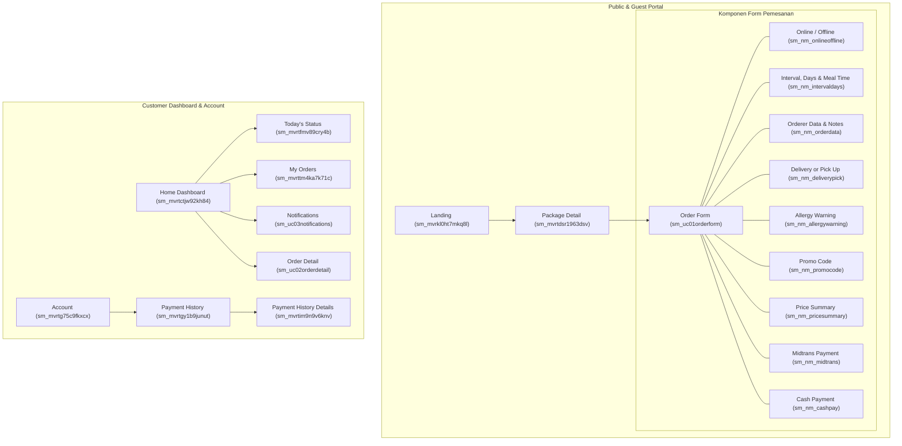
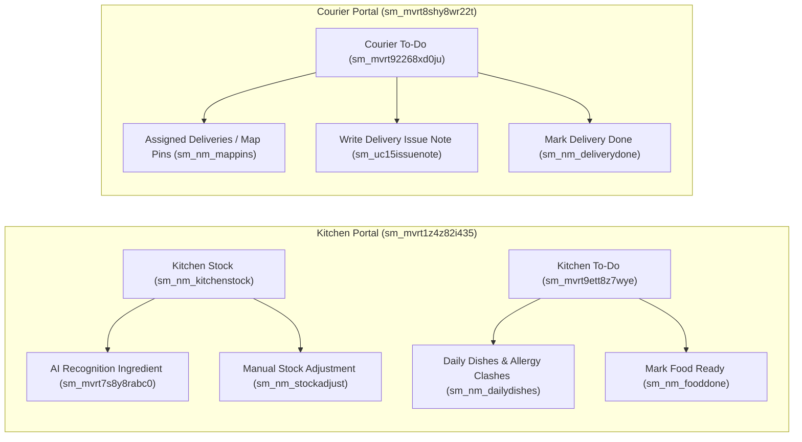
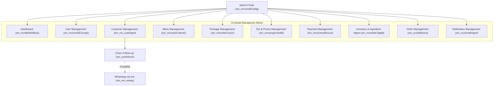

# Information Architecture & System Sitemap Specification (LAHAP)

> **Spesifikasi Lengkap Navigasi, Hirarki Halaman, dan Struktur Antarmuka Pengguna**  
> **Aplikasi:** LAHAP (Platform Langganan Katering untuk UMKM)  
> **Dokumen Terkait:** `docs/PRD.md`, `docs/USE_CASES.md`, `docs/architecture_model.json`  
> **Diagram Acuan:** Sitemap Model (`dg_mvrkkfc57j640u` dalam `architecture_model.json`)  
> **Tujuan Dokumen:** Panduan definitif bagi AI coding agent dan frontend/backend engineers untuk membangun arsitektur perutean (routing), proteksi akses (middleware guard), layouting, dan komponen UI.

---

## 1. Ikhtisar Arsitektur Antarmuka (UI/UX Architecture Overview)

Sistem antarmuka LAHAP dirancang modular dengan model B2B2C terpadu yang membagi hak akses ke dalam 5 ranah navigasi:
1. **Public & Guest Portal:** Menangani *landing page*, etalase katalog paket, detail hidangan, dan formulir langganan/checkout.
2. **Customer Portal (`/dashboard` & `/account`):** Antarmuka responsif ramah seluler untuk pelanggan mengelola profil alergi, melacak status pengantaran slot harian (*live tracking*), melewati slot (*skip*), mengubah catatan pesanan, riwayat pembayaran, serta menerima notifikasi kecelakaan/kendala pengantaran.
3. **Kitchen Mobile / Tablet Portal (`/kitchen`):** Antarmuka operasional dapur untuk memantau produksi harian (*ToCook*), melihat daftar bentrok alergi dan menu alternatif, menekan konfirmasi *Makanan Siap*, serta mengelola stok bahan (dengan bantuan deteksi AI foto).
4. **Courier Mobile Portal (`/courier`):** Antarmuka operasional kurir pengantar berbasis peta/pin alamat, catatan kendala perjalanan, dan aksi konfirmasi *Pengantaran Selesai*.
5. **Admin Back-Office Portal (`/admin`):** Pusat manajemen katering untuk pemilik usaha yang mencakup 10 subsistem (Dashboard analitik, Pengguna, Pelanggan & Churn WA, Menu, Paket & Jadwal, Tier & Promo, Kasir Pembayaran/Refund, Inventaris & OCR, Logistik Pengantaran, serta Pusat Pengumuman).

Total entitas antarmuka dalam model arsitektur mencakup **98 node** (1 Beranda Utama, 27 Halaman Layar, 69 Seksi Komponen Form/Tabel/Aksi, dan 1 Integrasi Eksternal).

---

## 2. Visualisasi Sitemap (Mermaid Hierarchy Diagrams)

### 2.1. Hirarki Tingkat Tinggi (Master High-Level Sitemap)

```mermaid
flowchart TD
    Landing["Landing Page (sm_mvrkl0ht7mkq8l)"]
    Auth["Authentication (sm_mvrthfth9p49e6)"]
    Admin["Admin Portal (sm_mvrsvn4b7jufqj)"]

    %% Landing Sub-branches
    Landing --> PkgList["Package List & Details"]
    PkgList --> OrderForm["Order Form & Checkout (sm_uc01orderform)"]
    Landing --> Auth
    Landing --> Admin

    %% Auth Sub-branches
    Auth --> Home["Customer Home (sm_mvrtctjw92kh84)"]
    Auth --> Account["Customer Account (sm_mvrtg75c9fkxcx)"]
    Auth --> Kitchen["Kitchen Portal (sm_mvrt1z4z82i435)"]
    Auth --> Courier["Courier Portal (sm_mvrt8shy8wr22t)"]

    %% Admin Sub-branches
    Admin --> AdmDash["Dashboard"]
    Admin --> AdmUsers["User Mgmt"]
    Admin --> AdmCust["Customer Mgmt & Churn"]
    Admin --> AdmMenu["Menu Mgmt & Schedule"]
    Admin --> AdmPkg["Package Mgmt & PIC"]
    Admin --> AdmPromo["Tier & Promo Mgmt"]
    Admin --> AdmPay["Payment & Cash Verif"]
    Admin --> AdmInv["Inventory & OCR"]
    Admin --> AdmOrder["Order & Delivery Mgmt"]
    Admin --> AdmNotif["Notification Mgmt"]
```



---

### 2.2. Diagram Alur Pelanggan & Checkout (Customer & Guest Sitemap)



---

### 2.3. Diagram Alur Dapur & Kurir (Kitchen & Courier Operational Sitemaps)



---

### 2.4. Diagram Alur Admin Back-Office (Admin Back-Office Sitemap)



---

## 3. Katalog Lengkap Node Sitemap & Pemetaan Rute (Complete Route Catalog)

Tabel berikut mendefinisikan seluruh node arsitektur, jenis node, jalur perutean yang direkomendasikan (*Next.js App Router*), hak akses (*Role Guard*), serta keterkaitannya dengan *Use Case Model*:

| Node ID | Tipe | Nama / Label Layar & Komponen | Jalur Perutean Direkomendasikan | Hak Akses (Role) | Use Case Terkait | Deskripsi Operasional & Komponen |
| :--- | :--- | :--- | :--- | :--- | :--- | :--- |
| `sm_mvrkl0ht7mkq8l` | `sm-home` | **Landing Page** | `/` | Public | `u3` | Beranda promosi umum; memuat etalase menu, paket, benefit, dan FAQ. |
| `sm_mvrkx4pp7zt3er` | `sm-section` | Header Navigasi | - (Global Component) | Public | - | Bar navigasi atas: logo, tautan paket, jadwal, tombol login/register. |
| `sm_mvrkreaa7u1wgh` | `sm-section` | Tag Line & Hero | `/` (Hero Section) | Public | - | Headline nilai jual katering langganan praktis, bergizi, hemat. |
| `sm_mvrkrlbq7vad4v` | `sm-section` | Package List | `/#packages` | Public | `u3` | Daftar kartu ringkasan paket langganan (hemat, harian, kantoran). |
| `sm_mvrtdsr1963dsv` | `sm-page` | **Package Details** | `/packages/:packageId` | Public | `u3` | Halaman detail rincian paket, varian durasi, dan menu terjadwal. |
| `sm_nm_packagedetails`| `sm-section` | Package Details Content | `/packages/:packageId` | Public | `u3` | Rincian deskripsi lauk, jangkauan porsi, dan jadwal mingguan paket. |
| `sm_uc01orderform` | `sm-page` | **Order Form & Checkout** | `/subscribe/:packageId` | Public / Customer | `u5`, `u7`, `u6` | Halaman formulir berlangganan interaktif (*multi-step checkout*). |
| `sm_nm_onlineoffline`| `sm-section` | Online or Offline Selector | Formulir Langganan | Public / Customer | `u5` | Pilihan metode pemesanan: Pelanggan mandiri (Online) vs Kasir kas (Offline). |
| `sm_nm_intervaldays` | `sm-section` | Interval, Days & Meal Time | Formulir Langganan | Public / Customer | `u5` | Pilihan slot: Senin-Jumat / Tiap Hari, Waktu Makan (Pagi/Siang/Malam). |
| `sm_nm_orderdata` | `sm-section` | Orderer Data & Notes | Formulir Langganan | Public / Customer | `u5` | Input nama pemesan, nomor WhatsApp aktif, dan catatan khusus selera. |
| `sm_nm_deliverypick` | `sm-section` | Delivery or Pick Up | Formulir Langganan | Public / Customer | `u5` | Pilihan pengantaran ke alamat (kalkulasi Haversine) atau ambil sendiri. |
| `sm_nm_allergywarning`| `sm-section` | Allergy Warning Card | Formulir Langganan | Public / Customer | `u7` | Komponen peringatan otomatis jika paket memuat bahan alergi pelanggan. |
| `sm_nm_promocode` | `sm-section` | Promo Code Input | Formulir Langganan | Public / Customer | `u6` | Input kode promo voucher kupon dengan validasi kuota & tanggal. |
| `sm_nm_pricesummary` | `sm-section` | Price Summary Breakdown | Formulir Langganan | Public / Customer | `u7`, `u6` | Ringkasan rincian: Subtotal makanan, Diskon Tier, Diskon Promo, Ongkir, Total. |
| `sm_nm_midtrans` | `sm-section` | Midtrans Payment Option | Formulir Langganan | Public / Customer | `u8` | Pilihan pembayaran non-tunai (Snap QRIS, VA Bank, GoPay, ShopeePay). |
| `sm_nm_cashpay` | `sm-section` | Cash Payment Option | Formulir Langganan | Public / Customer | `u8` | Pilihan pembayaran tunai offline (membutuhkan verifikasi Admin Kasir). |
| `sm_mvrkruz77wm17s` | `sm-section` | Menu List | `/#menu` | Public | `u3` | Tampilan variasi hidangan kuliner yang disajikan catering. |
| `sm_mvrksa6v7xut5g` | `sm-section` | Why Us | `/#why-us` | Public | - | Ulasan keunggulan: higienis, tepat waktu, bahan segar tanpa MSG berlebih. |
| `sm_mvrkwwol7y88ym` | `sm-section` | FAQ Section | `/#faq` | Public | - | Daftar tanya-jawab seputar perubahan jadwal, alergi, dan pengantaran. |
| `sm_mvrkx7hj80ozge` | `sm-section` | Footer | - (Global Component) | Public | - | Informasi kontak katering, jam operasional dapur, alamat, dan hak cipta. |
| `sm_mvrtdkug9539et` | `sm-section` | Menu Showcase | `/menu` | Public | `u3` | Katalog eksplorasi menu mingguan dan kandungan nutrisi/alergen. |
| `sm_mvrtwcaiaghuup` | `sm-section` | Tier Showcase | `/tiers` | Public | `u20` | Penjelasan level loyalitas pelanggan (Biasa, Silver, Gold). |
| `sm_mvrthfth9p49e6` | `sm-page` | **Authentication Gateway**| `/auth` (`/login`, `/register`) | Public / Guest | `u2` | Portal masuk dan pendaftaran nomor HP + password pelanggan. |
| `sm_mvrtctjw92kh84` | `sm-page` | **Customer Home Dashboard**| `/dashboard` | Customer | `u9` | Beranda utama pelanggan login: status pesanan aktif hari ini & pintasan. |
| `sm_mvrtfmv89cry4b` | `sm-page` | **Today's Status** | `/dashboard/today` | Customer | `u9` | Layar pelacakan pengantaran slot makanan harian secara real-time. |
| `sm_nm_liveslot` | `sm-section` | Live Slot Tracking Component| `/dashboard/today` | Customer | `u9` | Indikator tahapan slot: Terjadwal -> Disiapkan -> Diantar -> Selesai. |
| `sm_mvrttm4ka7k71c` | `sm-page` | **My Orders** | `/dashboard/orders` | Customer | `u9` | Daftar seluruh langganan aktif, selesai, dan dibatalkan. |
| `sm_nm_orderlist` | `sm-section` | Order List & Status Labels | `/dashboard/orders` | Customer | `u9` | Kartu riwayat pesanan dengan badge status dan tanggal periode. |
| `sm_uc03notifications`| `sm-page` | **Customer Notifications**| `/dashboard/notifications` | Customer | `u12`, `u_accident` | Pusat kotak masuk notifikasi pengantaran dan pengumuman katering. |
| `sm_nm_notiflist` | `sm-section` | Notification List Component| `/dashboard/notifications` | Customer | `u12` | Daftar pesan sistem ber-timestamp (kategori: Info, Sukses, Peringatan). |
| `sm_nm_accidentres` | `sm-section` | Order Accident Resolution | `/dashboard/notifications` | Customer | `u_accident` | Banner penyelesaian kendala pesanan (mis. info pergantian kurir/delay). |
| `sm_uc02orderdetail` | `sm-page` | **Order Detail** | `/dashboard/orders/:orderId`| Customer | `u9`, `u10`, `u_ordernote` | Layar rincian langganan, kalender slot makanan, dan kontrol tindakan. |
| `sm_nm_slotstatus` | `sm-section` | Slot Status Tracking | `/dashboard/orders/:orderId`| Customer | `u9` | Matriks status slot per hari dan waktu makan (Pagi/Siang/Malam). |
| `sm_nm_skipslot` | `sm-section` | Skip Slot Action Modal | Modal Dialog | Customer | `u10` | Dialog konfirmasi melewati slot makan hari ini (sebelum cut-off dapur). |
| `sm_nm_ordernote` | `sm-section` | Write / Edit Order Note | Modal / Inline | Customer | `u_ordernote` | Dialog pengisian catatan selera makanan untuk dapur dan kurir. |
| `sm_mvrtg75c9fkxcx` | `sm-page` | **Customer Account** | `/account` | Customer | `u2`, `uc_mvwigh0g84y0lg` | Pusat pengelolaan profil pelanggan, loyalitas tier, dan alamat tersimpan. |
| `sm_mvrtkau8a3hsdl` | `sm-section` | Tier Overview Card | `/account` | Customer | `u2` | Ringkasan level tier saat ini, persentase diskon, dan akumulasi poin. |
| `sm_mvrtgctp9gmk7d` | `sm-section` | Account Details Form | `/account` | Customer | `u2` | Formulir data profil (Nama, Nomor HP, Email, Alamat Pengantaran utama). |
| `sm_nm_allergycheck` | `sm-section` | Allergy Checklist Matrix | `/account/allergies` | Customer | `uc_mvwigh0g84y0lg` | Checklist alergen resmi (kacang, seafood, telur, susu) & catatan bebas. |
| `sm_mvrtgy1b9junut` | `sm-page` | **Payment History** | `/account/payments` | Customer | `u8` | Halaman riwayat seluruh invoice tagihan pembayaran langganan. |
| `sm_nm_paymentlist` | `sm-section` | Payment Table / Cards | `/account/payments` | Customer | `u8` | Daftar transaksi pembayaran: kode invoice, nominal, tanggal, status bayar. |
| `sm_mvrtim9n9v6knv` | `sm-page` | **Payment History Details**| `/account/payments/:invId` | Customer | `u8` | Halaman struk digital / invoice bukti pembayaran resmi. |
| `sm_nm_paymentinfo` | `sm-section` | Payment Information Card | `/account/payments/:invId` | Customer | `u8` | Rincian metode bayar, kode referensi Midtrans, dan rincian item langganan. |
| `sm_mvrtgk6s9hyiql` | `sm-section` | Log Out Action | Header / Account | Customer | `u2` | Aksi pengakhiran sesi login dan pembersihan cookie / token otorisasi. |
| `sm_mvrt1z4z82i435` | `sm-page` | **Kitchen Portal Hub** | `/kitchen` | Kitchen | `u13`, `u16` | Halaman utama portal dapur; mengarahkan ke To-Do Masak dan Stok Bahan. |
| `sm_nm_kitchenstock` | `sm-page` | **Kitchen Stock Management**| `/kitchen/stock` | Kitchen | `u16`, `u_ocr` | Antarmuka pemantauan dan pembaruan stok bahan baku dapur. |
| `sm_mvrt7s8y8rabc0` | `sm-section` | AI Recognition Ingredient | `/kitchen/stock/ai-detect` | Kitchen | `u_ocr` | Komponen unggah foto bahan cair untuk estimasi otomatis sisa volume. |
| `sm_nm_stockadjust` | `sm-section` | Manual Stock Adjustment | `/kitchen/stock` | Kitchen | `u16` | Form input numerik untuk penyesuaian stok bahan masuk dan keluar. |
| `sm_mvrt9ett8z7wye` | `sm-page` | **Kitchen To-Do Production**| `/kitchen/todo` | Kitchen | `u13`, `u15`, `u14` | Antarmuka utama produksi harian dapur (*ToCook*) per waktu makan. |
| `sm_nm_dailydishes` | `sm-section` | Daily Dishes & Allergy Clashes| `/kitchen/todo` | Kitchen | `u13`, `u14` | Tabel ringkasan porsi menu utama dan daftar pesanan bentrok alergi. |
| `sm_nm_fooddone` | `sm-section` | Mark Food Ready Action | `/kitchen/todo` | Kitchen | `u15` | Tombol status untuk menandai porsi hidangan telah matang dan siap diambil. |
| `sm_mvrt8shy8wr22t` | `sm-page` | **Courier Portal Hub** | `/courier` | Courier | `u17`, `u18` | Halaman utama portal kurir; navigasi penugasan rute pengantaran. |
| `sm_mvrt92268xd0ju` | `sm-page` | **Courier To-Do Logistics** | `/courier/todo` | Courier | `u17`, `u18`, `u19` | Layar daftar pengantaran aktif harian kurir per klaster waktu makan. |
| `sm_nm_mappins` | `sm-section` | Assigned Deliveries (Map Pins)| `/courier/todo` | Courier | `u17` | Daftar alamat, nomor telepon pemesan, koordinat lokasi, dan pin peta. |
| `sm_uc15issuenote` | `sm-section` | Order Note / Delivery Issue | Modal / Drawer | Courier | `u19` | Form pelaporan kendala logistik (ban bocor, jalan ditutup, delay cuaca). |
| `sm_nm_deliverydone` | `sm-section` | Mark Delivery Done Action | `/courier/todo` | Courier | `u18` | Tombol konfirmasi pengantaran sukses setelah makanan diserahkan ke pelanggan. |
| `sm_mvrsvn4b7jufqj` | `sm-page` | **Admin Portal Hub** | `/admin` | Admin | `u26` | Kerangka tata letak (*layout*) dasbor admin dengan sidebar navigasi. |
| `sm_mvrt6fnl8n8bue` | `sm-page` | **Admin Dashboard** | `/admin/dashboard` | Admin | `u26` | Layar ringkasan analitik bisnis katering secara real-time. |
| `sm_nm_grossrev` | `sm-section` | Gross Revenue Analytics | `/admin/dashboard` | Admin | `u26` | Grafik pendapatan kotor harian, mingguan, dan bulanan. |
| `sm_nm_stockalerts` | `sm-section` | Stock Alerts Widget | `/admin/dashboard` | Admin | `u26` | Indikator peringatan bahan baku yang berada di bawah ambang batas minimal. |
| `sm_nm_trendingmenus`| `sm-section` | Trending Menus Widget | `/admin/dashboard` | Admin | `u26` | Statistik 5 menu favorit dengan pemesanan dan rating tertinggi. |
| `sm_mvrsz4387oznpk` | `sm-page` | **User Management** | `/admin/users` | Admin | `u25` | Halaman manajemen akun pengguna internal (Admin, Kitchen, Courier). |
| `sm_mvrt3lbz83pe5k` | `sm-section` | CRUD User Component | `/admin/users` | Admin | `u25` | Formulir tambah staf, ubah peran (*role*), dan reset kredensial akun. |
| `sm_nm_custmgmt` | `sm-page` | **Customer Management** | `/admin/customers` | Admin | `u25` | Direktori database pelanggan katering dan deteksi resiko churn. |
| `sm_nm_custdir` | `sm-section` | Customer Directory Table | `/admin/customers` | Admin | `u25` | Tabel pencarian pelanggan, filter status tier, dan riwayat pesanan. |
| `sm_uc04churn` | `sm-section` | Churn Follow-up Trigger | `/admin/customers` | Admin | `u25` | Indikator pelanggan tidak aktif (>2 minggu) dengan tombol aksi WhatsApp. |
| `sm_nm_extwa` | `sm-external`| **WhatsApp API Integration** | `https://wa.me/:phone` | Admin | `u25` | Integrasi tautan luar ke WhatsApp Web/App dengan draf sapaan promo churn. |
| `sm_mvrsze0r7qirm0` | `sm-page` | **Menu Management** | `/admin/menus` | Admin | `u21`, `u23`, `u14` | Halaman master katalog makanan dan penyusunan kalender menu. |
| `sm_mvrt3pgu84wpkc` | `sm-section` | CRUD Menu Component | `/admin/menus` | Admin | `u21` | Form tambah/ubah menu: nama masakan, upload foto hidangan (`photo_url`), deskripsi, takaran bahan baku. |
| `sm_uc06publish` | `sm-section` | Publish Menu Schedule | `/admin/menus/schedule` | Admin | `u23` | Antarmuka kalender publikasi menu mingguan/bulanan kepada pelanggan. |
| `sm_nm_adminaltmenu` | `sm-section` | Alternative Menu Assignment | `/admin/menus/schedule` | Admin | `u14` | Form penetapan menu pengganti untuk pesanan pelanggan terdeteksi alergi. |
| `sm_mvrszhts7riy10` | `sm-page` | **Package Management** | `/admin/packages` | Admin | `u20` | Pusat manajemen paket katering, durasi langganan, dan penugasan PIC. |
| `sm_mvrt3tqu852106` | `sm-section` | CRUD Package Component | `/admin/packages` | Admin | `u20` | Formulir buat paket baru: harga dasar, deskripsi, durasi, upload foto cover paket (`photo_url`), dan jam pengantaran menu (`delivery_time`). |
| `sm_uc05mealtime` | `sm-section` | CRUD Menu Schedule Matrix | `/admin/packages/:id` | Admin | `u20` | Matriks pengaturan waktu makan & jam pengantaran menu (`delivery_time`) yang didukung. |
| `sm_nm_picassign` | `sm-section` | PIC Assignment | `/admin/packages/:id` | Admin | `u20` | Penugasan koki dapur (*Kitchen PIC*) dan kurir penanggung jawab rute. |
| `sm_nm_durationfee` | `sm-section` | Duration & Fee Overrides | `/admin/packages/:id` | Admin | `u20` | Pengaturan durasi hari dan diskon bundling paket jangka panjang. |
| `sm_mvrszng37sis8d` | `sm-page` | **Tier & Promo Management** | `/admin/promotions` | Admin | `u20` | Pusat kontrol loyalty reward pelanggan dan kampanye kode kupon promo. |
| `sm_mvrt46cc873gzh` | `sm-section` | CRUD Tier Component | `/admin/promotions/tiers` | Admin | `u20` | Pengaturan batas transaksi tier, persen diskon loyalitas, upload ikon/lencana tingkatan (`photo_url`). |
| `sm_mvrt49yf887zmy` | `sm-section` | CRUD Promo Component | `/admin/promotions/promos`| Admin | `u20` | Form kode kupon: diskon %, kuota penggunaan, tanggal kedaluwarsa. |
| `sm_nm_promostack` | `sm-section` | Promo Stacking Rules | `/admin/promotions/promos`| Admin | `u20` | Toggle `allow_stack_with_tier` untuk mengatur penggabungan diskon tier. |
| `sm_mvrt1mex80cuc4` | `sm-page` | **Payment Management** | `/admin/payments` | Admin | `u26` | Pusat verifikasi transaksi finansial, penerimaan kas, dan pengembalian dana. |
| `sm_mvrt4e6589boee` | `sm-section` | Payment Details Component | `/admin/payments/:id` | Admin | `u26` | Modal rincian bukti transaksi bank, invoice ID, dan timestamp callback. |
| `sm_uc07cashverif` | `sm-section` | Cash Verification Action | `/admin/payments` | Admin | `u26` | Tombol aksi persetujuan (*Approve/Reject*) pembayaran tunai kasir offline. |
| `sm_nm_needsrefund` | `sm-section` | Needs Refund Queue Table | `/admin/payments/refunds` | Admin | `u26` | Antarmuka daftar pesanan yang dibatalkan pelanggan yang wajib di-refund. |
| `sm_mvrszt6o7tglq8` | `sm-page` | **Inventory & Ingredient Mgmt**| `/admin/inventory` | Admin | `u21` | Halaman pemantauan gudang bahan baku dan pengindeksan alergen. |
| `sm_mvrt4rle8aez6e` | `sm-section` | CRUD Ingredient Component | `/admin/inventory` | Admin | `u21` | Form tambah bahan baku: nama bahan, satuan (kg/gr/ml), stok minimal, upload foto kemasan/wadah (`photo_url`). |
| `sm_mvrt4xap8b3sve` | `sm-section` | Receipt OCR Integration | `/admin/inventory/ocr` | Admin | `u21` | Antarmuka pemindaian foto struk belanja pasar untuk auto-update stok. |
| `sm_uc08allergy` | `sm-section` | CRUD Allergy Tags | `/admin/inventory/allergies`| Admin | `u21` | Manajemen master alergen sistem dan pemetaan relasi bahan (M:N). |
| `sm_nm_stockdetect` | `sm-section` | Stock Shortage Detection | `/admin/inventory` | Admin | `u21` | Algoritma peringatan dini jika proyeksi produksi melampaui sisa stok. |
| `sm_uc10delivery` | `sm-page` | **Order & Delivery Management**| `/admin/orders` | Admin | `u26` | Pusat kendali operasional pemrosesan pesanan katering dan armada kurir. |
| `sm_nm_dailyproduction`| `sm-section` | Daily Production List | `/admin/orders/production` | Admin | `u26` | Rekapitulasi jumlah porsi yang harus dimasak hari ini per resep hidangan. |
| `sm_nm_specialorders`| `sm-section` | Allergy & Notes Monitor | `/admin/orders/production` | Admin | `u26` | Filter pesanan yang memiliki catatan alergi atau modifikasi bahan khusus. |
| `sm_uc11courierschedule`| `sm-section`| Courier Schedule Dispatcher| `/admin/orders/delivery` | Admin | `u26` | Antarmuka alokasi rute paket katering ke masing-masing armada kurir. |
| `sm_uc12deliverystatus`| `sm-section` | Delivery Status Board | `/admin/orders/delivery` | Admin | `u26` | Papan status logistik (Belum Dikirim, Sedang Jalan, Terkirim, Terkendala).|
| `sm_nm_delivcorr` | `sm-section` | Delivery Corrections Form | Modal / Inline | Admin | `u26` | Form intervensi admin untuk mengubah status slot secara manual bila salah. |
| `sm_uc14notifmgmt` | `sm-page` | **Notification Management** | `/admin/notifications` | Admin | `u23` | Pusat penyiaran pesan push notifikasi in-app kepada pelanggan dan staf. |
| `sm_nm_sendnotif` | `sm-section` | Send Direct Notification | `/admin/notifications/send`| Admin | `u23` | Form kirim notifikasi targeted ke akun pelanggan tertentu (info khusus). |
| `sm_nm_adminalerts` | `sm-section` | Send Broadcast Announcement | `/admin/notifications/broadcast`| Admin | `u23` | Form publikasi pengumuman publik (jadwal libur dapur, promo akbar). |

---

## 4. Rincian Desain Subsistem Antarmuka (Deep-Dive Subsystem Specifications)

### 4.1. Public Portal & Multi-Step Subscription Form (`sm_uc01orderform`)

Formulir pemesanan langganan dirancang sebagai alur interaktif (*progressive disclosure form*) yang mengintegrasikan aturan bisnis PRD secara ketat:
1. **Mode Pemesanan (`sm_nm_onlineoffline`):**
   - Toggle: `Online Subscription` (pelanggan mengakses langsung via browser) atau `Offline Counter` (kasir katering menginput atas nama pelanggan walk-in).
2. **Konfigurasi Jadwal (`sm_nm_intervaldays`):**
   - Pemilihan durasi paket (misal 5 hari, 10 hari, 20 hari).
   - Pemilihan hari makan: `Senin-Jumat` (default paket hemat kantoran) atau `Setiap Hari Termasuk Akhir Pekan`.
   - Pemilihan slot waktu makan: Multi-select antara slot waktu yang ditentukan oleh properti `delivery_time` paket (default: `Pagi` 06:00-08:00, `Siang` 11:00-13:00, dan `Malam` 17:00-19:00).
3. **Data Pemesan & Catatan Khusus (`sm_nm_orderdata`):**
   - Nomor WhatsApp aktif (digunakan sebagai identitas autentikasi & kanal follow-up).
   - Catatan preferensi selera (*order notes*) yang tidak termasuk alergi medis (contoh: "Kuah dipisah", "Nasi sedikit").
4. **Metode Pemenuhan (`sm_nm_deliverypick`):**
   - Toggle: `Ambil Sendiri di Dapur (Pick Up)` atau `Kirim ke Alamat (Delivery)`.
   - Jika *Delivery*: Menampilkan input alamat teks lengkap dan peta penentuan titik koordinat latitude/longitude.
   - Sistem menjalankan perhitungan jarak Haversine ke titik koordinat dapur (maksimal radius 15 km). Jika $\le 3	ext{ km}$, ongkir = Rp 0; jika $> 3	ext{ km}$, ongkir = $(	ext{jarak} - 3) 	imes 	ext{Rp } 3.000$ per slot pengantaran.
5. **Validasi Alergen Otomatis (`sm_nm_allergywarning`):**
   - Jika pelanggan telah memiliki profil alergi, sistem mengecek matriks bahan pada menu yang terjadwal dalam paket.
   - Jika ditemukan bentrok (contoh: pelanggan alergi `Udang` dan paket menyajikan `Tom Yum Udang`), muncul peringatan *Allergy Conflict Warning* dengan keterangan: *"Menu utama bentrok dengan profil alergi Anda. Dapur akan otomatis menyiapkan menu alternatif yang aman saat verifikasi pesanan."*
6. **Kalkulasi & Pembayaran (`sm_nm_promocode`, `sm_nm_pricesummary`, `sm_nm_midtrans`, `sm_nm_cashpay`):**
   - Ringkasan kalkulasi matematis:
     $$	ext{Total} = (	ext{Subtotal Makanan} - 	ext{Diskon Tier} - 	ext{Diskon Promo}) + 	ext{Total Ongkir}$$
   - Pilihan metode bayar:
     - Non-tunai: Integrasi Midtrans Snap modal (QRIS, GoPay, VA BCA/Mandiri/BRI).
     - Tunai: Notifikasi pembayaran di kasir dengan batas waktu bayar sebelum H-1 jadwal mulai.

---

### 4.2. Customer Experience & Tracking Portal (`/dashboard`)

1. **Today's Status (`sm_mvrtfmv89cry4b` & `sm_nm_liveslot`):**
   - Menampilkan visual progress bar status slot makan hari ini:
     - `Terjadwal`: Pesanan telah terkonfirmasi dan masuk antrean harian.
     - `Disiapkan`: Dapur sedang mengolah hidangan sesuai resep dan catatan alergi.
     - `Diantar`: Kurir telah mengambil paket dan sedang dalam perjalanan ke alamat pemesan.
     - `Selesai`: Paket telah sampai dan diserahkan kepada penerima.
2. **Order Detail & Modifikasi Slot (`sm_uc02orderdetail`, `sm_nm_skipslot`, `sm_nm_ordernote`):**
   - Pelanggan dapat melihat kalender jadwal makan selama durasi langganan.
   - **Skip Slot Action:** Pelanggan dapat menekan tombol *Lewati Slot Hari Ini* dengan ketentuan status slot masih `Terjadwal` (sebelum berubah ke `Disiapkan` oleh dapur). Slot yang dilewati otomatis memperpanjang tanggal akhir langganan (+1 slot kompensasi).
   - **Order Note Action:** Pelanggan dapat memperbarui catatan khusus makanan sebelum jam pemrosesan dapur dimulai.
3. **Pusat Notifikasi & Penanganan Kendala (`sm_uc03notifications`, `sm_nm_accidentres`):**
   - Notifikasi real-time via Server-Sent Events (SSE).
   - Jika terjadi kendala pengantaran (misal: kurir mengalami ban bocor atau cuaca ekstrem), muncul banner peringatan *Delivery Accident*: *"Pengantaran makan siang Anda mengalami kendala lalu lintas (estimasi keterlambatan 20 menit). Mohon menunggu atau hubungi tim bantuan katering."*

---

### 4.3. Kitchen Operational System (`/kitchen`)

1. **Kitchen To-Do Board (`sm_mvrt9ett8z7wye`):**
   - Filter berdasarkan klaster waktu makan aktif (`Pagi`, `Siang`, atau `Malam`).
   - Bagian **Daily Dishes**: Menampilkan total porsi menu utama yang harus dimasak hari ini.
   - Bagian **Special & Allergy Clashes (`sm_nm_dailydishes`):**
     - Tabel pesanan yang memiliki catatan alergi bentrok dengan menu utama.
     - Menampilkan ID pesanan, nama pelanggan, alergen yang terbentrok, dan menu alternatif yang dialokasikan oleh sistem/admin (`sm_nm_adminaltmenu`).
   - Tombol **Mark Food Ready (`sm_nm_fooddone`):**
     - Ketika masakan selesai dibungkus, koki menekan tombol ini.
     - Sistem memperbarui status slot dari `Disiapkan` menjadi `Makanan Siap`, yang otomatis mengaktifkan antrean pengantaran kurir dan menonaktifkan tombol *Skip* pelanggan.
2. **Kitchen Stock & AI Recognition (`sm_nm_kitchenstock`, `sm_mvrt7s8y8rabc0`):**
   - Menampilkan daftar sisa stok bahan baku utama (beras, minyak goreng, telur, ayam, dsb.).
   - Fitur **AI Photo Recognition (`sm_mvrt7s8y8rabc0`):**
     - Koki dapat mengambil foto wadah minyak goreng atau stok bumbu cair.
     - Model Vision AI mendeteksi estimasi ketinggian cairan wadah dan mengusulkan estimasi sisa volume (mis. *"Perkiraan sisa 3.5 Liter dari jerigen 5 Liter"*).
     - Koki memverifikasi dan menyetujui angka tersebut untuk memperbarui master stok secara instan.

---

### 4.4. Courier Logistics System (`/courier`)

1. **Courier To-Do & Assigned Deliveries (`sm_mvrt92268xd0ju`, `sm_nm_mappins`):**
   - Menampilkan daftar titik alamat pengantaran yang ditugaskan ke kurir yang login untuk sesi waktu makan aktif.
   - Peta visual terintegrasi dengan pin koordinat dan urutan pengantaran teroptimasi.
   - Setiap kartu pengantaran memuat: Nama penerima, Nomor WhatsApp (tombol klik untuk panggil), Alamat lengkap, Catatan khusus pengantaran (mis. *"Titip di pos satpam"*), dan Status slot.
2. **Issue Reporting & Proof of Delivery (`sm_uc15issuenote`, `sm_nm_deliverydone`):**
   - Jika kurir mengalami hambatan di perjalanan, kurir membuka modal *Write Issue Note* dan memilih kategori (Ban Bocor, Cuaca Ekstrem, Penerima Tidak di Tempat). Sistem langsung menerbitkan notifikasi ke pelanggan dan dasbor admin.
   - Tombol **Mark Delivery Done:** Kurir menekan konfirmasi selesai saat paket telah diserahkan. Slot berubah menjadi `Selesai`.

---

### 4.5. Admin Back-Office Management Portal (`/admin`)

1. **Dashboard Eksekutif (`sm_mvrt6fnl8n8bue`):**
   - Kartu Metrik Utama: Pendapatan Kotor (Gross Revenue), Pelanggan Aktif, Total Porsi Dimasak Hari Ini, dan Pelanggan Berisiko Churn.
   - Grafik Penjualan dan Menu Terfavorit.
   - Widget Peringatan Bahan Baku Kritis (*Stock Alerts*).
2. **Manajemen Pelanggan & Follow-up Churn (`sm_nm_custmgmt`, `sm_uc04churn`, `sm_nm_extwa`):**
   - Tabel direktori pelanggan dengan indikator status churn otomatis (aturan PRD: pelanggan yang tidak berlangganan ulang selama $\ge 14	ext{ hari}$ sejak paket terakhir selesai).
   - Tombol **Follow-up WhatsApp (`sm_nm_extwa`):**
     - Membuka tautan eksternal `https://wa.me/<customer_phone>?text=<encoded_template>`.
     - Template otomatis: *"Halo Kak [Nama Pelanggan]! Kangen masakan LAHAP? Dapatkan potongan diskon spesial [Promo Code] untuk langganan menu minggu depan! Cek menu kami di sini: [Link]"*.
3. **Manajemen Menu, Kalender & Penugasan Alergi (`sm_mvrsze0r7qirm0`):**
   - Master resep hidangan, takaran gramatur bahan baku, upload foto hidangan (`photo_url`), dan relasi tag alergen.
   - Kalender publikasi menu terjadwal (*Schedule Publisher*).
   - Antarmuka alokasi menu alternatif (*Alternative Menu Assignment*) bagi pesanan yang bentrok alergen.
4. **Manajemen Paket & PIC (`sm_mvrszhts7riy10`):**
   - Pengaturan paket langganan, upload foto cover hero (`photo_url`), jam/waktu pengantaran menu (`delivery_time`), varian durasi, penugasan Kepala Dapur (Kitchen PIC) dan Koordinator Kurir penanggung jawab.
5. **Tier Loyalty & Kupon Promo (`sm_mvrszng37sis8d`):**
   - Konfigurasi ambang batas akumulasi pesanan tier pelanggan, upload ikon/lencana tingkatan (`photo_url`), serta persentase diskon.
   - Pembuatan kode promo voucher dengan aturan penumpukan (*allow_stack_with_tier*).
6. **Verifikasi Pembayaran & Antrean Refund (`sm_mvrt1mex80cuc4`):**
   - Pemantauan status transaksi Midtrans (Settlement, Pending, Expired).
   - Tombol verifikasi kasir offline untuk pesanan yang membayar tunai di outlet.
   - Tabel antrean *Needs Refund* untuk pengembalian dana pembatalan pesanan pelanggan sesuai syarat PRD.
7. **Pusat Inventaris & OCR Struk Belanja (`sm_mvrszt6o7tglq8`):**
   - Pemantauan stok bahan baku dan upload foto wadah/kemasan bahan (`photo_url`) untuk kalibrasi visual AI & staf dapur.
   - Deteksi otomatis kekurangan bahan baku (*Stock Shortage Detection*) berdasarkan total porsi ToCook esok hari.
   - Fitur OCR Struk Belanja (`sm_mvrt4xap8b3sve`) untuk input otomatis belanja bahan pasar secara massal.
8. **Pengendalian Pengantaran & Koreksi Status (`sm_uc10delivery`, `sm_nm_delivcorr`):**
   - Pemantauan seluruh armada kurir secara real-time.
   - Fitur intervensi koreksi status pengantaran jika terjadi kesalahan teknis penekanan tombol oleh kurir.
9. **Manajemen Notifikasi & Pengumuman (`sm_uc14notifmgmt`):**
   - Pengiriman pesan broadcast pengumuman operasional atau pesan privat peringatan pembayaran.

---

## 5. Arsitektur Teknis Implementasi Frontend (Next.js App Router Structure)

Struktur direktori modul antarmuka yang direkomendasikan untuk implementasi basis kode:

```text
src/
├── app/
│   ├── (public)/                     # Route Group: Public & Guest
│   │   ├── layout.tsx                # Public Layout (Header + Footer)
│   │   ├── page.tsx                  # sm_mvrkl0ht7mkq8l (Landing Page)
│   │   ├── menu/page.tsx             # sm_mvrtdkug9539et (Menu Showcase)
│   │   ├── tiers/page.tsx            # sm_mvrtwcaiaghuup (Tier Showcase)
│   │   ├── packages/[id]/page.tsx    # sm_mvrtdsr1963dsv (Package Details)
│   │   └── subscribe/[id]/page.tsx   # sm_uc01orderform (Multi-Step Checkout Form)
│   │
│   ├── (auth)/                       # Route Group: Authentication
│   │   ├── layout.tsx                # Auth Form Layout
│   │   ├── login/page.tsx            # sm_mvrthfth9p49e6 (Login)
│   │   └── register/page.tsx         # sm_mvrthfth9p49e6 (Register)
│   │
│   ├── (customer)/dashboard/         # Route Group: Customer Dashboard (Protected)
│   │   ├── layout.tsx                # Customer App Shell (Mobile Nav Bar)
│   │   ├── page.tsx                  # sm_mvrtctjw92kh84 (Customer Home Dashboard)
│   │   ├── today/page.tsx            # sm_mvrtfmv89cry4b (Today's Live Slot Status)
│   │   ├── orders/page.tsx           # sm_mvrttm4ka7k71c (My Orders List)
│   │   ├── orders/[id]/page.tsx      # sm_uc02orderdetail (Order Detail & Slot Modals)
│   │   └── notifications/page.tsx    # sm_uc03notifications (In-App Notifications)
│   │
│   ├── (customer)/account/           # Customer Account Management
│   │   ├── page.tsx                  # sm_mvrtg75c9fkxcx (Profile & Tier Overview)
│   │   ├── allergies/page.tsx        # sm_nm_allergycheck (Allergy Checklist Form)
│   │   └── payments/                 # sm_mvrtgy1b9junut (Payment History)
│   │       ├── page.tsx              # Payment List
│   │       └── [invId]/page.tsx      # sm_mvrtim9n9v6knv (Payment Invoice Details)
│   │
│   ├── kitchen/                      # Route Group: Kitchen Tablet Portal (Protected)
│   │   ├── layout.tsx                # Kitchen App Shell
│   │   ├── todo/page.tsx             # sm_mvrt9ett8z7wye (ToCook Dishes & Allergy Clashes)
│   │   └── stock/                    # sm_nm_kitchenstock (Kitchen Stock Management)
│   │       ├── page.tsx              # Manual Stock Adjustment
│   │       └── ai-detect/page.tsx    # sm_mvrt7s8y8rabc0 (AI Photo Detection)
│   │
│   ├── courier/                      # Route Group: Courier Mobile Portal (Protected)
│   │   ├── layout.tsx                # Courier Mobile Shell
│   │   └── todo/page.tsx             # sm_mvrt92268xd0ju (Map Pins & Delivery Issue Form)
│   │
│   └── admin/                        # Route Group: Admin Portal (Protected)
│       ├── layout.tsx                # Admin Sidebar Layout
│       ├── dashboard/page.tsx        # sm_mvrt6fnl8n8bue (Revenue & Stock Alerts)
│       ├── users/page.tsx            # sm_mvrsz4387oznpk (User Accounts CRUD)
│       ├── customers/page.tsx        # sm_nm_custmgmt (Customer Directory & Churn WA)
│       ├── menus/                    # sm_mvrsze0r7qirm0 (Menu Management)
│       │   ├── page.tsx              # CRUD Menus & Recipe Grams
│       │   └── schedule/page.tsx     # sm_uc06publish (Schedule & Alt Menu)
│       ├── packages/page.tsx         # sm_mvrszhts7riy10 (Package CRUD & PIC)
│       ├── promotions/page.tsx       # sm_mvrszng37sis8d (Tier & Promo Code Stacking)
│       ├── payments/page.tsx         # sm_mvrt1mex80cuc4 (Payment Details, Cash Verif, Refunds)
│       ├── inventory/page.tsx        # sm_mvrszt6o7tglq8 (Stock Shortage, OCR, Allergy Tags)
│       ├── orders/page.tsx           # sm_uc10delivery (Production Rekap & Delivery Board)
│       └── notifications/page.tsx    # sm_uc14notifmgmt (Direct & Broadcast Alerts)
│
└── middleware.ts                     # RBAC Guard & Session Redirection Middleware
```

---

## 6. Matriks Proteksi Akses & Middleware Guard (Security Matrix)

| Rute Prefix | Otorisasi Akses | Syarat Sesi / Token | Tindakan Jika Tidak Sah |
| :--- | :--- | :--- | :--- |
| `/(public)/*` | Siapapun (Tamu / Pelanggan) | Bebas (Optional Session) | Akses diizinkan tanpa pengalihan. |
| `/(auth)/*` | Pengguna Belum Login | Sesi Tidak Boleh Ada | Jika telah login, redirect otomatis ke `/dashboard` atau portal peran terkait. |
| `/dashboard/*`, `/account/*` | `Customer` | Valid JWT Cookie / Sesi Aktif | Redirect ke `/login?redirect=<target_url>`. |
| `/kitchen/*` | `Kitchen`, `Admin` | Valid JWT dengan Role `KITCHEN` / `ADMIN` | Jika tidak memiliki hak, lempar `403 Forbidden` / redirect `/dashboard`. |
| `/courier/*` | `Courier`, `Admin` | Valid JWT dengan Role `COURIER` / `ADMIN` | Jika tidak memiliki hak, lempar `403 Forbidden` / redirect `/dashboard`. |
| `/admin/*` | `Admin` | Valid JWT dengan Role `ADMIN` | Jika bukan admin, lempar `403 Forbidden` / redirect `/login`. |

---

## 7. Hubungan Antar Dokumen Rekayasa (Engineering Cross-References)

Untuk menjaga konsistensi arsitektur kode di seluruh fase pembangunan:
- **Aturan Bisnis & Batasan Sistem:** Mengacu penuh pada `docs/PRD.md` (BR-01 s/d BR-28).
- **Alur Interaksi & Spesifikasi Use Case:** Mengacu pada `docs/USE_CASES.md` (25 Use Cases, relasi `«include»` dan `«extend»`).
- **Skema Database & Relasi Entitas:** Didefinisikan dalam dokumen selanjutnya: `docs/ERD.md`.
- **Diagram Kelas & Sequence Model:** Didefinisikan dalam dokumen selanjutnya: `docs/UML.md`.
