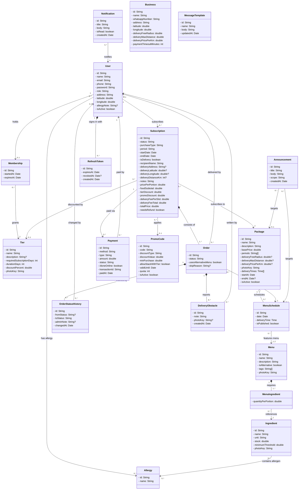
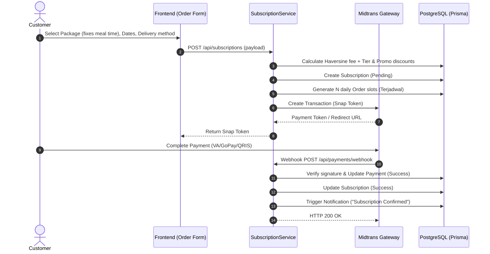
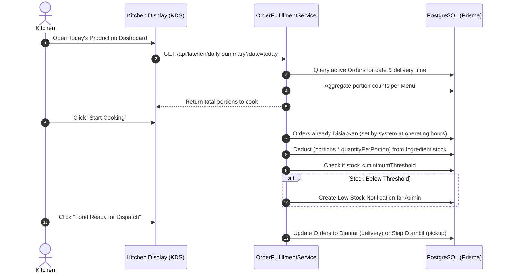
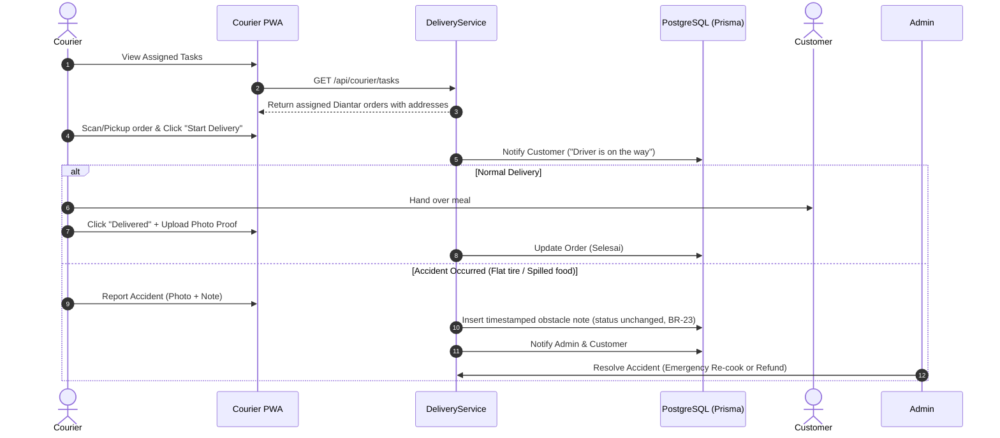

# Unified Modeling Language (UML) Specification: LAHAP Platform

> **Target Audience:** Autonomous AI Coding Agents, Backend Engineers, and System Architects
> **System Name:** LAHAP (SME Catering Subscription & Fulfillment Platform)
> **Related Documents:** [`docs/design/PRD.md`](PRD.md), [`docs/design/USE_CASES.md`](USE_CASES.md), [`docs/design/SITEMAP.md`](SITEMAP.md)

---

## 1. Architectural Philosophy & Design Principles

The LAHAP platform domain layer is designed according to the **Anemic Domain Model** pattern (Martin Fowler):

1. **Entity Models as Data Containers (`stereotype: "entity"`):**
    - Entities represent pure persisted database state and Data Transfer Objects (DTOs).
    - Attributes use strict private encapsulation (`-`).
    - Entity boxes define **zero business logic methods** (`methods: []`).
    - Relationships (associations, aggregations, compositions) replace raw foreign key strings inside class definitions.

2. **Application Service Layer Separation:**
    - All state transitions, validation routines, external integrations (Midtrans Payment Gateway, Haversine delivery calculations, AI Vision stock estimator), and invariant checks reside strictly within application services (`AuthService`, `SubscriptionService`, `OrderFulfillmentService`, `InventoryService`, `NotificationService`).

3. **Lifecycle Management & Relationship Hierarchy:**
    - **Composition (`*--`)**: Strong lifecycle ownership. If the parent is deleted, child records are cascade-deleted (`Subscription` owns `Order`; `Menu` owns `MenuIngredient`).
    - **Aggregation (`o--`)**: Grouping or bundling container relationship where children retain an independent lifecycle (`Package` bundles `MenuSchedule`).
    - **Association (`-->`)**: Peer-to-peer references across domain boundaries (`Order` references `MenuSchedule`, `Courier`, and `User`).

---

## 2. Visual Class Diagram (Mermaid)



---

## 3. Entity Data Dictionary (20 Domain Entities)

> Mutable entities also carry `createdAt` and `updatedAt` (auto-maintained), omitted from the tables below. Link tables and append-only logs (`OrderStatusHistory`, `DeliveryObstacle`) have no `updatedAt`.

### 3.1 `User` (`c_user`)

- **Stereotype:** `«entity»`
- **Domain Role:** Single table inheritance / unified identity for all platform actors (`CUSTOMER`, `ADMIN`, `KITCHEN`, `COURIER`).
- **Attributes:**
  | Attribute | Type | Nullable | Description & Invariants |
  | :--- | :--- | :---: | :--- |
  | `id` | `String` | No | Primary Key (UUIDv4 / CUID). |
  | `name` | `String` | No | Display name. Optional at registration (UC-01); the app stores the phone number when none is given. |
  | `email` | `String` | Yes | Optional, unique; usable for login (UC-13). Stored trimmed and lowercased. |
  | `phone` | `String` | No | Required, unique login id. Normalized to digits starting with `62` (e.g. `62812…`), ready for `wa.me` links (UC-29). |
  | `password` | `String` | No | Argon2id / bcrypt password hash. |
  | `role` | `String` | No | Role enum: `CUSTOMER`, `ADMIN`, `KITCHEN`, `COURIER`. |
  | `address` | `String` | Yes | Default profile address, used only to prefill the order form (UC-07). Each order stores its own `Subscription.deliveryAddress`. |
  | `latitude` | `double` | Yes | Default profile pin latitude (WGS 84); prefill only. |
  | `longitude` | `double` | Yes | Default profile pin longitude (WGS 84); prefill only. |
  | `allergyNote` | `String` | Yes | Free-text allergies not on the common list (PRD UC-41). Can't be matched to menu tags automatically, so a non-empty note puts all the customer's slots in the kitchen's special category (UC-39). |
  | `isActive` | `boolean` | No | Account status flag (default: `true`). |

### 3.2 `Notification` (`c_notif`)

- **Stereotype:** `«entity»`
- **Domain Role:** In-app transaction and operational notification delivered to users.
- **Attributes:**
  | Attribute | Type | Nullable | Description & Invariants |
  | :--- | :--- | :---: | :--- |
  | `id` | `String` | No | Primary Key (UUIDv4). |
  | `title` | `String` | No | Brief alert heading (e.g., "Meal Dispatched", "Delivery Delayed"). |
  | `body` | `String` | No | Detailed notification message. |
  | `isRead` | `boolean` | No | Read status tracker (default: `false`). |
  | `createdAt` | `Date` | No | Timestamp of creation. |

### 3.3 `Tier` (`c_tier`)

- **Stereotype:** `«entity»`
- **Domain Role:** Customer loyalty tier offering discount privileges based on historical active subscription days (PRD BR-18).
- **Attributes:**
  | Attribute | Type | Nullable | Description & Invariants |
  | :--- | :--- | :---: | :--- |
  | `id` | `String` | No | Primary Key. |
  | `name` | `String` | No | Tier name (e.g., `BRONZE`, `SILVER`, `GOLD`). |
  | `description` | `String` | Yes | Tier description shown to customers and the admin (PRD UC-35). |
  | `requiredSubscriptionDays` | `int` | No | Cumulative subscription days threshold required to unlock; `≥ 0` (base tier may be 0, UC-36). **Unique**, so "the previous tier" (UC-38) is unambiguous. |
  | `durationDays` | `int` | No | Validity duration once unlocked (default: `30` days). |
  | `discountPercent` | `double` | No | Loyalty percentage discount applied to subscription base price. |
  | `photoKey` | `String` | Yes | Badge illustration or tier medal icon. Stores the object-storage **key**, not a URL; API responses expose a freshly signed `photoUrl`. |

### 3.4 `Allergy` (`c_allergy`)

- **Stereotype:** `«entity»`
- **Domain Role:** Master allergen catalog for automated safety warning detection (PRD BR-24).
- **Attributes:**
  | Attribute | Type | Nullable | Description & Invariants |
  | :--- | :--- | :---: | :--- |
  | `id` | `String` | No | Primary Key. |
  | `name` | `String` | No | Allergen tag name (e.g., `Peanuts`, `Shellfish`, `Dairy`, `Gluten`, `Egg`). |

### 3.5 `Package` (`c_package`)

- **Stereotype:** `«entity»`
- **Domain Role:** Catering subscription package plan defining base pricing, schedule interval, and delivery parameters.
- **Attributes:**
  | Attribute | Type | Nullable | Description & Invariants |
  | :--- | :--- | :---: | :--- |
  | `id` | `String` | No | Primary Key. |
  | `name` | `String` | No | Commercial package name (e.g., `Diet Sehat 14 Hari`, `Family Lunch 30 Hari`). |
  | `description` | `String` | No | Marketing summary and nutritional highlights. |
  | `basePrice` | `double` | No | Base subscription cost before discounts and delivery fees. |
  | `periods` | `String[]` | No | Order periods the package offers: any of `Harian`, `Mingguan`, `Bulanan` (PRD BR-03 "duration", UC-05); at least one. The actual order length lives in `Subscription.startDate`/`endDate`. |
  | `deliveryFreeRadius` | `double` | Yes | Override of the free delivery radius in km; `null` = use `Business.deliveryFreeRadius` (PRD BR-14). |
  | `deliveryMaxDistance` | `double` | Yes | Override of the max delivery distance in km; `null` = use `Business.deliveryMaxDistance`. Beyond it, courier delivery is hidden (PRD BR-15). |
  | `deliveryPricePerKm` | `double` | Yes | Override of the per-km surcharge beyond the free radius; `null` = use `Business.deliveryPricePerKm` (PRD BR-14). |
  | `photoKey` | `String` | No | Cover/hero image for the meal plan. Stores the object-storage **key**, not a URL; API responses expose a freshly signed `photoUrl`. |
  | `deliveryTimes` | `Time[]` | No | Meal times the admin enters manually for this package (PRD BR-05, UC-20), minute precision, e.g. `[07:00, 12:00, 18:30]`. The `Pagi`/`Siang`/`Malam` label is derived on output (00:00–10:59 Pagi, 11:00–15:59 Siang, 16:00–23:59 Malam), never stored. |
  | `startAt` | `Date` | No | Start of the package validity window (PRD BR-03). |
  | `endAt` | `Date` | Yes | End of the validity window; `null` = no expiry. Past `endAt`, new orders are rejected (PRD BR-03). |
  | `isActive` | `boolean` | No | Admin's manual on/off switch (UC-22), reversible; default `true`. The shown status "aktif" is derived: `isActive` and within `startAt`–`endAt`. |

### 3.6 `MenuSchedule` (`c_menuschedule`)

- **Stereotype:** `«entity»`
- **Domain Role:** Kitchen calendar slot binding a specific calendar date to scheduled catalog dishes.
- **Attributes:**
  | Attribute | Type | Nullable | Description & Invariants |
  | :--- | :--- | :---: | :--- |
  | `id` | `String` | No | Primary Key. |
  | `date` | `Date` | No | Calendar date of fulfillment (`YYYY-MM-DD`). |
  | `deliveryTime` | `Time` | No | The slot's meal time; must be one of `Package.deliveryTimes`. Unique per package + date + time (PRD BR-07). |
  | `isPublished` | `boolean` | No | Visibility flag for customer browsing (default: `false`). |

### 3.7 `Menu` (`c_menu`)

- **Stereotype:** `«entity»`
- **Domain Role:** Reusable catalog recipe dish created by kitchen administration.
- **Attributes:**
  | Attribute | Type | Nullable | Description & Invariants |
  | :--- | :--- | :---: | :--- |
  | `id` | `String` | No | Primary Key. |
  | `name` | `String` | No | Dish name (e.g., `Ayam Bakar Madu`, `Gado-Gado Spesial`). |
  | `description` | `String` | No | Ingredients summary and culinary preparation notes. |
  | `isAlternative` | `boolean` | No | Flags whether dish is an alternative option switch (PRD BR-07). |
  | `tags` | `String[]` | No | Flavor / dietary badges (e.g., `["Pedas", "Rendah Kalori", "Tinggi Protein"]`). |
  | `photoKey` | `String` | No | Dish photo for the catalog and customer browsing. Stores the object-storage **key**, not a URL; API responses expose a freshly signed `photoUrl`. |

### 3.8 `Ingredient` (`c_ingredient`)

- **Stereotype:** `«entity»`
- **Domain Role:** Raw kitchen inventory warehouse stock item tracked by weight/volume.
- **Attributes:**
  | Attribute | Type | Nullable | Description & Invariants |
  | :--- | :--- | :---: | :--- |
  | `id` | `String` | No | Primary Key. |
  | `name` | `String` | No | Raw ingredient name (e.g., `Beras Putih`, `Dada Ayam`, `Kacang Tanah`). |
  | `unit` | `String` | No | Unit of measure: `kg`, `gram`, `liter`, `ml`, `butir`, `ikat`. |
  | `stock` | `double` | No | Current on-hand quantity in kitchen inventory. |
  | `minimumThreshold` | `double` | No | Low-stock warning trigger threshold (PRD BR-21). |
  | `photoKey` | `String` | No | Reference photo of the raw ingredient/container (inventory & AI visual estimation). Stores the object-storage **key**, not a URL; API responses expose a freshly signed `photoUrl`. |

### 3.9 `MenuIngredient` (`c_menu_ing`)

- **Stereotype:** `«entity»`
- **Domain Role:** Associative recipe component defining ingredient portion quantity needed to cook 1 portion of a `Menu`.
- **Attributes:**
  | Attribute | Type | Nullable | Description & Invariants |
  | :--- | :--- | :---: | :--- |
  | `quantityPerPortion` | `double` | No | Gross amount required per single meal portion. |

### 3.10 `Subscription` (`c_order`)

- **Stereotype:** `«entity»`
- **Domain Role:** Master commercial subscription contract booked by a customer.
- **Attributes:**
  | Attribute | Type | Nullable | Description & Invariants |
  | :--- | :--- | :---: | :--- |
  | `id` | `String` | No | Primary Key (Order/Subscription Number). |
  | `purchaseType` | `String` | No | `Online` (gateway only) or `Offline` (gateway or cash) (PRD UC-03). Used for income by purchase type (UC-31). |
  | `status` | `String` | No | Stored state: `Pending`, `Success`, `Expire`, `Dibatalkan` (PRD BR-21). Display labels `Akan Datang` / `Aktif` / `Selesai` are derived from dates, never stored. |
  | `period` | `String` | No | Chosen period: `Harian`, `Mingguan` or `Bulanan`; must be one of `Package.periods` (PRD UC-05). |
  | `startDate` | `Date` | No | Date of the first slot; drives the cut-off (PRD BR-09). |
  | `endDate` | `Date` | No | Date of the last slot; drives the derived labels (BR-21) and churn (BR-28). |
  | `isDelivery` | `boolean` | No | Fulfillment method for **every** slot: `true` = Courier Delivery; `false` = Self Pick-Up (PRD BR-13). Each slot's meal time is its `MenuSchedule.deliveryTime`, so one subscription can span several meal times (PRD UC-06, UC-09). |
  | `recipientName` | `String` | No | Orderer's name for this order; required (UC-07), prefilled from the profile. |
  | `deliveryAddress` | `String` | Yes | Delivery address for this order; required when `isDelivery`. Snapshotted at checkout, so profile edits never move existing orders. |
  | `deliveryLatitude` | `double` | Yes | Order's map pin latitude (WGS 84); required when `isDelivery` (PRD §6.3). |
  | `deliveryLongitude` | `double` | Yes | Order's map pin longitude (WGS 84); required when `isDelivery`. |
  | `deliveryDistanceKm` | `int` | Yes | Rounded-up Haversine km used for the fee (PRD BR-15); shown to customer and admin. |
  | `notes` | `String` | Yes | Customer special requests (e.g., "Pisahkan sambal", "Titip di pos satpam"). |
  | `pricePerPortion` | `double` | No | `Package.basePrice` snapshotted at checkout (PRD BR-02). |
  | `foodSubtotal` | `double` | No | Slot count × `pricePerPortion`, before discounts. |
  | `tierDiscount` | `double` | No | Rp taken off by the tier (default `0`); the granting tier is linked for UC-35 reports and set to `null` if that tier is deleted. |
  | `promoDiscount` | `double` | No | Rp taken off by the promo code (default `0`). |
  | `deliveryFeePerSlot` | `double` | No | Fee per delivered slot at checkout; `0` for pick-up; never discounted (PRD BR-16). |
  | `deliveryFeeTotal` | `double` | No | `deliveryFeePerSlot` × delivered slots, kept separate from food (PRD BR-16, §8). Skips don't change it. |
  | `totalPrice` | `double` | No | `foodSubtotal − tierDiscount − promoDiscount + deliveryFeeTotal` (PRD BR-17). |
  | `needsRefund` | `boolean` | No | `true` when a paid subscription is cancelled (`Dibatalkan`); the admin refunds manually outside the app (PRD §6A). Default `false`. |

### 3.11 `Order` (`cl_mvxako5r7p1j47`)

- **Stereotype:** `«entity»`
- **Domain Role:** Individual daily fulfillment slot generated for every single delivery day of a subscription.
- **Attributes:**
  | Attribute | Type | Nullable | Description & Invariants |
  | :--- | :--- | :---: | :--- |
  | `id` | `String` | No | Primary Key (Daily Slot Order ID). |
  | `status` | `String` | No | Slot status: `Terjadwal`, `Disiapkan`, `Diantar`, `Siap Diambil`, `Selesai`, `Dilewati` (PRD BR-23). Delivery obstacles are timestamped notes, not a status. |
  | `usesAlternativeMenu` | `boolean` | No | `true` = kitchen assigned the schedule's alternative menu (`ScheduleMenu.isPrimary = false`) for an allergy clash (PRD BR-24). Default `false`. |
  | `skipReason` | `String` | Yes | Optional free-text reason, set only when the slot becomes `Dilewati` (PRD UC-44). |

### 3.12 `Payment` (`c_payment`)

- **Stereotype:** `«entity»`
- **Domain Role:** Financial payment record for subscription checkouts. A `DELIVERY_SERVICE_UPGRADE` type is reserved for the post-release change-method feature (PRD §7.5); in the MVP, changing the method means cancelling and re-ordering (PRD BR-13).
- **Attributes:**
  | Attribute | Type | Nullable | Description & Invariants |
  | :--- | :--- | :---: | :--- |
  | `id` | `String` | No | Primary Key. |
  | `method` | `String` | No | `CASH` (cashier, verified by admin), `MIDTRANS` (gateway, channel not chosen yet), or `MIDTRANS_<PAYMENT_TYPE>` from the webhook (e.g. `MIDTRANS_QRIS`, `MIDTRANS_BANK_TRANSFER`) (PRD BR-19). |
  | `type` | `String` | No | `SUBSCRIPTION` (the only type the MVP creates) or `DELIVERY_SERVICE_UPGRADE` (reserved: extra delivery fee when switching pick-up → delivery after release, PRD §7.5). |
  | `amount` | `double` | No | Exact monetary amount billed. |
  | `status` | `String` | No | Stored state: `Pending`, `Success`, `Expire` (PRD BR-20), or `Refund` once the admin confirms the manual refund. Midtrans statuses are normalized by the `PaymentGateway` port and mapped to these values. |
  | `/doneOnline` | `boolean` | No | **Derived, not stored:** `method != "CASH"`. Included in API responses for the frontend. |
  | `transactionId` | `String` | Yes | External payment gateway transaction/order identifier. |
  | `paidAt` | `Date` | Yes | Timestamp when payment was verified. |

### 3.13 `PromoCode` (`c_promocode`)

- **Stereotype:** `«entity»`
- **Domain Role:** Promotional voucher code applying flat or percentage deductions.
- **Attributes:**
  | Attribute | Type | Nullable | Description & Invariants |
  | :--- | :--- | :---: | :--- |
  | `id` | `String` | No | Primary Key. |
  | `code` | `String` | No | Unique voucher alphanumeric string (e.g., `DISKONHEMAT20`). |
  | `discountType` | `String` | No | `Persen` (percentage) or `Nominal` (flat Rp) (PRD BR-18). |
  | `discountValue` | `double` | No | Percent (0–100) or Rp amount, per `discountType`. |
  | `minPurchase` | `double` | No | Minimum food subtotal (before discounts) for the code to apply (PRD BR-18). Default `0`. |
  | `allowStackWithTier` | `boolean` | No | When `true`, promo can stack on top of customer tier loyalty discount (PRD BR-17). |
  | `validUntil` | `Date` | No | Expiration cut-off date. |
  | `quota` | `int` | No | Remaining redemption capacity. |
  | `isActive` | `boolean` | No | Master operational toggle. |

### 3.14 `Announcement` (`cl_mvxf9g7o7m57qy`)

- **Stereotype:** `«entity»`
- **Domain Role:** Contextual announcement banner targeted to all users, subscribers of a specific package, or patrons of a single schedule slot.
- **Attributes:**
  | Attribute | Type | Nullable | Description & Invariants |
  | :--- | :--- | :---: | :--- |
  | `id` | `String` | No | Primary Key. |
  | `title` | `String` | No | Broadcast subject headline. |
  | `body` | `String` | No | Announcement text content or warning notice. |
  | `scope` | `String` | No | Target scope: `GLOBAL`, `PACKAGE`, or `SCHEDULE`. |
  | `createdAt` | `Date` | No | Timestamp of publication. |

### 3.15 `Business` (`c_business`)

- **Stereotype:** `«entity»`
- **Domain Role:** Catering business profile and global operational settings. Exactly **one row** in the MVP; tenant scoping (`businessId` on other entities) is deferred.
- **Attributes:**
  | Attribute | Type | Nullable | Description & Invariants |
  | :--- | :--- | :---: | :--- |
  | `id` | `String` | No | Primary Key. |
  | `name` | `String` | No | Business name. |
  | `whatsappNumber` | `String` | No | Business contact number (`62…` format). Kept for future features; no MVP feature uses it (churn `wa.me` links target the customer's number). |
  | `address` | `String` | No | Kitchen / outlet address (self pick-up location). |
  | `latitude` | `double` | No | Kitchen latitude, Haversine origin (PRD BR-15). |
  | `longitude` | `double` | No | Kitchen longitude, Haversine origin (PRD BR-15). |
  | `deliveryFreeRadius` | `double` | No | Default free delivery radius in km (default `1.0`, PRD BR-14). |
  | `deliveryMaxDistance` | `double` | No | Default max delivery distance in km (default `10.0`, PRD BR-14). |
  | `deliveryPricePerKm` | `double` | No | Default per-km surcharge in Rp (default `5000.0`, PRD BR-14). |
  | `paymentTimeoutMinutes` | `int` | No | Minutes before a `Pending` payment becomes `Expire` (default `15`, PRD BR-20). |

### 3.16 `OrderStatusHistory` (`c_order_status_history`)

- **Stereotype:** `«entity»`
- **Domain Role:** Audit trail of every slot status transition (PRD §9.4). Inserted in the same transaction as the `Order.status` change.
- **Attributes:**
  | Attribute | Type | Nullable | Description & Invariants |
  | :--- | :--- | :---: | :--- |
  | `id` | `String` | No | Primary Key. |
  | `fromStatus` | `String` | Yes | Previous slot status; `null` for the initial `Terjadwal`. |
  | `toStatus` | `String` | No | New slot status (PRD BR-23 values). |
  | `adminNote` | `String` | Yes | Reason for an admin status correction (UC-27); required when an admin corrects a status, `null` for normal flow changes. |
  | `changedAt` | `Date` | No | Timestamp of the transition. |
  | _(changedBy)_ | `User` | Yes | Acting user; `null` = system/worker (e.g. automatic `Disiapkan`). |

### 3.17 `DeliveryObstacle` (`c_delivery_obstacle`)

- **Stereotype:** `«entity»`
- **Domain Role:** Timestamped courier/admin obstacle note (flat tire, rain). **Not a slot status** (PRD BR-23); triggers a customer-level real-time notification (PRD BR-27).
- **Attributes:**
  | Attribute | Type | Nullable | Description & Invariants |
  | :--- | :--- | :---: | :--- |
  | `id` | `String` | No | Primary Key. |
  | `note` | `String` | No | Obstacle description. |
  | `photoKey` | `String` | Yes | Optional photo evidence. Stores the object-storage **key**, not a URL; API responses expose a freshly signed `photoUrl`. |
  | `createdAt` | `Date` | No | Timestamp of the report. |
  | _(author)_ | `User` | No | Courier or admin who wrote the note. |

### 3.18 `Membership` (`c_membership`)

- **Stereotype:** `«entity»`
- **Domain Role:** A customer's current loyalty tier. At most **one per user** (`user.membership`). It stores the last tier granted and its window; tier re-evaluation (every payment) updates the row in place (PRD BR-18). When the window runs out, the customer drops one tier, with a fresh window starting when the old one ended; the step-down is computed on read, never stored (PM decision 2026-11-06).
- **Attributes:**
  | Attribute | Type | Nullable | Description & Invariants |
  | :--- | :--- | :---: | :--- |
  | `id` | `String` | No | Primary Key. |
  | `startedAt` | `Date` | No | When the tier took effect. |
  | `expiresAt` | `Date` | No | `startedAt + tier.durationDays`; after it passes, the effective tier steps down one level per lapsed window, and the discount comes from the effective tier while it's active. |
  | _(user)_ | `User` | No | Owner; unique, so a user has 0..1 membership. |
  | _(tier)_ | `Tier` | No | The earned tier. |

### 3.19 `MessageTemplate` (`c_message_template`)

- **Stereotype:** `«entity»`
- **Domain Role:** Admin-written WhatsApp follow-up template for churned customers (PRD UC-29, UC-48). Standalone, with no associations. The available placeholders are a fixed list in code (`src/shared/utils/message-template`), not stored: `{nama}`, `{paket_terakhir}`, `{tanggal_berakhir}`, `{lama_tidak_memesan}`, `{kode_promo}`.
- **Attributes:**
  | Attribute | Type | Nullable | Description & Invariants |
  | :--- | :--- | :---: | :--- |
  | `id` | `String` | No | Primary Key. |
  | `name` | `String` | No | Label in the admin's template picker. |
  | `body` | `String` | No | Message text with `{key}` placeholders, filled per customer and URL-encoded into a `wa.me` link. |
  | `updatedAt` | `Date` | No | Last edit time. |

### 3.20 `RefreshToken` (`c_refresh_token`)

- **Stereotype:** `«entity»`
- **Domain Role:** One issued JWT refresh token (a sign-in session on one device). Access tokens stay stateless and are not stored. Owned by the `auth` module. Every refresh revokes the presented token and issues a new one (rotation); presenting an already revoked token again revokes all of the user's active tokens (reuse detection). Logout revokes the presented token.
- **Attributes:**
  | Attribute | Type | Nullable | Description & Invariants |
  | :--- | :--- | :---: | :--- |
  | `id` | `String` | No | Primary Key; the token's `jti` claim, set by the app. |
  | `expiresAt` | `Date` | No | When the token expires (`JWT_REFRESH_EXPIRES_IN` after issue). The JWT `exp` claim is still what rejects expired tokens; this column allows cleaning up old rows. |
  | `revokedAt` | `Date` | Yes | When the token was revoked (rotation, logout or reuse detection); `null` = still usable. |
  | `createdAt` | `Date` | No | When the token was issued. |
  | _(user)_ | `User` | No | The signed-in user. |

---

## 4. Relationship & Multiplicity Matrix (25 Edges)

The following matrix documents all 25 edges connecting the 20 entities in the class model:

| Edge ID             | Source Node      |  Mult  | Relation Type | Target Node    |  Mult  | Label               | Foreign Key / Cascade Semantics                                                                                                                 |
| :------------------ | :--------------- | :----: | :-----------: | :------------- | :----: | :------------------ | :---------------------------------------------------------------------------------------------------------------------------------------------- |
| `e_notif_user`      | `Notification`   | `0..*` | `association` | `User`         |  `1`   | `notifies`          | `Notification.userId -> User.id` (ON DELETE CASCADE). A user receives multiple notifications.                                                   |
| `e_pkg_sched`       | `MenuSchedule`   | `0..*` | `aggregation` | `Package`      |  `1`   | `schedules`         | `MenuSchedule.packageId -> Package.id` (ON DELETE RESTRICT). Package acts as an aggregate container for calendar schedules.                     |
| `e_pkg_order`       | `Subscription`   | `0..*` | `association` | `Package`      |  `1`   | `subscribes to`     | `Subscription.packageId -> Package.id` (ON DELETE RESTRICT). Subscription references the chosen package tier.                                   |
| `e_sched_menu`      | `MenuSchedule`   | `0..*` | `association` | `Menu`         | `1..2` | `features menu`     | Join table `ScheduleMenu`: 1 schedule features 1 primary menu and optionally 1 alternative menu. Menu exists independently in catalog.          |
| `e_order_promo`     | `Subscription`   | `0..*` | `association` | `PromoCode`    | `0..1` | `applies`           | `Subscription.promoCodeId -> PromoCode.id` (ON DELETE SET NULL). Promo is optional.                                                             |
| `e_sub_tier` | `Subscription` | `0..*` | `association` | `Tier` | `0..1` | `discounted by` | `Subscription.tierId -> Tier.id` (ON DELETE SET NULL). Tier that granted `tierDiscount`; the amount survives tier deletion. |
| `e_order_payment`   | `Subscription`   |  `1`   | `association` | `Payment`      | `0..*` | `paid via`          | `Payment.subscriptionId -> Subscription.id` (ON DELETE RESTRICT). Checkout payment; post-release, also delivery-upgrade payments (PRD §7.5). |
| `e_menu_ing_comp`   | `MenuIngredient` | `1..*` | `composition` | `Menu`         |  `1`   | `requires`          | `MenuIngredient.menuId -> Menu.id` (ON DELETE CASCADE). Recipe line items are strictly owned by their parent Menu.                              |
| `e_ing_item`        | `MenuIngredient` | `0..*` | `association` | `Ingredient`   |  `1`   | `references`        | `MenuIngredient.ingredientId -> Ingredient.id` (ON DELETE RESTRICT). Warehouse ingredients exist independently of recipes.                      |
| `e_ing_allergy`     | `Ingredient`     | `0..*` | `association` | `Allergy`      | `0..*` | `contains allergen` | Many-to-Many join table `IngredientAllergy`. Allergen tags categorize raw ingredients.                                                          |
| `e_user_membership` | `User` | `1` | `association` | `Membership` | `0..1` | `holds` | `Membership.userId -> User.id` (UNIQUE, ON DELETE CASCADE). A user holds at most one current tier membership. |
| `e_membership_tier` | `Membership` | `0..*` | `association` | `Tier` | `1` | `grants` | `Membership.tierId -> Tier.id` (ON DELETE RESTRICT). The tier whose discount the membership grants. Before deleting a tier, the app moves its members to the previous tier, keeping their dates (PRD UC-38). |
| `fl_mvx9emsy7kximg` | `User`           |  `1`   | `association` | `Subscription` | `0..*` | `subscribes`        | `Subscription.userId -> User.id` (ON DELETE RESTRICT). User owns 0 or many subscriptions over time.                                             |
| `fl_mvx9f08k7lk70g` | `User`           | `0..*` | `association` | `Allergy`      | `0..*` | `has allergy`       | Many-to-Many join table `UserAllergy`. User declares personal allergies for automated warnings.                                                 |
| `fl_mvxanurz7qdtob` | `Order`          | `0..*` | `association` | `MenuSchedule` |  `1`   | `fulfills`          | `Order.menuScheduleId -> MenuSchedule.id` (ON DELETE RESTRICT). Daily slot fulfills a scheduled menu day.                                       |
| `fl_mvxao7827rcriz` | `Order`          | `0..*` | `association` | `User`         | `0..1` | `delivered by`      | `Order.courierId -> User.id` (ON DELETE SET NULL). Courier assigned **per slot by the admin** (UC-27); reassigning one delivery = changing this slot's courier.                                          |
| `fl_mvxazynb7s4h7d` | `Order`          | `1..*` | `composition` | `Subscription` |  `1`   | `consists of`       | `Order.subscriptionId -> Subscription.id` (ON DELETE CASCADE). Subscription has exclusive lifecycle ownership over its daily Order slots.       |
| `fl_mvxf00217jqp3s` | `Payment`        | `0..*` | `association` | `User`         |  `1`   | `paid by`           | `Payment.userId -> User.id` (ON DELETE RESTRICT). Financial transactions link directly to the paying user account.                              |
| `fl_mvxfgvif7ni4u9` | `Announcement`   | `0..*` | `association` | `Package`      | `0..1` | `targets`           | `Announcement.packageId -> Package.id` (ON DELETE CASCADE). Set when `scope == "PACKAGE"`; null for global or schedule alerts.                  |
| `fl_mvxfhhn77tsc8y` | `Announcement`   | `0..*` | `association` | `MenuSchedule` | `0..1` | `targets`           | `Announcement.menuScheduleId -> MenuSchedule.id` (ON DELETE CASCADE). Set when `scope == "SCHEDULE"`; null for global or package alerts.        |
| `e_hist_order` | `OrderStatusHistory` | `0..*` | `composition` | `Order` | `1` | `tracked by` | `OrderStatusHistory.orderId -> Order.id` (ON DELETE CASCADE). One row per slot status transition (PRD §9.4). |
| `e_hist_user` | `OrderStatusHistory` | `0..*` | `association` | `User` | `0..1` | `changed by` | `OrderStatusHistory.changedById -> User.id` (ON DELETE RESTRICT). `null` = system/worker. |
| `e_obst_order` | `DeliveryObstacle` | `0..*` | `composition` | `Order` | `1` | `reports` | `DeliveryObstacle.orderId -> Order.id` (ON DELETE CASCADE). Obstacle notes owned by the slot (PRD BR-23). |
| `e_obst_user` | `DeliveryObstacle` | `0..*` | `association` | `User` | `1` | `written by` | `DeliveryObstacle.authorId -> User.id` (ON DELETE RESTRICT). Courier or admin author. |
| `e_user_refresh_token` | `User` | `1` | `composition` | `RefreshToken` | `0..*` | `signs in with` | `RefreshToken.userId -> User.id` (ON DELETE CASCADE). One row per issued refresh token, so per session and per rotation. |

---

## 5. Domain Rules & Core Algorithms

### 5.1 Haversine Delivery Pricing Algorithm (PRD BR-04, BR-08, BR-14)

When a customer selects Courier Delivery (`Subscription.isDelivery = true`), the delivery fee is calculated using the spherical Haversine formula between the kitchen warehouse coordinates $(\text{lat}_1, \text{lon}_1)$ and the order's delivery pin (`Subscription.deliveryLatitude`/`deliveryLongitude`, not the profile pin) $(\text{lat}_2, \text{lon}_2)$:

$$\Delta\text{lat} = \text{lat}_2 - \text{lat}_1, \quad \Delta\text{lon} = \text{lon}_2 - \text{lon}_1$$
$$a = \sin^2\left(\frac{\Delta\text{lat}}{2}\right) + \cos(\text{lat}_1)\cos(\text{lat}_2)\sin^2\left(\frac{\Delta\text{lon}}{2}\right)$$
$$c = 2 \cdot \text{atan2}\left(\sqrt{a}, \sqrt{1-a}\right)$$
$$d = R \cdot c \quad (\text{with } R = 6371.0 \text{ km})$$

Kitchen coordinates come from `Business`. Each rate parameter resolves as `Package.<param> ?? Business.<param>` (PRD BR-14). The distance is rounded **up** first (PRD BR-15), with $\text{km} = \lceil d \rceil$:

$$
\text{DeliveryFeePerSlot} = \begin{cases}
0, & \text{if } \text{km} \le \text{freeRadius} \\
(\text{km} - \text{freeRadius}) \times \text{pricePerKm}, & \text{if } \text{km} > \text{freeRadius}
\end{cases}
$$

If $\text{km} > \text{maxDistance}$, courier delivery is hidden and only self pick-up is offered (the order is not rejected).

### 5.2 Subscription Pricing & Discount Stacking (PRD BR-17, BR-18)

$$\text{FoodSubtotal} = \text{slotCount} \times \text{basePrice}, \quad \text{TierDiscount} = \text{FoodSubtotal} \times \frac{\text{tier.discountPercent}}{100}$$

$$
\text{Promo}(x) = \begin{cases}
x \times \frac{\text{promo.discountValue}}{100}, & \text{if } \text{promo.discountType} = \text{Persen} \\
\text{promo.discountValue}, & \text{if } \text{promo.discountType} = \text{Nominal}
\end{cases}
$$

The promo applies only if $\text{FoodSubtotal} \ge \text{promo.minPurchase}$ (and the code is active, within quota and `validUntil`):

$$
\text{FoodTotal} = \begin{cases}
\text{FoodSubtotal} - \text{TierDiscount} - \text{Promo}(\text{FoodSubtotal} - \text{TierDiscount}), & \text{if } \text{promo.allowStackWithTier} \\
\text{FoodSubtotal} - \max\left(\text{TierDiscount}, \text{Promo}(\text{FoodSubtotal})\right), & \text{otherwise}
\end{cases}
$$

$$\text{totalPrice} = \max(0, \text{FoodTotal}) + \text{deliveredSlotCount} \times \text{DeliveryFeePerSlot}$$

Delivery fees are never discounted (PRD BR-16).

### 5.3 Daily Slot Order State Machine

Forward-only transitions (PRD BR-23); out-of-order changes are rejected. Every transition records the actor `userId` and a timestamp.

```
[Terjadwal] ──(Service-day operating hours start, system)──> [Disiapkan] ──(Kitchen: "Makanan Siap")──┐
                                                                                                      │
              ┌───────────────────────────────────────────────────────────────────────────────────────┴───────┐
              │ (isDelivery == true)                                                                          │ (isDelivery == false)
              ▼                                                                                               ▼
         [Diantar] ──(Courier hands over meal)──> [Selesai]                       [Siap Diambil] ──(Admin: customer picked up)──> [Selesai]

[Terjadwal | Disiapkan] ──(Customer: "Skip", before food is ready)──> [Dilewati]
```

Courier obstacles (flat tire, rain) are **not** a state. They are stored as timestamped obstacle notes and trigger a real-time notification.

---

## 6. Sequence Diagrams

### 6.1 Subscription Checkout & Payment Verification



### 6.2 Kitchen Production & Inventory Deduction



### 6.3 Courier Delivery & Accident Handling



---

## 7. Concrete Prisma Schema Reference (`contract.prisma`)

The canonical physical schema is `backend/src/infrastructure/database/prisma/contract.prisma` (Prisma 8, contract-first). A verbatim copy is maintained in [`ERD.md` §6](ERD.md#6-production-prisma-schema-specification-contractprisma). Note the naming differences between this class model and the physical schema: `MenuSchedule` is the `Schedule` model (`schedule` table), and the many-to-many `MenuSchedule`↔`Menu` association is the explicit `ScheduleMenu` join model (`isPrimary`). Status values are plain strings (`VarChar`) holding the PRD's Indonesian values listed in §3.
