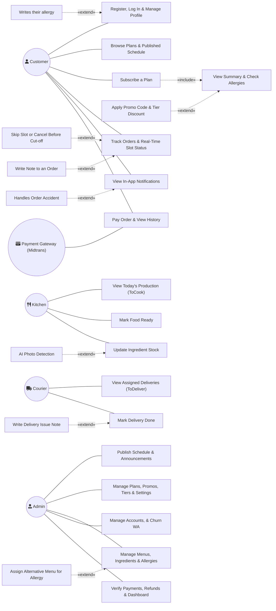

# Use Case Specification & Interaction Model (LAHAP)

> **Spesifikasi Lengkap Use Case & Model Interaksi Berdasarkan Use Case Diagram Resmi**  
> **Aplikasi:** LAHAP (Platform Langganan Katering untuk UMKM)  
> **Dokumen Terkait:** `docs/PRD.md`  
> **Diagram Acuan:** Use Case Diagram (`media_1793457877042_3fcc8f2e.jpg`)  
> **Tujuan Dokumen:** Panduan definitif bagi AI coding agent dan software engineers untuk mengimplementasikan route handler, domain service, controller, middleware hak akses, dan antarmuka pengguna.

---

## 1. Visualisasi Diagram Use Case (Mermaid Representation)

Berikut adalah representasi UML lengkap yang memetakan seluruh aktor, use case utama, use case turunan, relasi `«include»`, dan relasi `«extend»` persis sesuai diagram arsitektur:

---

## 2. Katalog Aktor (Actor Catalog)

| Aktor | Tipe | Peran & Deskripsi Operasional |
| :--- | :--- | :--- |
| **`Customer`** | Human (B2C) | Pengguna akhir katering (mahasiswa, pekerja, keluarga). Melakukan registrasi, memilih paket, mengatur jadwal, membayar langganan, melacak pengantaran real-time, melewati slot, dan mencatat profil alergi. |
| **`Admin`** | Human (B2B) | Pemilik usaha katering (owner). Mengontrol master paket, kalender menu, master bahan & alergen, stok, akun staf, verifikasi kasir offline, monitoring produksi ToCook, follow-up churn via WhatsApp, dan penyiapan kupon promo. |
| **`Kitchen`** | Human (Internal) | Staf dapur pengolah makanan. Membaca to-do produksi harian, memeriksa tabel Kategori Khusus (alergen/catatan), mengalokasikan menu alternatif, menekan Makanan Siap, dan menginput sisa stok bahan. |
| **`Courier`** | Human (Internal) | Staf logistik pengantar. Membaca daftar alamat pengantaran per waktu makan, melihat koordinat map pin, mencatat kendala perjalanan ber-timestamp, dan menandai status pengantaran selesai. |
| **`Payment Gateway (Midtrans)`** | System / External | Sistem pihak ketiga penanganan pembayaran non-tunai. Menerbitkan snap token / URL bayar dan mengirim webhook callback HTTP POST untuk konfirmasi status pembayaran otomatis. |

---

## 3. Matriks Relasi «include» dan «extend»

Pemahaman relasi ini sangat krusial untuk struktur modular kode backend dan UI flow:

| Edge ID | Base Node | Relasi | Target / Extension Node | Makna & Kondisi Eksekusi Bisnis |
| :--- | :--- | :---: | :--- | :--- |
| `e29` | `u5` (Subscribe a Plan) | `«include»` | `u7` (View Summary & Check Allergies) | **Wajib Dieksekusi.** Setiap alur checkout langganan *selalu* melalui kalkulasi breakdown harga (makanan + ongkir) dan pemeriksaan otomatis bentrok tag alergen sebelum pembayaran diizinkan. |
| `e30` | `u7` (View Summary & Check Allergies) | `«extend»` | `u6` (Apply Promo Code & Tier Discount) | **Opsional / Bersyarat.** Pelanggan dapat memasukkan kode promo aktif atau sistem menerapkan diskon tier pelanggan untuk memotong subtotal makanan. |
| `fl_mvwigh0j8593ru` | `u2` (Register, Log In & Manage Profile) | `«extend»` | `uc_mvwigh0g84y0lg` (Writes their allergy) | **Opsional.** Pelanggan yang telah memiliki akun dapat secara spesifik membuka tab profil alergi untuk memilih checklist alergen umum dan mengisi catatan alergi khusus. |
| `e33` | `u9` (Track Orders & Real-Time Slot Status) | `«extend»` | `u10` (Skip Slot or Cancel Before Cut-off) | **Opsional / Bersyarat.** Dari tampilan detail pesanan/status, pelanggan dapat membatalkan pesanan (jika masih H-1 23:59:59 sebelum periode mulai) atau menekan Skip slot (sebelum makanan berstatus siap). |
| `e_ordernote` | `u9` (Track Orders & Real-Time Slot Status) | `«extend»` | `u_ordernote` (Write Note to an Order) | **Opsional.** Menambahkan catatan selera khusus non-alergi (mis. "tanpa sambal", "kuah dipisah") yang akan ditampilkan di pesanan dan to-do dapur/kurir. |
| `e_accident` | `u12` (View In-App Notifications) | `«extend»` | `u_accident` (Handles Order Accident) | **Dipicu Event Sistem.** Ketika kurir atau admin mencatat kendala jalan (ban bocor, delay), notifikasi push real-time (SSE) masuk ke daftar notifikasi pelanggan untuk dipantau. |
| `e_ocr` | `u16` (Update Ingredient Stock) | `«extend»` | `u_ocr` (AI Photo Detection) | **Opsional (Could Have `UC-56`).** Dapur dapat mengunggah foto wadah bahan cair (botol minyak, galon air) untuk estimasi sisa volume otomatis sebelum disimpan manual. |
| `e42` | `u18` (Mark Delivery Done) | `«extend»` | `u19` (Write Delivery Issue Note) | **Opsional.** Pada proses pengantaran, jika terjadi masalah di perjalanan sebelum diselesaikan, kurir dapat menginput catatan kendala teks singkat. |
| `e37` | `u21` (Manage Menus, Ingredients & Allergies) | `«extend»` | `u14` (Assign Alternative Menu for Allergy) | **Eksekusi Kasus Khusus.** Ketika pesanan pelanggan terdeteksi bentrok alergi dengan menu utama terjadwal, staf dapur/admin mengeksekusi penugasan menu alternatif secara manual. |

---

## 4. Spesifikasi Rinci Use Case per Aktor

### A. Customer Use Cases

#### 1. `Register, Log In & Manage Profile`
* **Diagram Node ID:** `u2`
* **Diagram Edges:** `Incoming: e1 (association from a1), fl_mvwigh0j8593ru (extend from uc_mvwigh0g84y0lg)`
* **Aktor:** `Customer`
* **Referensi PRD:** `UC-01`, `UC-13`, `UC-41`
* **Prekondisi:** Pelanggan memiliki koneksi internet dan nomor HP aktif.
* **Alur Utama (Main Flow):**
  1. Pelanggan mengakses halaman autentikasi (`/register` atau `/login`).
  2. Untuk pendaftaran: Pelanggan menginput Nomor HP (wajib) dan Password (wajib). Nama, email, dan alamat bersifat opsional.
  3. Sistem memvalidasi keunikan nomor HP dan kekuatan password, lalu menyimpan hash password.
  4. Sistem membuat sesi aktif (*auto-login*) dan mengarahkan pengguna ke beranda.
  5. Pengguna dapat mengubah nama, email, dan alamat pengiriman default kapan saja melalui halaman profil (`/profil`).
* **Extension Points:**
  * **`Writes their allergy`:** Pelanggan mengakses bagian manajemen alergi di profilnya.
* **Postkondisi:** Profil tersimpan di database dengan ID pelanggan aktif dan sesi JWT/Bearer token diterbitkan.

#### 2. `Writes their allergy` (`«extend»` ke Profile)
* **Diagram Node ID:** `uc_mvwigh0g84y0lg`
* **Diagram Edges:** `Outgoing: fl_mvwigh0j8593ru (extend to u2)`
* **Aktor:** `Customer`
* **Referensi PRD:** `UC-41`, `BR-24`
* **Prekondisi:** Pelanggan telah login ke akun mereka.
* **Alur Utama:**
  1. Pelanggan membuka tab "Alergi" pada halaman profil (`/profil`).
  2. Pelanggan mencentang satu atau beberapa alergen umum dari master yang tersedia (telur, susu, kacang, seafood, gluten, dll.).
  3. Pelanggan dapat mengetikkan pantangan spesifik pada input teks "Catatan Alergi Lain".
  4. Pelanggan menekan tombol "Simpan Alergi".
* **Postkondisi:** Relasi `user_allergies` diperbarui; data ini menjadi acuan pencocokan bentrok alergi saat checkout dan pada tampilan dapur (*Kategori Khusus*).

#### 3. `Browse Plans & Published Schedule`
* **Diagram Node ID:** `u3`
* **Diagram Edges:** `Incoming: e2 (association from a1)`
* **Aktor:** `Customer` (dan Tamu / Pengunjung tanpa login)
* **Referensi PRD:** `UC-02`, `BR-04`, `BR-08`, `BR-10`
* **Prekondisi:** Tidak ada (dapat diakses publik).
* **Alur Utama:**
  1. Pengguna membuka landing page (`/` atau `/beranda`).
  2. Sistem menampilkan daftar paket langganan aktif yang belum melewati tanggal `end_at`.
  3. Pengguna memilih salah satu paket untuk melihat kalender jadwal menu terpublikasi (Senin–Minggu) serta estimasi waktu pengantaran menu (`delivery_time`) per waktu makan (Pagi, Siang, Malam).
  4. Kartu menu menampilkan nama hidangan, deskripsi, foto, kategori, dan tag alergen otomatis.
  5. Jika pengguna telah login dan memiliki pesanan aktif, periode berlangganannya ditandai khusus (*highlight* visual) pada kalender jadwal.
* **Postkondisi:** Pengguna memperoleh informasi menu dan dapat menekan tombol CTA "Pesan Sekarang".

#### 4. `Subscribe a Plan`
* **Diagram Node ID:** `u5`
* **Diagram Edges:** `Incoming: e4 (association from a1) | Outgoing: e29 (include to u7)`
* **Aktor:** `Customer`
* **Referensi PRD:** `UC-03`, `UC-04`, `UC-05`, `UC-06`, `UC-07`, `UC-08`, `BR-06`, `BR-12`, `BR-13`, `BR-14`, `BR-15`
* **Prekondisi:** Pelanggan telah login; minimal ada 1 paket aktif dengan menu terpublikasi.
* **Alur Utama:**
  1. Pelanggan menekan tombol "Pesan" dan memilih jenis pembelian: **Online** atau **Offline** (`UC-03`).
  2. Pelanggan memilih Paket Langganan (`UC-04`).
  3. Pelanggan memilih Periode Pesanan: Harian, Mingguan, atau Bulanan (`UC-05`).
  4. Pelanggan memilih Hari Layanan dan Waktu Makan / Jam Pengantaran (`UC-06`) sesuai konfigurasi properti `delivery_time` paket:
     - *Harian:* Memilih kombinasi tanggal dan jam makan/pengantaran spesifik.
     - *Mingguan/Bulanan:* Mencentang waktu makan yang berlaku berulang pada hari layanan bermenu.
  5. Pelanggan mengisi Data Penerima dan Catatan Selera Khusus non-alergi (`UC-07`).
  6. Pelanggan memilih metode penerimaan: **Ambil Sendiri (Pick Up)** atau **Diantar (Kurir)** (`UC-08`):
     - Jika Diantar: Pelanggan menandai pin lokasi pada peta Leaflet. Sistem menghitung jarak garis lurus Haversine ke lokasi dapur katering (dibulatkan ke atas). Jika jarak $\le 	ext{jarak\_maksimum}$, ongkir per slot dihitung. Jika melebihi jarak maksimum, opsi Diantar disembunyikan otomatis.
  7. **`«include»` View Summary & Check Allergies:** Sistem menampilkan ringkasan pesanan dan validasi alergen.
* **Postkondisi:** Draf pesanan siap dibayar.

#### 5. `View Summary & Check Allergies` (`«include»` dalam Subscribe Plan)
* **Diagram Node ID:** `u7`
* **Diagram Edges:** `Incoming: e29 (include from u5), e30 (extend from u6)`
* **Aktor:** `Customer`
* **Referensi PRD:** `UC-09`, `UC-41`, `BR-16`, `BR-17`, `BR-24`
* **Prekondisi:** Pemilihan slot dan alamat/metode telah lengkap pada form checkout.
* **Alur Utama:**
  1. Sistem melakukan pengecekan bentrok alergi:
     $$	ext{bentrok} = (	ext{alergi\_profil} \cap 	ext{tag\_alergen\_menu}) 
e \emptyset$$
  2. Jika ada menu yang bentrok dengan profil pelanggan, sistem menampilkan kotak peringatan kuning per slot terkait (nama menu dan alergen yang bentrok). Checkout tetap diizinkan.
  3. Sistem menghitung subtotal makanan:
     $$	ext{SubtotalMakanan} = 	ext{Jumlah Slot} 	imes 	ext{Harga Paket}$$
  4. Sistem menghitung total ongkir (jika metode Diantar):
     $$	ext{TotalOngkir} = 	ext{Jumlah Slot Diantar} 	imes 	ext{Ongkir per Slot}$$
  5. **`«extend»` Apply Promo Code & Tier Discount:** Pelanggan dapat memasukkan kode promo atau menikmati diskon tier.
  6. Sistem menampilkan rincian total tagihan final.
* **Postkondisi:** Rincian biaya diverifikasi oleh backend sebagai dasar pembuatan transaksi Midtrans.

#### 6. `Apply Promo Code & Tier Discount` (`«extend»` ke Summary)
* **Diagram Node ID:** `u6`
* **Diagram Edges:** `Outgoing: e30 (extend to u7)`
* **Aktor:** `Customer`
* **Referensi PRD:** `UC-49`, `UC-51`, `UC-52`, `BR-18`
* **Prekondisi:** Halaman ringkasan checkout terbuka.
* **Alur Utama:**
  1. Sistem otomatis mendeteksi Tier pelanggan saat ini. Jika memiliki diskon tier, persentase diskon dipotong terlebih dahulu dari subtotal makanan.
  2. Pelanggan dapat mengetikkan kode voucher promo pada kolom yang tersedia dan menekan "Gunakan".
  3. Sistem memvalidasi kode promo (aktif, belum kedaluwarsa, kuota tersedia, minimal belanja terpenuhi, belum pernah digunakan pelanggan).
  4. Sistem memeriksa opsi `allow_stack_with_tier` pada kode promo:
     - Jika `true`: Kode promo dipotong dari harga makanan yang telah terpotong diskon tier.
     - Jika `false`: Sistem membandingkan potongan tier vs potongan promo, dan hanya menerapkan **satu potongan terbesar**.
  5. Ongkir dipastikan tidak terkena potongan diskon apa pun (`BR-16`).
* **Postkondisi:** Nilai potongan diskon diperbarui pada ringkasan pembayaran.

#### 7. `Pay Order & View History`
* **Diagram Node ID:** `u8`
* **Diagram Edges:** `Incoming: e5 (association from a1), e26 (association from a5)`
* **Aktor:** `Customer`, `Payment Gateway (Midtrans)`
* **Referensi PRD:** `UC-10`, `UC-28`, `BR-19`, `BR-20`, `BR-21`
* **Prekondisi:** Pesanan telah dibuat dengan status `Pending`.
* **Alur Utama (Online):**
  1. Pelanggan menekan tombol "Bayar Sekarang".
  2. Sistem memanggil API Midtrans Snap Token dan menampilkan popup/halaman pembayaran Midtrans.
  3. Pelanggan menyelesaikan transaksi non-tunai (GoPay, QRIS, Virtual Account, dll.).
  4. Midtrans mengirimkan notifikasi HTTP Webhook ke endpoint backend katering.
  5. Backend memvalidasi signature key Midtrans, lalu mengupdate status pembayaran menjadi `Success` dan status pesanan menjadi `Success`.
  6. Slot pesanan otomatis berstatus `Terjadwal`.
* **Alur Alternatif (Offline - Tunai):**
  1. Pelanggan memilih metode Tunai saat registrasi di kasir katering.
  2. Pesanan berstatus `Pending` hingga admin kasir memverifikasi fisik uang di dashboard admin (`UC-28`), memicu status menjadi `Success`.
* **Postkondisi:** Transaksi tercatat di riwayat pembayaran pelanggan (`/pesanan`), dan jadwal slot masuk ke daftar produksi dapur.

#### 8. `Track Orders & Real-Time Slot Status`
* **Diagram Node ID:** `u9`
* **Diagram Edges:** `Incoming: e6 (association from a1), e33 (extend from u10), e_ordernote (extend from u_ordernote)`
* **Aktor:** `Customer`
* **Referensi PRD:** `UC-11`, `UC-12`, `BR-10`, `BR-21`, `BR-23`
* **Prekondisi:** Pelanggan memiliki pesanan dengan status `Success`.
* **Alur Utama:**
  1. Pelanggan membuka menu "Pesanan Saya" (`/pesanan`) atau halaman "Status Hari Ini" (`/status-hari-ini`).
  2. Sistem membuka koneksi Server-Sent Events (SSE) ke browser pelanggan.
  3. Pelanggan melihat daftar slot hari ini dengan badge status progres:
     - Jalur Diantar: `Terjadwal` $
ightarrow$ `Disiapkan` $
ightarrow$ `Diantar` $
ightarrow$ `Selesai`
     - Jalur Ambil Sendiri: `Terjadwal` $
ightarrow$ `Disiapkan` $
ightarrow$ `Siap Diambil` $
ightarrow$ `Selesai`
  4. Jika slot dilewati, status menampilkan `Dilewati`.
  5. Jika ada kendala jalan dari kurir, teks catatan kendala dan jam pencatatan muncul secara live tanpa reload halaman.
* **Extension Points:**
  * **`Skip Slot or Cancel Before Cut-off`**
  * **`Write Note to an Order`**
* **Postkondisi:** Pelanggan memperoleh visibilitas penuh terhadap proses pesanan mereka.

#### 9. `Skip Slot or Cancel Before Cut-off` (`«extend»` ke Track Orders)
* **Diagram Node ID:** `u10`
* **Diagram Edges:** `Outgoing: e33 (extend to u9)`
* **Aktor:** `Customer`
* **Referensi PRD:** `UC-43`, `UC-44`, `BR-09`, `BR-11`, `BR-21`
* **Prekondisi:** Pesanan berstatus `Success`.
* **Kasus A: Pembatalan Pesanan Penuh (`Cancel Before Cut-off`)**
  1. Pelanggan memilih opsi "Batalkan Pesanan".
  2. Sistem memeriksa waktu saat ini terhadap waktu cut-off pesanan:
     $$	ext{WaktuSekarang} \le 	ext{H-1 23:59:59 sebelum hari layanan pertama}$$
  3. Jika cut-off belum lewat: Pesanan diubah menjadi `Dibatalkan`. Seluruh slot dihapus dari jadwal produksi dapur dan kurir.
  4. Transaksi ditandai `needs_refund = true` untuk proses pengembalian dana manual oleh admin di luar aplikasi.
* **Kasus B: Melewatkan Slot Spesifik (`Skip Slot`)**
  1. Pelanggan memilih tombol "Skip" pada slot tertentu (atau "Skip Hari Ini").
  2. Sistem memvalidasi bahwa status makanan slot tersebut belum ditandai siap (`Disiapkan` atau `Terjadwal`).
  3. Status slot berubah menjadi `Dilewati`.
  4. Slot langsung hilang dari daftar masak dapur (ToCook) dan daftar pengantaran kurir.
  5. Sesuai `BR-11`, **tidak ada pengembalian dana atau ongkir**; slot tetap dihitung sebagai pendapatan usaha.
* **Postkondisi:** Database merefleksikan pembatalan/skip dan memicu update status real-time via SSE.

#### 10. `Write Note to an Order` (`«extend»` ke Track Orders)
* **Diagram Node ID:** `u_ordernote`
* **Diagram Edges:** `Outgoing: e_ordernote (extend to u9)`
* **Aktor:** `Customer`
* **Referensi PRD:** `UC-07`, `BR-25`
* **Prekondisi:** Form pemesanan atau detail pesanan aktif.
* **Alur Utama:**
  1. Pelanggan menginput teks pada kolom catatan pesanan (maks. 255 karakter).
  2. Catatan hanya boleh memuat instruksi selera non-alergi (misalnya: *"jangan terlalu pedas"*, *"sambal dibungkus terpisah"*).
  3. Sistem menyimpan catatan pada entitas `Order`.
* **Postkondisi:** Catatan tampil pada detail pesanan pelanggan, kartu to-do dapur (*Kategori Khusus*), dan informasi pengantaran kurir.

#### 11. `View In-App Notifications`
* **Diagram Node ID:** `u12`
* **Diagram Edges:** `Incoming: e7 (association from a1), e_accident (extend from u_accident)`
* **Aktor:** `Customer`
* **Referensi PRD:** `UC-42`, `BR-27`
* **Prekondisi:** Pelanggan login ke aplikasi.
* **Alur Utama:**
  1. Pelanggan membuka ikon lonceng / menu "Notifikasi" (`/notifikasi`).
  2. Sistem menampilkan daftar notifikasi yang tersimpan untuk pelanggan, dikelompokkan berdasarkan waktu.
  3. Notifikasi baru yang terkirim saat browser terbuka langsung muncul secara instan melalui koneksi real-time SSE.
  4. Pengguna dapat mengeklik notifikasi untuk menandai telah dibaca (`read_at != null`).
* **Extension Points:**
  * **`Handles Order Accident`**
* **Postkondisi:** Riwayat pesan tersimpan dan status baca diperbarui.

#### 12. `Handles Order Accident` (`«extend»` ke Notifications)
* **Diagram Node ID:** `u_accident`
* **Diagram Edges:** `Outgoing: e_accident (extend to u12)`
* **Aktor:** `Customer` (menerima dampak dari aksi `Courier` / `Admin`)
* **Referensi PRD:** `UC-30`, `UC-42`, `BR-23`, `BR-27`
* **Prekondisi:** Slot pengantaran berstatus `Diantar` dan mengalami insiden.
* **Alur Utama:**
  1. Kurir atau admin menginput catatan kendala (mis. *"Ban motor bocor di Jl. Veteran, estimasi delay 20 menit"*).
  2. Sistem membuat record notifikasi level pelanggan dan menyiarkannya via SSE.
  3. Di aplikasi pelanggan, muncul banner peringatan/notifikasi bertanda jam pengisian kendala.
  4. Pelanggan dapat memantau keterlambatan tanpa perlu menelepon dapur/owner.
* **Postkondisi:** Transparansi kendala terjaga tanpa mengubah status slot menjadi status error baru.

---

### B. Kitchen Use Cases

#### 13. `View Today's Production (ToCook)`
* **Diagram Node ID:** `u13`
* **Diagram Edges:** `Incoming: e8 (association from a2)`
* **Aktor:** `Kitchen` (dan `Admin`)
* **Referensi PRD:** `UC-26`, `UC-39`, `BR-22`
* **Prekondisi:** Staf dapur login dengan role `dapur`.
* **Alur Utama:**
  1. Dapur membuka menu "To-Do Dapur" (`/dapur/to-do`).
  2. Sistem melakukan agregasi on-request dari seluruh pesanan berstatus `Success`:
     - Menghitung total porsi per menu utama dan menu alternatif secara terpisah (slot `Dilewati` tidak dihitung).
     - Menghitung kebutuhan total takaran bahan (porsi $	imes$ takaran resep).
  3. Menampilkan daftar terpisah bernama **Kategori Khusus**, yang berisi pesanan dengan catatan khusus dan pelanggan yang profil alerginya bentrok dengan menu utama hari tersebut.
* **Postkondisi:** Staf dapur memiliki daftar panduan memasak harian yang presisi (*zero food waste*).

#### 14. `Mark Food Ready`
* **Diagram Node ID:** `u15`
* **Diagram Edges:** `Incoming: e9 (association from a2)`
* **Aktor:** `Kitchen`
* **Referensi PRD:** `UC-39`, `BR-23`
* **Prekondisi:** Menu untuk waktu makan terkait telah selesai dimasak dan dipacking.
* **Alur Utama:**
  1. Dapur memeriksa batch pesanan yang telah selesai disiapkan.
  2. Dapur menekan tombol **"Makanan Siap"** pada kelompok menu terkait.
  3. Sistem memajukan status slot secara otomatis:
     - Untuk pesanan Diantar: status slot berubah dari `Disiapkan` menjadi `Diantar` (otomatis muncul sebagai item siap diambil di to-do kurir bertugas).
     - Untuk pesanan Ambil Sendiri: status slot berubah dari `Disiapkan` menjadi `Siap Diambil`.
  4. Perubahan status disiarkan ke pelanggan melalui SSE.
* **Postkondisi:** Tindakan bersifat satu arah; slot diteruskan ke kurir atau admin kasir.

#### 15. `Update Ingredient Stock`
* **Diagram Node ID:** `u16`
* **Diagram Edges:** `Incoming: e10 (association from a2), e_ocr (extend from u_ocr)`
* **Aktor:** `Kitchen`
* **Referensi PRD:** `UC-40`, `BR-24`
* **Prekondisi:** Staf dapur login.
* **Alur Utama:**
  1. Dapur membuka menu "Stok Bahan" (`/dapur/stok`).
  2. Dapur melihat daftar bahan baku dari master bahan.
  3. Dapur memasukkan angka penyesuaian fisik (misalnya pemakaian harian atau sisa stok aktual).
  4. Sistem menyimpan riwayat mutasi stok beserta identitas pengubah. Dapur tidak memiliki hak menghapus bahan atau mengubah batas minimum stok (hanya admin).
* **Extension Points:**
  * **`AI Photo Detection`**
* **Postkondisi:** Data stok bahan sinkron dengan kalkulasi kekurangan belanja admin (`UC-32`).

#### 16. `AI Photo Detection` (`«extend»` ke Stock)
* **Diagram Node ID:** `u_ocr`
* **Diagram Edges:** `Outgoing: e_ocr (extend to u16)`
* **Aktor:** `Kitchen`
* **Referensi PRD:** `UC-56` (Could Have Scope)
* **Prekondisi:** Perangkat dapur memiliki kamera / akses file gambar.
* **Alur Utama:**
  1. Dapur memilih opsi input via foto pada bahan cair (misal botol minyak, galon air).
  2. Dapur mengambil atau mengunggah foto wadah bahan.
  3. Sistem memproses estimasi volume/ketinggian cairan.
  4. Nilai estimasi ditampilkan di form untuk dikonfirmasi atau dikoreksi manual oleh staf dapur sebelum disimpan.
* **Postkondisi:** Nilai stok terisi secara semi-otomatis.

---

### C. Courier Use Cases

#### 17. `View Assigned Deliveries (ToDeliver)`
* **Diagram Node ID:** `u17`
* **Diagram Edges:** `Incoming: e11 (association from a3)`
* **Aktor:** `Courier`
* **Referensi PRD:** `UC-30`, `BR-23`
* **Prekondisi:** Kurir login dengan role `kurir`; admin telah menjadwalkan kurir bertugas untuk tanggal dan waktu makan tersebut.
* **Alur Utama:**
  1. Kurir membuka aplikasi to-do kurir (`/kurir/to-do`).
  2. Sistem menampilkan daftar pengantaran yang ditugaskan kepada kurir tersebut untuk tanggal hari ini, diurutkan per waktu makan.
  3. Setiap item menampilkan: nama penerima, nomor telepon/WhatsApp, alamat lengkap, pin koordinat titik antar, menu final (utama/alternatif), porsi, dan catatan pengantaran.
  4. Pesanan dengan metode Ambil Sendiri dan slot yang di-skip secara otomatis disaring keluar (tidak tampil).
* **Postkondisi:** Kurir mengetahui rute dan daftar paket yang harus diantar.

#### 18. `Mark Delivery Done`
* **Diagram Node ID:** `u18`
* **Diagram Edges:** `Incoming: e12 (association from a3), e42 (extend from u19)`
* **Aktor:** `Courier`
* **Referensi PRD:** `UC-30`, `BR-23`
* **Prekondisi:** Makanan telah siap (`Diantar`) dan kurir telah menyerahkan makanan ke tangan pelanggan.
* **Alur Utama:**
  1. Kurir membuka item pesanan yang telah sampai di tujuan.
  2. Kurir menekan tombol **"Selesai"**.
  3. Sistem mengubah status slot menjadi `Selesai` dan mencatat timestamp penyelesaian serta ID kurir pengantar.
  4. Sistem memperbarui status di aplikasi pelanggan dan dashboard admin secara real-time melalui SSE.
* **Extension Points:**
  * **`Write Delivery Issue Note`**
* **Postkondisi:** Slot pengantaran selesai secara permanen.

#### 19. `Write Delivery Issue Note` (`«extend»` ke Delivery Done)
* **Diagram Node ID:** `u19`
* **Diagram Edges:** `Outgoing: e42 (extend to u18)`
* **Aktor:** `Courier`
* **Referensi PRD:** `UC-30`, `BR-23`, `BR-27`
* **Prekondisi:** Slot sedang dalam perjalanan (`Diantar`).
* **Alur Utama:**
  1. Jika terjadi hambatan (misal hujan lebat, ban bocor, kecelakaan ringan), kurir menekan tombol "Catat Kendala".
  2. Kurir mengetik deskripsi singkat kendala dan menekan "Kirim".
  3. Sistem mencatat teks kendala bersama jam pencatatan pada slot tersebut.
  4. Sistem otomatis menerbitkan notifikasi level pelanggan ke penerima pesanan.
* **Postkondisi:** Informasi kendala tersampaikan transparan tanpa mengubah status alur slot pengantaran.

---

### D. Admin Use Cases

#### 20. `Publish Schedule & Announcements`
* **Diagram Node ID:** `u23`
* **Diagram Edges:** `Incoming: e18 (association from a4)`
* **Aktor:** `Admin`
* **Referensi PRD:** `UC-24`, `UC-46`, `BR-08`, `BR-27`
* **Prekondisi:** Admin telah menyusun draf menu mingguan.
* **Alur Utama:**
  1. Admin membuka kalender jadwal menu (`/admin/menu`).
  2. Admin memvalidasi kelengkapan menu dan menekan tombol **"Publish Schedule"**.
  3. Menu yang dipublikasikan langsung terlihat oleh pelanggan di landing page dan form pemesanan.
  4. Untuk pengumuman umum: Admin membuka menu "Kirim Notifikasi" (`/admin/notifikasi`), memilih level *Aplikasi* (semua pelanggan), mengisikan judul dan isi pesan, lalu menyiarkannya via SSE.
* **Postkondisi:** Jadwal berstatus publik dan pengumuman tersimpan di tabel notifikasi.

#### 21. `Manage Plans, Promos, Tiers & Settings`
* **Diagram Node ID:** `u20`
* **Diagram Edges:** `Incoming: e15 (association from a4)`
* **Aktor:** `Admin`
* **Referensi PRD:** `UC-19`, `UC-20`, `UC-21`, `UC-22`, `UC-25`, `UC-35`, `UC-36`, `UC-37`, `UC-38`, `UC-47`, `BR-01`, `BR-02`, `BR-03`, `BR-14`, `BR-18`
* **Prekondisi:** Hak akses role `admin`.
* **Alur Utama:**
  1. **Paket Langganan:** Admin dapat menambah, mengubah, atau menonaktifkan paket (menetapkan harga flat, deskripsi, foto cover (`photo_url`), jam/waktu pengantaran menu (`delivery_time`) yang menentukan waktu menu akan diantarkan kepada pelanggan, durasi yang ditawarkan, jam makan kustom, dan override tarif ongkir khusus paket).
  2. **Kode Promo:** Admin membuat voucher diskon (persen/nominal, kuota, minimal belanja, dan sakelar `allow_stack_with_tier`).
  3. **Loyalty Tier:** Admin mengelola konfigurasi level tier langganan (syarat hari langganan akumulatif, masa aktif tier, diskon %, dan lencana/ikon visual `photo_url`).
  4. **Pengaturan Usaha:** Admin menetapkan titik lokasi GPS dapur (WGS 84), default 3 parameter ongkir global (radius gratis, batas jarak maksimal, tarif per km), serta timeout pembatalan otomatis pesanan pending (15 menit).
* **Postkondisi:** Aturan konfigurasi bisnis tersimpan di database dan berlaku untuk seluruh pesanan baru.

#### 22. `Manage Menus, Ingredients & Allergies`
* **Diagram Node ID:** `u21`
* **Diagram Edges:** `Incoming: e16 (association from a4), e37 (extend from u14)`
* **Aktor:** `Admin`
* **Referensi PRD:** `UC-23`, `UC-45`, `BR-07`, `BR-24`, `BR-26`
* **Prekondisi:** Hak akses role `admin`.
* **Alur Utama:**
  1. **Master Bahan & Alergen:** Admin mendaftarkan bahan baku, satuan unit, stok fisik, ambang batas minimum, foto referensi kemasan/wadah (`photo_url`), dan mengasosiasikan satu atau lebih tag alergen (`UC-45`).
  2. **Pembuatan Menu:** Admin membuat menu per slot, menginputkan nama, deskripsi, foto hidangan (`photo_url`), kategori, komponen masakan, serta memilih bahan dan takaran per porsi. Tag alergen menu terhitung otomatis dari union bahan-bahannya.
  3. **Perubahan Menu Berpesanan:** Jika menu diubah pada slot yang sudah memiliki pesanan berbayar (`BR-26`), admin wajib menginputkan alasan perubahan; sistem otomatis memicu notifikasi level paket ke seluruh pemesan terkait.
* **Extension Points:**
  * **`Assign Alternative Menu for Allergy`**
* **Postkondisi:** Master menu dan resep bahan tersimpan di database.

#### 23. `Assign Alternative Menu for Allergy` (`«extend»` ke Menus & Allergies)
* **Diagram Node ID:** `u14`
* **Diagram Edges:** `Outgoing: e37 (extend to u21)`
* **Aktor:** `Kitchen` / `Admin`
* **Referensi PRD:** `UC-39`, `BR-07`, `BR-24`, `BR-27`
* **Prekondisi:** Terdapat pesanan `Success` pada slot hari operasional yang profil alergi pelanggannya bentrok dengan menu utama.
* **Alur Utama:**
  1. Pada to-do dapur (atau monitoring admin), pesanan pelanggan bentrok tampil di tabel **Kategori Khusus**.
  2. Staf dapur memeriksa ketersediaan menu alternatif pada slot tersebut.
  3. Staf dapur menekan tombol **"Kasih Menu Alternatif"**.
  4. Sistem menetapkan hidangan alternatif sebagai menu final untuk pelanggan tersebut.
  5. Sistem otomatis mengirimkan notifikasi level pelanggan: *"Menu kamu hari ini diganti ke [Menu Alternatif] karena alergi [Alergen]"*.
  6. Jika slot tidak memiliki menu alternatif, sistem menandai "tanpa alternatif" dan pelanggan dapat memilih opsi Skip slot tanpa refund.
* **Postkondisi:** Menu final pelanggan diperbarui dan tercermin pada kartu pengantaran kurir.

#### 24. `Manage Accounts, & Churn WA`
* **Diagram Node ID:** `u25`
* **Diagram Edges:** `Incoming: e20 (association from a4)`
* **Aktor:** `Admin`
* **Referensi PRD:** `UC-14`, `UC-15`, `UC-16`, `UC-17`, `UC-18`, `UC-29`, `UC-48`, `BR-28`
* **Prekondisi:** Hak akses role `admin`.
* **Alur Utama:**
  1. **Manajemen Akun:** Admin dapat membuat akun staf (dapur, kurir), mengubah data user, atau mencabut hak akses tanpa menghapus riwayat pesanan.
  2. **Deteksi Churn Otomatis:** Sistem secara otomatis mendeteksi pelanggan yang memiliki riwayat pesanan namun sudah $> 14$ hari sejak periode pesanan terakhir berakhir tanpa pesanan aktif baru.
  3. **Follow-up WhatsApp Semi-Manual (`wa.me`):** Admin membuka halaman Churn, memilih template pesan win-back, memilih kode promo aktif (`UC-48`), dan mengeklik tombol WhatsApp. Tautan `https://wa.me/62xxx?text=...` terbuka langsung dengan teks terisi otomatis untuk dikirimkan secara personal.
* **Postkondisi:** Retensi pelanggan dapat dieksekusi secara terstruktur dan terukur.

#### 25. `Verify Payments, Refunds & Dashboard`
* **Diagram Node ID:** `u26`
* **Diagram Edges:** `Incoming: e21 (association from a4)`
* **Aktor:** `Admin`
* **Referensi PRD:** `UC-27`, `UC-28`, `UC-31`, `UC-33`, `BR-19`, `BR-21`, `BR-22`
* **Prekondisi:** Hak akses role `admin`.
* **Alur Utama:**
  1. **Verifikasi Kasir Offline:** Admin melihat daftar transaksi tunai berstatus `Pending` dan mengeklik "Verifikasi Pembayaran" setelah uang fisik diterima kasir, memicu status pesanan menjadi `Success`.
  2. **Monitoring Refund Manual:** Admin melihat transaksi pesanan yang dibatalkan pelanggan sebelum cut-off (berlabel *"Needs Refund"*), memproses transfer dana manual di luar aplikasi, dan menandai refund selesai.
  3. **Penjadwalan & Koreksi Kurir:** Admin menetapkan kurir bertugas per sesi makan dan berhak mengoreksi status slot jika staf dapur atau kurir lupa memperbarui status.
  4. **Dashboard Eksekutif:** Menampilkan omset kotor harian/mingguan/bulanan, tren menu terlaris, dan peringatan bahan menipis.
* **Postkondisi:** Integritas keuangan dan operasional harian terpantau penuh.

---

## 5. Ringkasan Pemetaan API Endpoint & Hak Akses

| Use Case Diagram Label | HTTP Method & Route | Hak Akses (Auth Middleware) |
| :--- | :--- | :--- |
| `Register, Log In & Manage Profile` | `POST /api/auth/register` `POST /api/auth/login` `GET, PUT /api/user/profile` | Public / `Customer`, `Admin`, `Kitchen`, `Courier` |
| `Writes their allergy` | `PUT /api/user/allergies` | `Customer` |
| `Browse Plans & Published Schedule` | `GET /api/plans` `GET /api/plans/:id/schedule` | Public / Unauthenticated |
| `Subscribe a Plan` | `POST /api/orders` | `Customer` |
| `View Summary & Check Allergies` | `POST /api/orders/summary-preview` | `Customer` |
| `Apply Promo Code & Tier Discount` | `POST /api/promos/validate` | `Customer` |
| `Pay Order & View History` | `POST /api/payments/snap-token` `POST /api/webhooks/midtrans` `GET /api/orders/history` | `Customer` / Midtrans Webhook / Kasir |
| `Track Orders & Real-Time Slot Status` | `GET /api/orders/active` `GET /api/realtime/slots/stream` (SSE) | `Customer` |
| `Skip Slot or Cancel Before Cut-off` | `POST /api/orders/:id/cancel` `POST /api/slots/:id/skip` | `Customer` |
| `Write Note to an Order` | `POST /api/orders` (field `notes`) | `Customer` |
| `View In-App Notifications` | `GET /api/notifications` `GET /api/realtime/notifications/stream` (SSE) | `Customer`, `Admin` |
| `Handles Order Accident` | Disalurkan via SSE `SlotObstacleEvent` | `Customer` (Listener) |
| `View Today's Production (ToCook)` | `GET /api/kitchen/to-cook` | `Kitchen`, `Admin` |
| `Mark Food Ready` | `POST /api/kitchen/slots/food-ready` | `Kitchen`, `Admin` |
| `Update Ingredient Stock` | `GET, PUT /api/kitchen/stock` | `Kitchen`, `Admin` |
| `AI Photo Detection` | `POST /api/kitchen/stock/photo-estimate` | `Kitchen` (Could Have) |
| `View Assigned Deliveries (ToDeliver)` | `GET /api/courier/to-deliver` | `Courier` |
| `Mark Delivery Done` | `POST /api/courier/slots/done` | `Courier`, `Admin` |
| `Write Delivery Issue Note` | `POST /api/courier/slots/issue-note` | `Courier`, `Admin` |
| `Publish Schedule & Announcements` | `POST /api/admin/schedule/publish` `POST /api/admin/notifications/broadcast` | `Admin` |
| `Manage Plans, Promos, Tiers & Settings`| `CRUD /api/admin/plans`, `/promos`, `/tiers`, `/settings` | `Admin` |
| `Manage Menus, Ingredients & Allergies` | `CRUD /api/admin/menus`, `/ingredients`, `/allergies` | `Admin` |
| `Assign Alternative Menu for Allergy` | `POST /api/kitchen/slots/assign-alternative` | `Kitchen`, `Admin` |
| `Manage Accounts, & Churn WA` | `CRUD /api/admin/users` `GET /api/admin/retention/churn` | `Admin` |
| `Verify Payments, Refunds & Dashboard` | `POST /api/admin/payments/:id/verify-cash` `POST /api/admin/payments/:id/confirm-refund` `GET /api/admin/dashboard/stats` | `Admin` |
